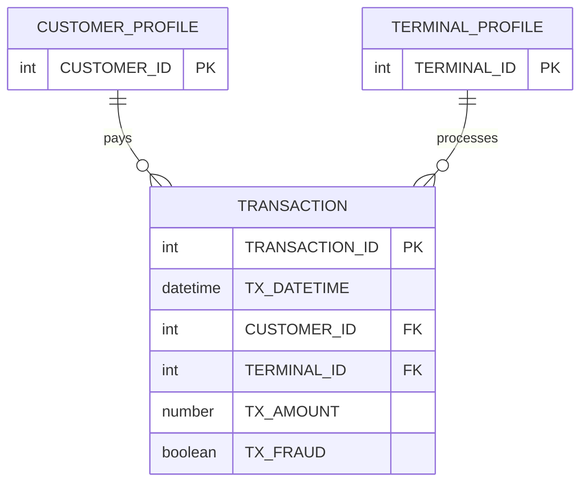

# Fraud Detection Handbook — Detailed Dataset Description and Evaluation

> **Independent source model.** This document deliberately does **not** convert the dataset into a shared Z-Anti-Fraud event schema.

## 1. Introduction and provenance

- **Domain / dataset type:** Synthetic payment-card transaction stream; configurable generator
- **Unit and scale:** One row is a card transaction involving a simulated customer and a simulated payment terminal. The simulator separately generates reusable customer and terminal profiles. The reference run includes 5,000 customers, 10,000 terminals, 183 days, 1,754,155 transactions and 14,681 fraud-labeled transactions (~0.84%). Actual size depends on parameters and seed.
- **Evidence available:** Published simulator example reproduced from the official Handbook page. The source provides code and generated output, not bank-observed data.
- **Original sources:**
  - https://fraud-detection-handbook.github.io/fraud-detection-handbook/Chapter_3_GettingStarted/SimulatedDataset.html
  - https://github.com/Fraud-Detection-Handbook/fraud-detection-handbook
  - https://github.com/Fraud-Detection-Handbook/simulated-data-raw

## 2. Native structure and relationships

The three tables reflect the generator's conceptual outputs; only the transaction table is the nine-column labeled stream. Coordinates are abstract 0–100-grid coordinates, **not real latitude/longitude**. The customer–terminal association is generated from a proximity rule, not directly observed payment authorization data.

## 3. Field-by-field dictionary

### Final labeled transaction table (all 9 columns)

| Original field | Type / role | Meaning | Risk / interpretation note |
|---|---|---|---|
| `TRANSACTION_ID` | integer / key | Unique payment row identifier assigned after sorting generated transactions. | Can be carried into event metadata; not a bank ID. |
| `TX_DATETIME` | datetime | Simulated transaction occurrence time. | Available before scoring; generated timestamps have no independent timezone evidence. |
| `CUSTOMER_ID` | integer / link | Reference to customer profile. | Repeated historical entity key. |
| `TERMINAL_ID` | integer / link | Reference to terminal profile. | Terminal is the merchant acceptance endpoint, not a full merchant master. |
| `TX_AMOUNT` | decimal | Amount of payment. | Available at authorization; currency absent in source. |
| `TX_TIME_SECONDS` | integer / derived | Elapsed seconds from simulation start. | Redundant with timestamp. |
| `TX_TIME_DAYS` | integer / derived | Elapsed whole-day index. | Useful for benchmarking windows; not a real business date. |
| `TX_FRAUD` | binary target | 0 legitimate, 1 injected fraud. | **Offline ground truth; never an inference feature.** |
| `TX_FRAUD_SCENARIO` | categorical annotation | 0 normal; 1 amount threshold, 2 compromised terminal, 3 compromised customer. | **Offline-only**; later scenario writes may replace earlier scenario value. |

### Generated customer profile (separate table)

| Original field | Type / role | Meaning | Risk / interpretation note |
|---|---|---|---|
| `CUSTOMER_ID` | integer / key | Synthetic cardholder/customer identifier. | Same key as transactions. |
| `x_customer_id` | float | Customer position X on artificial grid. | Not geographic longitude. |
| `y_customer_id` | float | Customer position Y on artificial grid. | Not geographic latitude. |
| `mean_amount` | float / generator parameter | Customer-specific mean of normal transaction amount. | Hidden generator setting; using directly in ML may be an unrealistic shortcut. |
| `std_amount` | float / generator parameter | Customer-specific transaction amount standard deviation. | Derive from prior observed history instead if testing online Feature Service. |
| `mean_nb_tx_per_day` | float / generator parameter | Expected transactions/day for Poisson generator. | Not an observed live risk feature. |
| `available_terminals` | list of integers | Terminals within generator’s chosen radius. | Simulation configuration; not the same as observed history. |

### Generated terminal profile (separate table)

| Original field | Type / role | Meaning | Risk / interpretation note |
|---|---|---|---|
| `TERMINAL_ID` | integer / key | Synthetic terminal ID. | Used for joining transactions. |
| `x_terminal_id` | float | Terminal position X on artificial grid. | Not longitude. |
| `y_terminal_id` | float | Terminal position Y on artificial grid. | Not latitude. |

## 4. Small example data

**Authentic published generator output**, five rows from the Handbook's final labeled transactions table. They are not fraud-positive and not randomly sampled from a downloaded archive.

| `TRANSACTION_ID` | `TX_DATETIME` | `CUSTOMER_ID` | `TERMINAL_ID` | `TX_AMOUNT` | `TX_TIME_SECONDS` | `TX_TIME_DAYS` | `TX_FRAUD` | `TX_FRAUD_SCENARIO` |
|---|---|---|---|---|---|---|---|---|
| 0 | 2018-04-01 00:00:31 | 596 | 3156 | 57.16 | 31 | 0 | 0 | 0 |
| 1 | 2018-04-01 00:02:10 | 4961 | 3412 | 81.51 | 130 | 0 | 0 | 0 |
| 2 | 2018-04-01 00:07:56 | 2 | 1365 | 146.00 | 476 | 0 | 0 | 0 |
| 3 | 2018-04-01 00:09:29 | 4128 | 8737 | 64.49 | 569 | 0 | 0 | 0 |
| 4 | 2018-04-01 00:10:34 | 927 | 9906 | 50.99 | 634 | 0 | 0 | 0 |

## 5. Detailed interpretation and label semantics

### Three original fraud-injection rules
1. **Scenario 1 — high value:** mark any payment with `TX_AMOUNT > 220` as fraud. This is intentionally an easy baseline, not realistic forensic evidence.
2. **Scenario 2 — compromised terminal:** each day select two terminals; mark their transactions over the subsequent 28 days as fraud.
3. **Scenario 3 — compromised customer:** each day select three customers; for 14 days multiply a subset (approximately one-third) of their transaction amounts by five and mark those payments as fraud.

Fraud scenarios can overlap. `TX_FRAUD_SCENARIO` is only one category, so it does not fully preserve overlapping campaign memberships. If the simulator is extended, export a separate campaign-membership dataset; that would be an **added annotation**, not a native source field.

## 6. Advantages

- Transparent and reproducible fraud mechanisms, with an exact simulator to modify and rerun.
- Customers and terminals recur over time, enabling rolling historical features and streaming replay.
- Reference fraud prevalence below 1% creates a useful, if simplified, imbalanced classification benchmark.
- Direct link from fraud mechanism to which rule or historical feature should detect it.

## 7. Limitations and threats to validity

- All behavioral distributions and fraud cases come from a simple generator; success on these rules does not generalize to real financial fraud.
- No login events, IPs, persistent devices, account balances, card network messages, merchant hierarchies or chargebacks.
- Fraud labels are injected immediately; real operational feedback is delayed.
- Customer mean and accessible terminal list are generator internals, not necessarily live features; terminal labels could leak future decisions.

## 8. Proposed use in Z-Anti-Fraud (dataset-specific only)

**Sprint 1:** Replay time-ordered transactions through a sync Feature Service and Rules Engine. Compute `customer_tx_count_1h`, `customer_amount_mean_30d`, `terminal_tx_count_24h`, and `customer_terminal_first_seen` strictly from historical events. Test the high-amount rule as a known correctness baseline; then benchmark temporal features for scenarios 2 and 3.

**Evaluation:** chronological train/validation/test windows with an untouched final holdout; precision/recall, PR-AUC, recall at fixed false-positive rate, and scoring latency. Fraud-history features must only use confirmations known by event time.

## 9. Recommended acquisition and sampling

Use official Python simulator or official daily `.pkl` output; preserve a time-contiguous window (e.g. entire 5–14 days) and associated profiles. For scenario debugging, build a separate fraud-enriched case pack; never report its precision as though it had the original prevalence.

## 10. Assessment

High-priority **deterministic integration simulator**. Best for end-to-end testing and rule interpretability, not as the sole evidence of realistic fraud-detection accuracy.

## 11. Provenance policy

Source fields, source annotations, inferred analytical entities, and proposed features are distinguished throughout. Fraud ground-truth labels should never enter the online inference payload. Where small examples are illustrative, they do not claim to be observations from the official dataset. For benchmark-quality results, obtain the full official data and verify legal access, data versions, timestamp semantics and natural label rates.
