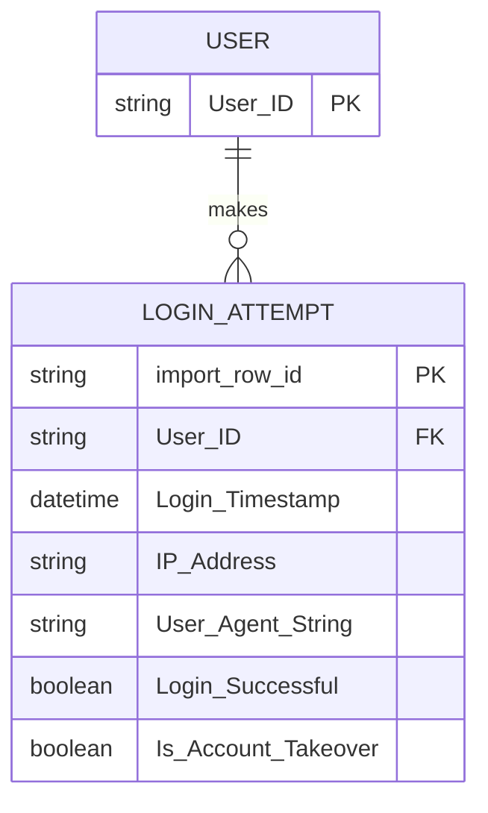

# RBA Login Dataset — Detailed Dataset Description and Evaluation

> **Independent source model.** This document deliberately does **not** convert the dataset into a shared Z-Anti-Fraud event schema.

## 1. Introduction and provenance

- **Domain / dataset type:** Privacy-preserving synthetic authentication/login events
- **Unit and scale:** More than 33 million synthetic login attempts associated with over 3.3 million pseudonymous users. Behavioral statistics were derived from an online SSO service in Norway (original study period February 2020–February 2021), but exact IPs, timestamps, user agents, and other released details are artificial. Each source row is one login attempt, not a user session or payment.
- **Evidence available:** Schema and metadata confirmed from the official GitHub README; full release CSV is not included in the uploaded material.
- **Original sources:**
  - https://github.com/das-group/rba-dataset
  - https://zenodo.org/records/6782156

## 2. Native structure and relationships

`USER` and `import_row_id` are **analytical projections**, not separately distributed source tables/keys. There is no actual persistent device ID or session ID. The 15-column login table should remain the authoritative raw structure.

## 3. Field-by-field dictionary

### Original 15-column login table

| Original field | Type / role | Meaning | Risk / interpretation note |
|---|---|---|---|
| `User ID` | integer / pseudonym | Persistent pseudonymous ID for the affected account. | Not a real identifier; repeat events enable per-user history. |
| `Login Timestamp` | 64-bit integer | Synthetic login-attempt timestamp. | Check real unit/precision in downloaded release before parsing; values were randomized. |
| `IP Address` | string | Synthetic IP assigned to attempt. | Can include non-public 10/8 values; not a real customer's address. |
| `Country` | string | Synthesized country associated with IP/context. | Geolocation is not guaranteed real-world consistent. |
| `Region` | string | Synthetic geographic region. | Derived from generated IP mapping. |
| `City` | string | Synthetic city. | Not reliable ground truth for true travel patterns. |
| `ASN` | integer | Synthetic autonomous-system number. | Certain values >=500000 intentionally unrealistic. |
| `User Agent String` | string | Generated HTTP client user-agent. | Not a persistent device ID. |
| `OS Name and Version` | string | OS parsed/derived from user-agent generation. | Client category, not unique identity. |
| `Browser Name and Version` | string | Browser parsed/derived from user-agent generation. | Client category, not unique identity. |
| `Device Type` | categorical string | mobile, desktop, tablet, bot, unknown. | Coarse category only. |
| `Round-Trip Time (RTT) [ms]` | integer | Simulated server-side latency. | At pre-auth scoring may not yet be fully known; may show artifacts. |
| `Login Successful` | boolean | Outcome of authentication attempt. | Only known after password/credential verification for current request. |
| `Is Attack IP` | boolean | IP was present in attacker-IP records. | Not identical to takeover ground truth; knowledge-time availability must be audited. |
| `Is Account Takeover` | boolean target | Incident-response classification for a login. | **Offline outcome/label**, never pass to inference. |

## 4. Small example data

**Illustrative examples written for this report — NOT rows from the official RBA release.** The examples show how several records for one pseudonymous user might appear. Timestamps below are human-readable for explanation; the original column is a 64-bit integer whose units must be confirmed from downloaded data.

| `User ID` | `Login Timestamp (illustrative rendering)` | `IP Address` | `Country` | `Browser Name and Version` | `Device Type` | `Login Successful` | `Is Attack IP` | `Is Account Takeover` |
|---|---|---|---|---|---|---|---|---|
| 102 | 2020-06-14 09:15:00 | 192.0.2.10 | US | Chrome 70 | desktop | true | false | false |
| 102 | 2020-06-14 09:16:00 | 192.0.2.10 | US | Chrome 70 | desktop | false | false | false |
| 102 | 2020-06-15 02:25:00 | 198.51.100.55 | IE | Firefox 83 | desktop | true | true | true |

## 5. Detailed interpretation and label semantics

### What is and is not a label
- `Is Account Takeover`: the target for takeover-detection research; must be separated from the scoring payload.
- `Is Attack IP`: potentially informative attacker intelligence. Whether it is usable in online evaluation depends on **when** the list was known. It must not be treated as a second equivalent target.
- `Login Successful`: the result of a login attempt; it is a legitimate input only for a risk decision made *after* credential verification, or as history for a later attempt.

A risk-based authentication pipeline can score *before* password verification, *after* password verification before MFA, or *after* login for monitoring; each stage has a different allowed feature set. Write the stage explicitly in every experiment.

## 6. Advantages

- Large population and repeated per-user login histories for real-time behavior/novelty feature experiments.
- Contains login success/failure, client metadata, network metadata and takeover annotations in one event model.
- Designed specifically to compare risk-based authentication approaches, not merely payment fraud classification.
- Can test historical login IP/ASN novelty, failed-attempt velocity and user-facing step-up MFA policies.

## 7. Limitations and threats to validity

- All concrete feature values are synthesized and should not be used to learn real IP reputation/geolocation patterns.
- No reliable physical `device_id`, no session identifier, and no payment/transaction linkage.
- Attack-IP flag might reveal knowledge that would only be available after investigation; score without it as ablation.
- Most users have sparse histories when uniformly subsampling 10k out of 3.3M, making a naive sample poor for behavioral features.

## 8. Proposed use in Z-Anti-Fraud (dataset-specific only)

**Auth risk track:** Maintain `user_last_login_at`, `user_seen_asn`, `user_seen_browser`, `user_failures_5m`, `ip_attempts_5m`, and geographic novelty metrics. Apply a challenge/allow/deny policy. Preserve the exact decision point and do not expose `Is Account Takeover` or future failed login outcomes.

**Evaluation:** use per-user chronological histories and a separate generalization evaluation for unseen users. Measure detection at fixed challenge rate, false-positive step-up rate, latency and the share of users with sufficient history.

## 9. Recommended acquisition and sampling

Prefer a cohort of user IDs and **all** their corresponding login attempts; also preserve a chronological time-window sample. Generate a separate case-enriched diagnostic set for rare takeover events. The original release is distributed via GitHub Releases/Zenodo; request or download it separately before reporting measured statistics.

## 10. Assessment

High priority for **login risk and authentication integration**; does not by itself validate downstream transaction fraud.

## 11. Provenance policy

Source fields, source annotations, inferred analytical entities, and proposed features are distinguished throughout. Fraud ground-truth labels should never enter the online inference payload. Where small examples are illustrative, they do not claim to be observations from the official dataset. For benchmark-quality results, obtain the full official data and verify legal access, data versions, timestamp semantics and natural label rates.
