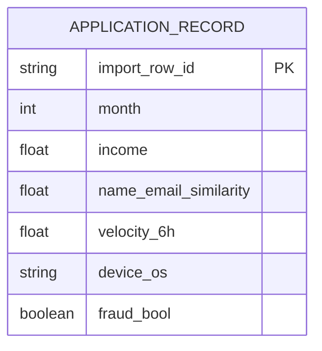

# Bank Account Fraud (BAF) — Detailed Dataset Description and Evaluation

> **Independent source model.** This document deliberately does **not** convert the dataset into a shared Z-Anti-Fraud event schema.

## 1. Introduction and provenance

- **Domain / dataset type:** CTGAN-based synthetic bank account-opening application records
- **Unit and scale:** Six independent experimental variants (Base and I–V), approximately one million applications each, with `month` from 0 to 7. Generated from a transformed real application-fraud dataset, with controlled size, prevalence, separability and temporal bias differences. Unit of observation is **one application**, not a transaction or a user event history.
- **Evidence available:** Official documentation describes six variants; full Base/variant CSVs are not included in the uploaded material.
- **Original sources:**
  - https://github.com/feedzai/bank-account-fraud
  - https://arxiv.org/abs/2211.13358
  - https://www.kaggle.com/datasets/sgpjesus/bank-account-fraud-dataset-neurips-2022

## 2. Native structure and relationships

The dataset has **one flat row per application**. It does **not** provide persistent applicant IDs, device IDs or IPs to support reliable joins. The import row ID is our technical identifier, and `variant` is a dataset/provenance tag; neither is a native entity relationship.

## 3. Field-by-field dictionary

### Target / time

| Original field | Type / role | Meaning | Risk / interpretation note |
|---|---|---|---|
| `fraud_bool` | binary target | Confirmed account-opening application fraud label: 0/1. | Offline target, remove from inference input. |
| `month` | integer 0–7 | Relative dataset month bucket. | Not an actual calendar date or exact application timestamp. |

### Applicant and identity attributes

| Original field | Type / role | Meaning | Risk / interpretation note |
|---|---|---|---|
| `income` | float / bucket | Annual income represented as quantile-like numerical value. | Not a monetary salary amount; sensitive for fairness evaluation. |
| `customer_age` | integer / bucket | Applicant age in years, commonly rounded/bucketed. | Demographic/sensitive attribute; use cautiously in real decision-making. |
| `employment_status` | categorical | Encoded employment status of applicant. | Encoded codes need dictionary/profile before interpretation. |
| `housing_status` | categorical | Encoded current residence/tenure classification. | Not an address or location ID. |
| `name_email_similarity` | float | Similarity of applicant name and submitted email. | Engineered verification signal, not raw email/name. |
| `prev_address_months_count` | integer / sentinel | Months at previous registered address. | `-1` may mean unknown; field-specific missing semantics. |
| `current_address_months_count` | integer / sentinel | Months at current address. | `-1` may mean missing; preserve source. |
| `email_is_free` | 0/1 | Whether email is on free-mail domain. | Does not identify the email itself. |
| `phone_home_valid` | 0/1 | Home telephone validity indicator. | This is a validation result, not phone number. |
| `phone_mobile_valid` | 0/1 | Mobile telephone validity indicator. | No phone ID or raw input. |

### Account / credit context

| Original field | Type / role | Meaning | Risk / interpretation note |
|---|---|---|---|
| `intended_balcon_amount` | float | Planned initial transfer / account balance amount in anonymized scale. | Name preserved as source; not assumed real USD/EUR. |
| `payment_type` | categorical | Applicant's selected payment plan/method classification. | Not an observed payment transfer. |
| `credit_risk_score` | integer | Existing credit/application risk score. | Availability and fairness/leakage assumptions must be audited. |
| `bank_months_count` | integer / sentinel | Age of previous bank-account relationship, if any. | `-1` often signifies unavailable. |
| `has_other_cards` | 0/1 | Applicant reports other cards. | Not a stable card ID. |
| `proposed_credit_limit` | numeric | Requested/proposed credit ceiling. | Not approved limit. |

### Application / session / device context

| Original field | Type / role | Meaning | Risk / interpretation note |
|---|---|---|---|
| `days_since_request` | float | Reported elapsed time from request/action context. | Determine exact decision timestamp before live use. |
| `foreign_request` | 0/1 | Request originated from another country. | No actual country/IP provided. |
| `source` | categorical | Application channel such as INTERNET / TELEAPP. | Channel only, not endpoint. |
| `session_length_in_minutes` | float / sentinel | Duration of application session. | Could be post-session relative to decision time; check availability. |
| `device_os` | categorical | Device operating-system category. | No persistent physical device key. |
| `keep_alive_session` | 0/1 | Keep-alive/remember-session setting. | Not full session history. |

### Already-aggregated historical features

| Original field | Type / role | Meaning | Risk / interpretation note |
|---|---|---|---|
| `zip_count_4w` | integer | Four-week count associated with ZIP feature. | Raw ZIP / original events absent. |
| `velocity_6h` | float | Historical six-hour activity metric of application process. | Can be non-integer / noisy; not raw event count. |
| `velocity_24h` | float | Historical 24-hour activity metric. | Cannot recompute from source rows. |
| `velocity_4w` | float | Historical four-week activity metric. | Precomputed and anonymized; causal availability needs audit. |
| `bank_branch_count_8w` | integer | Applications processed by branch during prior eight weeks. | No branch ID or raw branch events. |
| `date_of_birth_distinct_emails_4w` | integer | Number of distinct emails linked with DOB over four weeks. | No raw DOB/email identifiers. |
| `device_distinct_emails_8w` | integer / sentinel | Number of emails associated with a device over eight weeks. | No device ID; doc sometimes abbreviates name. |
| `device_fraud_count` | integer | Fraud-related count associated with device. | Potential strong historical label feature; knowledge-time is critical. |

### Variant-specific additions

| Original field | Type / role | Meaning | Risk / interpretation note |
|---|---|---|---|
| `x1 (variants III, V)` | numeric / artificial | Extra synthetic feature controlling relative separability. | Not a business feature; only in selected variants. |
| `x2 (variants III, V)` | numeric / artificial | Second synthetic separability feature. | Not a business feature; only in selected variants. |

## 4. Small example data

**Illustrative example only (not original BAF rows).** Values are invented to demonstrate field grouping, including a sentinel. They are not valid evidence of observed distributions. In the actual dataset some fields are anonymized or have counterintuitive numerical ranges.

| `fraud_bool` | `month` | `income` | `customer_age` | `name_email_similarity` | `prev_address_months_count` | `velocity_6h` | `device_os` | `source` | `device_fraud_count` |
|---|---|---|---|---|---|---|---|---|---|
| 0 | 0 | 0.5 | 30 | 0.89 | 24 | 1102.5 | windows | INTERNET | 0 |
| 0 | 1 | 0.2 | 50 | 0.33 | -1 | 345.2 | linux | INTERNET | 0 |
| 1 | 5 | 0.7 | 20 | 0.06 | -1 | 6892.4 | other | TELEAPP | 1 |

## 5. Detailed interpretation and label semantics

### Six benchmark variants are not extra features
| Variant | Controlled research condition |
|---|---|
| Base | Representative privatized synthetic sample; retains its original imbalances. |
| I | Greater relative group-size disparity. |
| II | Different fraud prevalence by group. |
| III | Different feature separability by group, with `x1`/`x2`. |
| IV | Temporal shift in group fraud-prevalence disparity. |
| V | Temporal shift in feature-separability disparity, with `x1`/`x2`. |

Each variant is a separate benchmark distribution. **Do not concatenate the six** and call them one six-million-record real population. `month` is a coarse 0–7 bucket; we cannot calculate genuine sliding 5-minute application histories from it.

## 6. Advantages

- Large standardized account-opening fraud benchmark with severe class imbalance.
- Several controlled data-distribution and fairness perturbations, including temporal shift.
- Has many practical precomputed risk signals, useful for ML pipelines and feature-ablation studies.
- Source code and datasheet support reproducible academic model comparisons.

## 7. Limitations and threats to validity

- No persistent applicant, device, IP or bank-account ID; historical graphs and online feature computation cannot be reconstructed.
- Training on synthetic privacy-protected records does not imply production-ready accuracy; uncommon minority fraud patterns may be distorted.
- Multiple fields encode precomputed activity and/or scores whose availability at authorization time is not established.
- Several features are demographic or potentially proxy sensitive attributes; use for auditing only unless governance is addressed.

## 8. Proposed use in Z-Anti-Fraud (dataset-specific only)

**ML and governance track:** Preserve all 32 Base columns (including label and `month`). Use logistic regression/LightGBM baseline and compare PR-AUC, precision at review capacity, calibration and performance across the variant groups. Ablate `device_fraud_count`, `credit_risk_score` and session-derived features.

**Not for Feature Service correctness:** `velocity_6h` already exists as a scalar, but the raw events needed to compute it are not included. This dataset can test *consuming* an engineered feature, not *generating* that feature from a stream.

## 9. Recommended acquisition and sampling

Take each variant separately; use months 0–5 for training/tuning with a suitable inner temporal validation and months 6–7 for untouched evaluation. Preserve original fraud prevalence in test. For 10k inspection, stratify month and separately create a fraud-enriched inspection sample with its artificial prevalence labeled.

## 10. Assessment

High priority for offline **application-fraud ML and bias/drift research**; low priority for real-time event or graph feature generation.

## 11. Provenance policy

Source fields, source annotations, inferred analytical entities, and proposed features are distinguished throughout. Fraud ground-truth labels should never enter the online inference payload. Where small examples are illustrative, they do not claim to be observations from the official dataset. For benchmark-quality results, obtain the full official data and verify legal access, data versions, timestamp semantics and natural label rates.
