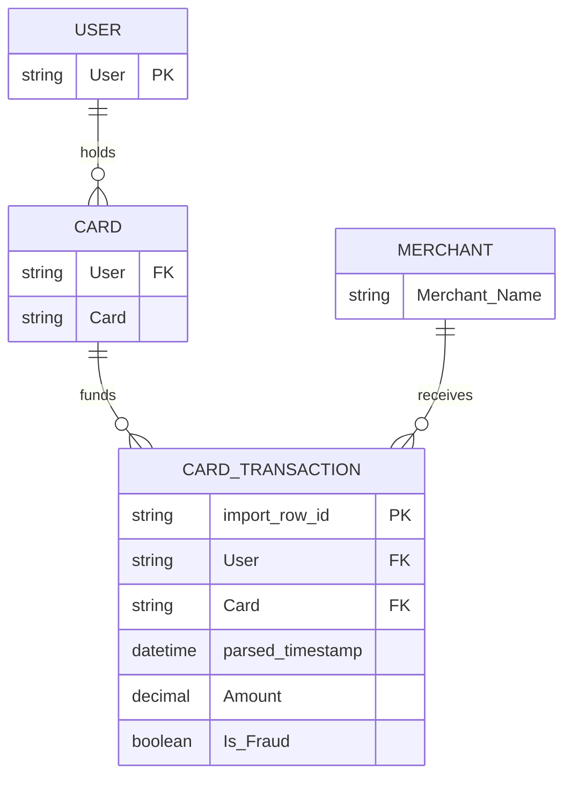

# IBM TabFormer — Detailed Dataset Description and Evaluation

> **Independent source model.** This document deliberately does **not** convert the dataset into a shared Z-Anti-Fraud event schema.

## 1. Introduction and provenance

- **Domain / dataset type:** Synthetic multivariate card-transaction histories / TabFormer benchmark
- **Unit and scale:** Approximately 24 million synthetic card payment events with repeated cardholder and card identifiers. IBM uses the data for sequential tabular modeling. The raw CSV contains 15 columns; after IBM preprocessing it becomes a 12-feature modeling representation (timestamp fields combined; amount encoding/transformation). For our modeling, preserve the **raw 15-column** form.
- **Evidence available:** Schema documented in original IBM repo; full `card_transaction.v1.tgz` archive was not attached. Original source is read-only/archived as of 2026-10-28.
- **Original sources:**
  - https://github.com/IBM/TabFormer
  - https://github.com/IBM/TabFormer/blob/main/data/credit_card/README.md
  - https://github.com/IBM/TabFormer/blob/main/dataset/card.py

## 2. Native structure and relationships

Only the transaction CSV is distributed in the referenced archive; the User, Card and Merchant dimensions shown here are **derived analytical projections**. Use composite `(User, Card)` for cards; `Card` alone is not globally unique. `Merchant Name` can be anonymized/integer-like and need not function as a clean stable merchant primary key.

## 3. Field-by-field dictionary

### Raw transaction file (15 original columns)

| Original field | Type / role | Meaning | Risk / interpretation note |
|---|---|---|---|
| `User` | categorical ID | Synthetic customer/cardholder identifier. | Can repeat across cards and transactions. |
| `Card` | categorical local ID | Card identifier/number within a user. | Key as `(User,Card)`; do not assume globally unique. |
| `Year` | integer | Year component of transaction time. | Combine with Month/Day/Time; do not assume timezone. |
| `Month` | integer | Month component. | Not a month index since simulation start. |
| `Day` | integer | Day of month. | Confirm calendar validity in raw data. |
| `Time` | string | Time-of-day field. | Parse carefully, check 12/24-hour format across file. |
| `Amount` | string / decimal | Original monetary amount, often formatted as `$NN.NN`. | Parse currency formatting; avoid float rounding for money. |
| `Use Chip` | categorical | Card-present/chip/swipe/online channel description. | Channel indicator, not device ID. |
| `Merchant Name` | categorical | Anonymized/numeric-like merchant descriptor. | Not necessarily real name or unique merchant key. |
| `Merchant City` | string / category | Merchant location city. | Online transactions may have no physical city. |
| `Merchant State` | string / category | Merchant state. | Not customer location; nulls meaningful. |
| `Zip` | string / category | Merchant postal/ZIP code. | Preserve leading zeros; missing online context. |
| `MCC` | categorical | Merchant Category Code. | Treat as categorical and preserve 4-digit notation. |
| `Errors?` | nullable categorical | Error(s) associated with card transaction. | Potentially known only after attempt/authorization; audit point-in-time availability. |
| `Is Fraud?` | Yes/No target | Injected/annotated fraud designation. | **Offline label only.** |

## 4. Small example data

**Illustrative example only, not rows extracted from the IBM archive.** Values convey the raw 15-column layout. Merchant names and ZIPs are placeholders; generated examples must not be used for training or performance claims.

| `User` | `Card` | `Year` | `Month` | `Day` | `Time` | `Amount` | `Use Chip` | `Merchant Name` | `Merchant City` | `MCC` | `Is Fraud?` |
|---|---|---|---|---|---|---|---|---|---|---|---|
| 0 | 0 | 2019 | 4 | 1 | 09:23 | $39.58 | Chip Transaction | 100023 | Brandon | 7538 | No |
| 0 | 0 | 2019 | 4 | 2 | 12:10 | $36.98 | Swipe Transaction | 100023 | Brandon | 7538 | No |
| 0 | 0 | 2019 | 4 | 3 | 02:12 | $899.00 | Online Transaction | 102914 | (blank) | 5942 | Yes |

## 5. Detailed interpretation and label semantics

### Raw fields versus IBM preprocessing
The repository’s `dataset/card.py` processes date components into a synthetic `Timestamp`, encodes categorical fields, transforms/quantizes the `Amount`, and exports twelve model inputs: `User, Card, Timestamp, Amount, Use Chip, Merchant Name, Merchant City, Merchant State, Zip, MCC, Errors?, Is Fraud?`. These preprocessed values should not be mistaken for raw authorization inputs.

Unlike PaySim or IBM AML, this dataset has **no sender and receiver account pair**. A cardholder–merchant edge does not, by itself, imply a laundering relationship.

## 6. Advantages

- Millions of repeated transactions give a substantial history per customer/card for rolling and sequence features.
- Contains merchant category, merchant location, channel, errors and amount/time relationships in one record.
- Can evaluate historical features, sequential ML and card–merchant graph aggregations.
- Realistic data-engineering scale for replay and feature-store throughput, even if not a real production feed.

## 7. Limitations and threats to validity

- Fraud labels do not identify specific fraud typologies or confirmed discovery times.
- No login events, device tokens, true card PAN, KYC, balance or transfer-chain data.
- Potentially anonymized merchant names and blank online-location values complicate intuitive rules.
- Synthetic multi-year behavior may encode simulator artifacts; older repository training stack is outdated.

## 8. Proposed use in Z-Anti-Fraud (dataset-specific only)

**Feature Service track:** key history on `(User,Card)`; compute card velocity, spend quantiles, new merchant/MCC, channel transitions and novel locations from strictly earlier rows. For ML compare per-transaction LightGBM with an optional sequence baseline.

**Graph experiments:** only user/card/merchant relations; avoid claims about mule networks and money laundering. Separate label discovery from live scores.

## 9. Recommended acquisition and sampling

Preserve whole user/card histories or contiguous chronological windows instead of taking first 10k file rows; create enriched labeled examples separately. Audit whether `User,Card` values repeat in the intended way and whether merchant identifiers have stable functional dependencies. Original IBM archive is linked through Git LFS / IBM Box.

## 10. Assessment

Very high priority for **historical behavioral features** and volume testing. Less explainable/controllable than the Handbook generator.

## 11. Provenance policy

Source fields, source annotations, inferred analytical entities, and proposed features are distinguished throughout. Fraud ground-truth labels should never enter the online inference payload. Where small examples are illustrative, they do not claim to be observations from the official dataset. For benchmark-quality results, obtain the full official data and verify legal access, data versions, timestamp semantics and natural label rates.
