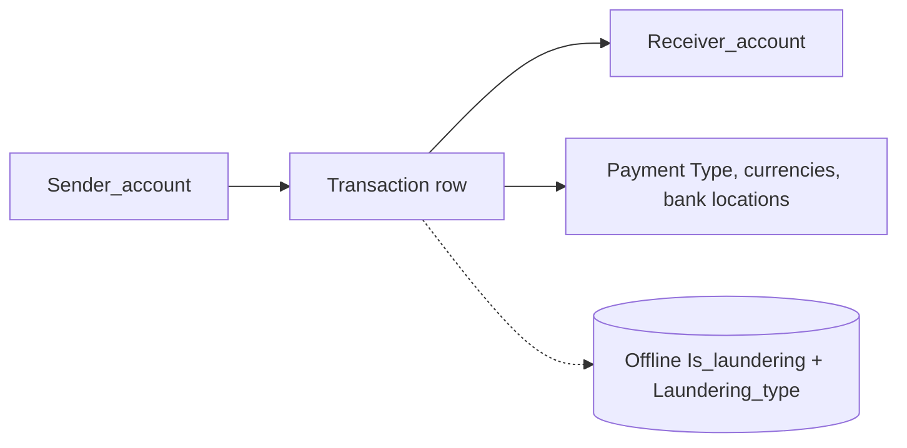

# SAML-D — Detailed Dataset Description and Evaluation

> **Independent source model.** This document deliberately does **not** convert the dataset into a shared Z-Anti-Fraud event schema.

## 1. Introduction and provenance

- **Domain / dataset type:** Synthetic transaction-based anti-money-laundering graph with named typologies
- **Unit and scale:** Publisher describes ~9.5 million bank-account payments, 28 named transaction/laundering patterns and about 0.104% laundering positives. Each record is a directed transfer from a sender account to a receiver account. The provided 15-row inspection sample has 10 `Is_laundering=1` and 5 `=0` rows and was deliberately selected; it cannot establish natural prevalence.
- **Evidence available:** Real example records in the uploaded `01_saml_d_sample.csv` (15 rows); publisher scale and label prevalence are not inferred from the tiny selected sample.
- **Original sources:**
  - https://github.com/BOztasUK/Anti_Money_Laundering_Transaction_Data_SAML-D
  - https://www.kaggle.com/datasets/berkanoztas/synthetic-transaction-monitoring-dataset-aml

## 2. Native structure and relationships

A directed **multigraph** is a useful projection: accounts are nodes; transfers are timestamped edges. There is no guaranteed original transaction ID or separate laundering-case ID. A `Laundering_type` on a row must not be silently promoted to a whole connected-component case.

## 3. Field-by-field dictionary

### All 12 source fields

| Original field | Type / role | Meaning | Risk / interpretation note |
|---|---|---|---|
| `Time` | string time | Time-of-day of transfer. | Combine with Date; unspecified timezone. |
| `Date` | date string | Calendar day of transfer. | Temporal ordering needs date + time and stable tie handling. |
| `Sender_account` | opaque string | Account at origin of flow. | Preserve as string; no standalone source bank ID. |
| `Receiver_account` | opaque string | Receiving account identifier. | Same account may occur in many roles/edges. |
| `Amount` | decimal | Source-provided amount. | Payment side currency is separate; no FX rate field. |
| `Payment_currency` | categorical | Currency denomination used to pay. | Currency name/code from source, not necessarily ISO code. |
| `Received_currency` | categorical | Receiving currency type. | No corresponding received-amount field supplied. |
| `Sender_bank_location` | categorical | Country/region of source bank. | Not GPS or client/device location. |
| `Receiver_bank_location` | categorical | Country/region of receiving bank. | Not necessarily recipient residence. |
| `Payment_type` | categorical | Transfer channel/instrument. | e.g. Cheque, Debit card, Cash Deposit. |
| `Is_laundering` | binary target | Flag for laundering transaction. | Offline label, never online inference feature. |
| `Laundering_type` | categorical annotation | Named transaction pattern, including `Normal_*` values. | Subtype annotation; **not** empty/nonempty fraud test. |

## 4. Small example data

**Actual rows from uploaded inspection CSV** `01_saml_d_sample.csv`. Deliberately enriched in positives and not representative of the dataset.

| `Date` | `Time` | `Sender_account` | `Receiver_account` | `Amount` | `Payment_type` | `Is_laundering` | `Laundering_type` |
|---|---|---|---|---|---|---|---|
| 2022-10-07 | 10:46:37 | 7401327478 | 4336451277 | 2603.3 | Cash Deposit | 1 | Smurfing |
| 2022-10-07 | 10:50:42 | 3758118046 | 2487128589 | 2564.96 | Debit card | 0 | Normal_Group |
| 2022-10-07 | 11:17:19 | 852237169 | 5748489103 | 11278.46 | Cheque | 0 | Normal_Group |
| 2022-10-07 | 11:19:32 | 6340007440 | 4316483340 | 106.04 | Cash Withdrawal | 1 | Cash_Withdrawal |
| 2022-10-07 | 11:21:24 | 7002077089 | 3758118046 | 778.19 | Cheque | 0 | Normal_Group |

## 5. Detailed interpretation and label semantics

### Interpreting subtype labels
Do not assume that any non-null `Laundering_type` is suspicious. The uploaded sample contains explicit `Normal_Group` labels paired with `Is_laundering=0`. Examples of named suspicious typologies include smurfing/structuring and network flows such as fan-in, fan-out and scatter–gather; actual subtype-level performance requires retaining the full connected context.

**Important conceptual separation:** a single source row is a labeled transfer; an inferred laundering group or case is something we can reconstruct experimentally and must be clearly distinguished from source truth.

## 6. Advantages

- Labeled subtype names make AML error analysis much more interpretable than a single binary flag.
- True directed account-to-account schema supports multi-hop, fan-in/out, cycle, burst and counterparty analytics.
- Large number of events makes streaming/graph experiment designs plausible.
- A useful complement to simple payment-card fraud datasets.

## 7. Limitations and threats to validity

- Synthetic typologies risk being recognizable through generation artifacts or fixed structural templates.
- No unique transaction ID, no customer KYC, IP/device, account owner, risk decision time or confirmed investigation timestamps.
- Account-level cases cannot be assumed from transaction-level typology strings.
- Random 10k extracts fracture graph structure and may contain too few natural positives.

## 8. Proposed use in Z-Anti-Fraud (dataset-specific only)

**Graph/Rules:** preserve repeated edges, build account fan-in/fan-out and time-window amount aggregates; count distinct counterparties. Separate the offline `Is_laundering` and `Laundering_type` labels. Evaluate per-typology recall *and* per-alert precision, not just per-row accuracy.

## 9. Recommended acquisition and sampling

Produce a schema-profiling random sample, a time-contiguous graph slice, and a case-enriched subset. Never use the enriched subset to estimate natural operational precision.

## 10. Assessment

High priority for **Graph Engine / AML pattern detection**.

## 11. Provenance policy

Source fields, source annotations, inferred analytical entities, and proposed features are distinguished throughout. Fraud ground-truth labels should never enter the online inference payload. Where small examples are illustrative, they do not claim to be observations from the official dataset. For benchmark-quality results, obtain the full official data and verify legal access, data versions, timestamp semantics and natural label rates.
