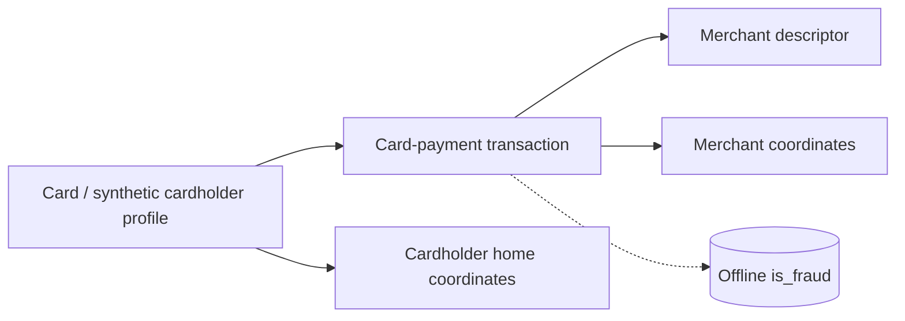

# Sparkov — Detailed Dataset Description and Evaluation

> **Independent source model.** This document deliberately does **not** convert the dataset into a shared Z-Anti-Fraud event schema.

## 1. Introduction and provenance

- **Domain / dataset type:** Synthetic cardholder-to-merchant card-payment activity
- **Unit and scale:** Typically distributed as `fraudTrain.csv` and `fraudTest.csv`; each row represents a synthetic payment to a named merchant, with a cardholder profile, home coordinates, merchant coordinates, transaction amount, two time representations and a fraud label. The provided five-record sample is all normal.
- **Evidence available:** Actual sample `02_sparkov_sample.csv` uploaded (5 rows; all nonfraud). The canonical Sparkov simulator/download is documented by Kaggle and project links.
- **Original sources:**
  - https://www.kaggle.com/datasets/kartik2112/fraud-detection
  - https://github.com/namebrandon/Sparkov_Data_Generation

## 2. Native structure and relationships

`cc_num` links card activity, `trans_num` identifies an event, and `merchant` is a descriptor rather than a guaranteed unique merchant-business key. Preserve the original flat row and construct dimensions only after checking uniqueness.

## 3. Field-by-field dictionary

### All native source fields

| Original field | Type / role | Meaning | Risk / interpretation note |
|---|---|---|---|
| `index / Unnamed: 0` | integer export index | CSV row number in some distributions. | Not a business transaction key. |
| `trans_date_trans_time` | datetime string | Printed date/time of transaction. | Audit against `unix_time` before using. |
| `cc_num` | string / card ID | Synthetic card identifier. | Preserve as a string to prevent precision/leading-zero issues. |
| `merchant` | string | Merchant descriptor from simulator. | `fraud_` prefix does **not** mean the transaction is fraud. |
| `category` | categorical | Merchant spending category. | Potential historical baseline by MCC-like category. |
| `amt` | decimal | Transaction monetary amount. | Currency not explicit; do not assert USD/EUR without source evidence. |
| `first` | string | Cardholder first name in generator. | Personal-profile metadata, not needed for most scoring. |
| `last` | string | Cardholder surname. | Do not use identity text as predictive shortcut. |
| `gender` | categorical | Cardholder generated gender. | Sensitive attribute; audit purposes only. |
| `street` | string | Generated home street. | Home address, not transaction POS location. |
| `city` | string | Cardholder home city. | Distinct from merchant location. |
| `state` | string | Cardholder home state. | Distinct from merchant location. |
| `zip` | string | Cardholder home postal code. | Keep leading zeros. |
| `lat` | float | Cardholder/home latitude. | Not necessarily current phone/POS position. |
| `long` | float | Cardholder/home longitude. | Not necessarily live customer location. |
| `city_pop` | integer | Population of cardholder's home city. | Synthetic locality information. |
| `job` | string | Synthetic occupation. | Potential fairness/proxy feature; not needed for baseline. |
| `dob` | date | string birthdate of synthetic cardholder. | Derive age carefully relative to transaction date if used. |
| `trans_num` | string / ID | Unique synthetic transaction identifier. | Best source key. |
| `unix_time` | integer | Secondary epoch-like time value in CSV. | Uploaded sample is inconsistent with printed timestamp (2012 vs 2019). |
| `merch_lat` | float | Latitude attributed to merchant. | Distance proxy to home, not true travel path. |
| `merch_long` | float | Longitude attributed to merchant. | Pair with merch_lat. |
| `is_fraud` | binary target | 0 normal; 1 fraudulent payment. | Offline label only. |

## 4. Small example data

**Actual rows in supplied CSV** `02_sparkov_sample.csv` (selected columns shown). The `trans_date_trans_time` values are 2019, while the supplied `unix_time` decodes to 2012; this needs investigation in the full release.

| `trans_date_trans_time` | `cc_num` | `merchant` | `category` | `amt` | `trans_num` | `unix_time` | `is_fraud` |
|---|---|---|---|---|---|---|---|
| 2019-01-01 00:00:18 | 2703186189652095 | fraud_Rippin, Kub and Mann | misc_net | 4.97 | 0b242abb623afc578575680df30655b9 | 1325376018 | 0 |
| 2019-01-01 00:00:44 | 630423337322 | fraud_Heller, Gutmann and Zieme | grocery_pos | 107.23 | 1f76529f8574734946361c461b024d99 | 1325376044 | 0 |
| 2019-01-01 00:00:51 | 38859492057661 | fraud_Lind-Buckridge | entertainment | 220.11 | a1a22d70485983eac12b5b88dad1cf95 | 1325376051 | 0 |
| 2019-01-01 00:01:16 | 3534093764340240 | fraud_Kutch, Hermiston and Farrell | gas_transport | 45.0 | 6b849c168bdad6f867558c3793159a81 | 1325376076 | 0 |

## 5. Detailed interpretation and label semantics

### Two high-risk interpretation errors
1. **Merchant prefix:** Source merchant strings frequently begin `fraud_`; it is a simulator naming convention and absolutely not a fraud-label feature.
2. **Timestamp mismatch:** In the uploaded example, `2019-01-01 00:00:18` is accompanied by `1325376018` (2012-01-01 UTC). Do not silently use one as ground truth without reconciling the downloaded version. Keep both raw fields and log the discrepancy.

Synthetic cardholder location usually represents a **home** point, not the physical location of a transaction request. It is unsafe to call a home-to-merchant distance an observed device-travel distance.

## 6. Advantages

- Card histories plus merchant categories and geography support behavior, novelty and distance features.
- Fraud labels allow transaction-level precision/recall benchmarks.
- Unique `trans_num` simplifies import/idempotency checks.
- Less opaque than IEEE-CIS, so it is good for explainable feature demonstrations.

## 7. Limitations and threats to validity

- Synthetic profiles and fraud patterns may encode learnable artifacts not present in live payments.
- No explicit stable physical device IDs, login events, account balances or chargeback/report timing.
- Merchant descriptors are not guaranteed unique entities; home coordinates are not per-transaction device coordinates.
- The uploaded sample includes a material timestamp inconsistency and no positive fraud cases.

## 8. Proposed use in Z-Anti-Fraud (dataset-specific only)

**Feature Service:** `card_tx_count_1h`, `card_spend_sum_1d`, `amount_zscore_vs_history`, `new_merchant_category`, intertransaction gap, time-of-day deviation and home-to-merchant distance (correctly labeled as a proxy). Use train/test partitions and time ordering carefully.

## 9. Recommended acquisition and sampling

Use full source train/test files where licensing permits. Preserve card histories in selected cohorts and a separate fraud-enriched diagnostic sample. Verify timezone and timestamp conflict on full release.

## 10. Assessment

High priority for **interpretable transaction-feature experiments**, after timestamp audit.

## 11. Provenance policy

Source fields, source annotations, inferred analytical entities, and proposed features are distinguished throughout. Fraud ground-truth labels should never enter the online inference payload. Where small examples are illustrative, they do not claim to be observations from the official dataset. For benchmark-quality results, obtain the full official data and verify legal access, data versions, timestamp semantics and natural label rates.
