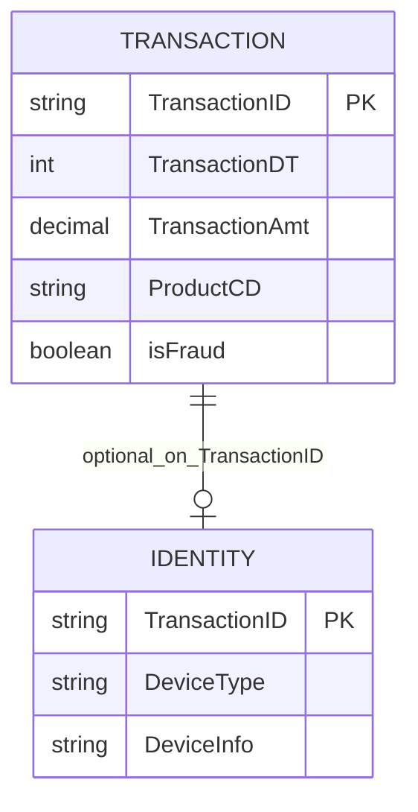

# IEEE-CIS Fraud Detection — Detailed Dataset Description and Evaluation

> **Independent source model.** This document deliberately does **not** convert the dataset into a shared Z-Anti-Fraud event schema.

## 1. Introduction and provenance

- **Domain / dataset type:** High-dimensional e-commerce fraud, transaction table plus optional identity table
- **Unit and scale:** Original competition has training/test transaction and identity tables joined on `TransactionID`. Most hundreds of columns are masked and/or engineered. The uploaded transaction CSV intentionally has only selected readable columns; the uploaded identity snippet includes `id_01`–`id_38`, DeviceType and DeviceInfo plus an exported index.
- **Evidence available:** User uploaded 5 selected transaction rows and 5 identity rows. These are not a full IEEE-CIS release; join overlap in those independently selected snippets is only one TransactionID.
- **Original sources:**
  - https://www.kaggle.com/competitions/ieee-fraud-detection/data

## 2. Native structure and relationships

Use **left join**, not inner join. Some transactions have no identity record. `TransactionDT` is elapsed seconds from a private reference timestamp; **not a Unix epoch**, and `id_XX` fields cannot be reliably renamed to concrete business meanings.

## 3. Field-by-field dictionary

### Transaction: directly named/context fields

| Original field | Type / role | Meaning | Risk / interpretation note |
|---|---|---|---|
| `TransactionID` | numeric/string key | Transaction identifier linking transaction and optional identity. | Key, preserve consistently across files. |
| `isFraud` | binary target | Fraud label on training transactions. | Offline only; often unavailable in test files. |
| `TransactionDT` | numeric seconds | Elapsed time from undisclosed reference. | Cannot assign actual calendar date; relative order meaningful. |
| `TransactionAmt` | numeric | Transaction amount as presented by dataset. | Currency not guaranteed across records. |
| `ProductCD` | categorical | Masked product code. | Cannot infer exact product family. |
| `card1–card6` | numeric/categorical group | Masked card metadata, not card PAN. | No guarantee of stable person/card ID or full business semantics. |
| `addr1, addr2` | categorical/numeric | Masked address metadata. | Cannot equate to full postal address or location. |
| `P_emaildomain` | categorical | Purchaser-related email-domain feature. | May be missing; domain only. |
| `R_emaildomain` | categorical | Receiver-related email-domain feature. | May be missing; domain only. |
| `dist1, dist2` | numeric | Provided distance-like features. | Units and exact derivation not fully established. |

### Transaction: masked/engineered feature families

| Original field | Type / role | Meaning | Risk / interpretation note |
|---|---|---|---|
| `C1–C14` | numeric | Masked counting/count-like engineered features. | Original individual meanings unavailable; preserve names and nulls. |
| `D1–D15` | numeric | Masked time-delta features. | Some may involve unavailable prior history; do not call directly reproducible. |
| `M1–M9` | categorical | Masked match features. | May contain T/F or missing; not universally true boolean. |
| `V1–V339` | numeric | Masked engineered Vesta features. | High dimensional; do not fabricate formulas/meaning. |

### Identity optional table

| Original field | Type / role | Meaning | Risk / interpretation note |
|---|---|---|---|
| `TransactionID` | numeric/string key | Links to transaction record. | Optional relation, not join guarantee. |
| `id_01–id_38` | mixed numeric/categorical | Masked identity or device-related features. | Do **not** interpret `id_01` as IP/login count by guess. |
| `DeviceType` | categorical | Broad device category (e.g., mobile/desktop). | May be missing. |
| `DeviceInfo` | string | Device descriptive string when available. | Not guaranteed persistent device ID. |

## 4. Small example data

**Actual uploaded snippets** (separate source extracts, selected fields). Transaction and identity rows below do not necessarily refer to the same records; only one TransactionID overlaps between the uploaded 5+5 rows.

| `TransactionID` | `isFraud` | `TransactionDT` | `TransactionAmt` | `ProductCD` | `card1` | `P_emaildomain` |
|---|---|---|---|---|---|---|
| 2987000 | 0 | 86400 | 68.5 | W | 13926 |  |
| 2987001 | 0 | 86401 | 29.0 | W | 2755 | gmail.com |
| 2987002 | 0 | 86469 | 59.0 | W | 4663 | outlook.com |
| 2987003 | 0 | 86499 | 50.0 | W | 18132 | yahoo.com |

**Identity table:**

| `TransactionID` | `id_01` | `id_02` | `id_15` | `id_30` | `id_31` | `DeviceType` | `DeviceInfo` |
|---|---|---|---|---|---|---|---|
| 2987004 | 0 | 70787 | New | Android 7.0 | samsung browser 6.2 | mobile | SAMSUNG SM-G892A Build/NRD90M |
| 2987008 | -5 | 98945 | New | iOS 11.1.2 | mobile safari 11.0 | mobile | iOS Device |
| 2987010 | -5 | 191631 | Found |  | chrome 62.0 | desktop | Windows |
| 2987011 | -5 | 221832 | New |  | chrome 62.0 | desktop |  |

## 5. Detailed interpretation and label semantics

### What should be preserved without interpretation
The official feature families `C`, `D`, `M`, `V` and `id_XX` are **masked or engineered, not reliably reverse-engineerable business facts**. We can train ML against their numeric values (offline benchmarking), but we cannot claim that the Z-Anti-Fraud online Feature Service could regenerate them from customer/order events.

### Dataset completeness
The provided transaction sample is **not** the complete full schema; do not treat missing `V1–V339` or `D` fields in the inspection upload as null-valued official columns. To obtain a valid 10k joined sample, sample 10k transactions first, then select matching identity rows by `TransactionID`.

## 6. Advantages

- Rich high-dimensional fraud classification benchmark with optional identity join and missingness.
- Effective for testing model inference, feature typing, nullable joins, categoricals and latency under wide input.
- Public competition ecosystem provides baseline methods and reproducibility discussions.
- Good complement to more transparent payment fraud datasets.

## 7. Limitations and threats to validity

- Opaque engineered columns have no dependable native business interpretation or online recomputation recipe.
- Identity data exists for only a subset of transactions; naïve inner join changes population.
- No real timestamps, stable customer/device graph or reliable human-readable fraud subtypes.
- Uploaded snippets are very small and from independently selected rows, with limited join overlap; full Kaggle data requires accepting competition rules.

## 8. Proposed use in Z-Anti-Fraud (dataset-specific only)

**Offline ML:** Benchmark rich-feature fraud classifier with preserved nullable/opaque fields. **Online serving simulation:** profile serialization, optional identity join and wide-feature inference cost. **Explainability:** be explicit that numeric masked column attributions are statistical, not actionable business rules.

## 9. Recommended acquisition and sampling

Obtain official train transaction + identity under Kaggle rules. Sample transactions first and left-join matching identity. Preserve missingness, perform time-order split based on relative `TransactionDT`, and keep label separate.

## 10. Assessment

High value for **ML and optional-identity-join benchmarking**; weak fit for constructing interpretable event-derived features from scratch.

## 11. Provenance policy

Source fields, source annotations, inferred analytical entities, and proposed features are distinguished throughout. Fraud ground-truth labels should never enter the online inference payload. Where small examples are illustrative, they do not claim to be observations from the official dataset. For benchmark-quality results, obtain the full official data and verify legal access, data versions, timestamp semantics and natural label rates.
