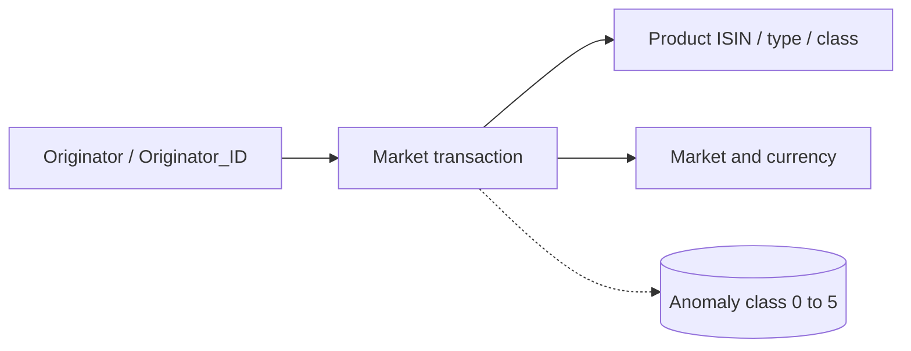

# Amaretto — Detailed Dataset Description and Evaluation

> **Independent source model.** This document deliberately does **not** convert the dataset into a shared Z-Anti-Fraud event schema.

## 1. Introduction and provenance

- **Domain / dataset type:** Synthetic securities/capital-markets time series with injected anomalies
- **Unit and scale:** Market and securities activity from originators, labeled with a normal class and five injected anomaly categories. Publisher descriptions indicate roughly 29.7M records and low anomaly prevalence, but their summary is inconsistent about originator count (40 versus 400); do not assert a reconciled total before raw archive validation.
- **Evidence available:** Uploaded `04_amaretto_published_paper_example.csv` is a published **four-column illustration** (not an extracted official archive slice). A separate upload lists the documented 12-field raw schema; complete archive has not been inspected.
- **Original sources:**
  - https://github.com/necst/amaretto_dataset

## 2. Native structure and relationships

No sender/receiver transfer pair is documented: `InputOutput` is a directional attribute of a market transaction, not proof of a bank counterparty.

## 3. Field-by-field dictionary

### Documented full archive schema (12 attributes)

| Original field | Type / role | Meaning | Risk / interpretation note |
|---|---|---|---|
| `Transaction ID` | string/number key | Market transaction identifier in full published schema. | Paper figure uses slightly different header `Transaction_ID`. |
| `Originator` | string | Originating actor label. | Relationship with ID should be checked in full data. |
| `Originator_ID` | string/category | Originator identifier. | Validate uniqueness/consistency with Originator. |
| `EntryDate` | date/time | Entry date or timestamp of transaction. | Granularity and timezone require full archive. |
| `Normalized Amount` | number | Normalized transaction/asset amount. | Not necessarily original local-currency cash amount. |
| `InputOutput` | categorical | Direction or inflow/outflow flag. | Interpret value domain only from full records. |
| `Market` | categorical | Venue/market classification. | Not a beneficiary account. |
| `Product ISIN` | string | Instrument identifier code. | May identify a security; validate codes. |
| `Product Type` | categorical | Specific financial product type. | Not same as broad product class. |
| `Product Class` | categorical | Broad asset grouping. | May support risk-by-asset views. |
| `Currency` | categorical | Currency descriptor. | Does not guarantee normalized amount is unconverted currency figure. |
| `Anomaly` | categorical 0–5 | Normal versus injected anomaly type. | Ground-truth label; numeric-to-narrative mapping requires validation. |

## 4. Small example data

**Actual six-row example printed in the original Amaretto paper and uploaded by the user**, but this example has **only four columns** and no anomaly label. It is not a sample extracted from the complete 12-field archive.

| `Transaction_ID` | `Originator` | `EntryDate` | `Normalized_Amount` |
|---|---|---|---|
| 00001 | AAAAAA | 2019-01-01 | 123456 |
| 00002 | AAAAAA | 2019-01-01 | 321654 |
| 00003 | AAAAAA | 2019-01-01 | 456321 |
| 00004 | BBBBBB | 2019-01-01 | 12345 |
| 00005 | BBBBBB | 2019-01-01 | 45321 |

## 5. Detailed interpretation and label semantics

### Published anomaly narratives (exact numeric mapping not verified)
1. Many small transactions in a short interval.
2. Repeated rounded amounts.
3. An instrument traded at an unusual time.
4. Abnormally large asset withdrawals.
5. Large collateral movements in/out over a short interval.

These are descriptions of injected anomaly **families**, not necessarily proven fraud cases or laundering activity. Until the full archive is inspected, do not map the five descriptions to integer codes 1–5 by guessing. Keep the `Anomaly` label offline.

## 6. Advantages

- Large, low-prevalence anomaly workload for temporal and rolling-window detection.
- Introduces genuinely different asset/market context, broadening tests beyond ordinary customer-to-merchant payments.
- Originator and instrument keys could support entity baselines and anomalous trading-time rules.
- Good candidate for stress testing anomaly detection with conceptually interpretable perturbations.

## 7. Limitations and threats to validity

- The user-provided example is truncated and does not include the original label or asset/market context.
- Anomalies do not necessarily correspond to proven market abuse or legally defined fraud.
- No sender/receiver bank relationship and little authentication/customer identity information.
- Publisher-count inconsistencies and multi-part archive make independent data-quality validation necessary.

## 8. Proposed use in Z-Anti-Fraud (dataset-specific only)

**Temporal anomaly track:** once full data are available, compute per-originator/instrument rolling volume, repeated amount patterns, unusual session times and abnormal withdrawal magnitudes. Isolate class labels in offline evaluation; benchmark alert recall separately for each anomaly family.

## 9. Recommended acquisition and sampling

Download all official archive parts before sampling, verify content integrity, then preserve time windows and positive-enriched scenarios separately. Never infer full-schema statistics from the paper figure.

## 10. Assessment

Medium priority; promising specialized **market-event/anomaly** dataset after full archive validation.

## 11. Provenance policy

Source fields, source annotations, inferred analytical entities, and proposed features are distinguished throughout. Fraud ground-truth labels should never enter the online inference payload. Where small examples are illustrative, they do not claim to be observations from the official dataset. For benchmark-quality results, obtain the full official data and verify legal access, data versions, timestamp semantics and natural label rates.
