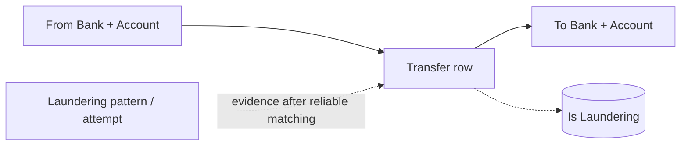

# IBM AML / AMLworld — Detailed Dataset Description and Evaluation

> **Independent source model.** This document deliberately does **not** convert the dataset into a shared Z-Anti-Fraud event schema.

## 1. Introduction and provenance

- **Domain / dataset type:** Synthetic bank-to-bank account transaction multigraph with optional laundering-pattern annotations
- **Unit and scale:** Family of synthetic bank transfers released in differently sized and laundering-intensive variants (e.g., HI-Small). Raw transaction files include sender and receiver account details, two amount/currency representations, transfer format and a binary laundering label. Separate `_Patterns.txt` files can describe named multi-transaction laundering scenarios.
- **Evidence available:** 6 actual rows provided in `05_ibm_aml_sample.csv`, with one labeled laundering transaction. The uploaded sample renamed two duplicate `Account` headers for clarity.
- **Original sources:**
  - https://github.com/IBM/AML-Data
  - https://www.kaggle.com/datasets/ealtman2019/ibm-transactions-for-anti-money-laundering-aml

## 2. Native structure and relationships

Account identity is **bank-scoped**: `(bank_code, account_code)` using strings. There is no original transaction UUID. A laundering **attempt/case** is not the same as a row-level flag.

## 3. Field-by-field dictionary

### Official transaction CSV: 11 positional columns

| Original field | Type / role | Meaning | Risk / interpretation note |
|---|---|---|---|
| `Timestamp` | datetime string | Time of transaction. | Original timezone unspecified. |
| `From Bank` | string | Origin bank code. | Preserve leading zeroes. |
| `Account (3rd column)` | string / source account | Origin account at sender bank. | Duplicate header `Account` in original CSV. |
| `To Bank` | string | Destination bank code. | Preserve leading zeroes. |
| `Account (5th column)` | string / target account | Recipient account at destination bank. | Duplicate `Account` column; must parse positionally. |
| `Amount Received` | decimal | Amount received on beneficiary side. | May differ from amount paid due to currency denomination/conversion. |
| `Receiving Currency` | string | Currency of received amount. | Pair with Amount Received. |
| `Amount Paid` | decimal | Amount removed/sent from source side. | Do not silently equate with amount received. |
| `Payment Currency` | string | Currency denomination of paid amount. | Pair with Amount Paid. |
| `Payment Format` | categorical | Cheque/wire/ACH-like format and other source channels. | Do not treat format as fraud classification. |
| `Is Laundering` | binary target | Transaction-level laundering label. | Offline only; not a case ID or subtype. |

### Separate pattern annotation file (family-specific; not a transaction CSV column)

| Original field | Type / role | Meaning | Risk / interpretation note |
|---|---|---|---|
| `*_Patterns.txt` | text/structured annotation | Named laundering attempts / sequences where publisher provides them. | Requires separate parsing and reliable transaction matching; not always one-to-one with CSV labels. |

## 4. Small example data

**Actual user-uploaded rows** from `05_ibm_aml_sample.csv`, with headers sanitized to `From Account` / `To Account` (source itself contains two `Account` columns).

| `Timestamp` | `From Bank` | `From Account` | `To Bank` | `To Account` | `Amount Received` | `Receiving Currency` | `Amount Paid` | `Payment Format` | `Is Laundering` |
|---|---|---|---|---|---|---|---|---|---|
| 2022/09/01 00:20 | 010 | 8000EBD30 | 010 | 8000EBD30 | 3697.34 | US Dollar | 3697.34 | Reinvestment | 0 |
| 2022/09/01 00:20 | 03208 | 8000F4580 | 001 | 8000F5340 | 0.01 | US Dollar | 0.01 | Cheque | 0 |
| 2022/09/01 00:00 | 03209 | 8000F4670 | 03209 | 8000F4670 | 14675.57 | US Dollar | 14675.57 | Reinvestment | 0 |
| 2022/09/01 00:02 | 012 | 8000F5030 | 012 | 8000F5030 | 2806.97 | US Dollar | 2806.97 | Reinvestment | 0 |
| 2022/09/01 00:06 | 021174 | 800737690 | 012 | 80011F990 | 2848.96 | Euro | 2848.96 | ACH | 1 |

## 5. Detailed interpretation and label semantics

### Duplicate CSV header hazard
The original data uses the literal header `Account` twice, once after `From Bank` and again after `To Bank`. A parser that silently renames to `Account` and `Account.1` or keeps only the last `Account` may cause incorrect edges. Parse by validated column index and rename explicitly into internal `from_account` and `to_account` while retaining raw source headers in metadata.

### Pattern labels versus transaction labels
`Is Laundering=1` is one row's annotation. A separate pattern document may encode a linked multi-transfer attempt and its typology. Do not infer exact case membership from the binary flag alone. Count matched/ambiguous/unmatched evidence when joining patterns to transactions. Self-transfers such as `Reinvestment` can be legitimate simulator behavior.

## 6. Advantages

- Naturally suited to transaction network modeling, cycles, money movement and flow attribution.
- Both paid and received currency/amount fields preserve cross-currency transaction context.
- Optional pattern file supports pattern-level detection beyond isolated positive rows.
- Large published variants support replay and graph scalability evaluation.

## 7. Limitations and threats to validity

- Synthetic scenarios may not match contemporary laundering behavior or realistic bank controls.
- Original transaction records lack immutable event IDs and live detection/confirmation timestamps.
- Pattern file joins can be nontrivial; duplicate transaction values can create false matches.
- No login, IP/device, detailed merchant/KYC information or authentic case outcomes.

## 8. Proposed use in Z-Anti-Fraud (dataset-specific only)

**Graph Engine:** nodes are bank-scoped accounts; edges are transfers with amounts, currency pairs, format and timestamps. Compute fan-in/out, cycles, time-window multi-hop paths, currency movement and evidence of rapid consolidation. Evaluate row-level recall separately from complete suspicious-attempt detection.

## 9. Recommended acquisition and sampling

Choose a manageable `HI-Small` file; include full transfer paths from selected pattern attempts and background edges. A pure random sample is insufficient for multi-hop AML detection. Retain original row order and file variant in technical ID.

## 10. Assessment

Very high priority for **AML graphs, attempt-level evaluation and stream replay**.

## 11. Provenance policy

Source fields, source annotations, inferred analytical entities, and proposed features are distinguished throughout. Fraud ground-truth labels should never enter the online inference payload. Where small examples are illustrative, they do not claim to be observations from the official dataset. For benchmark-quality results, obtain the full official data and verify legal access, data versions, timestamp semantics and natural label rates.
