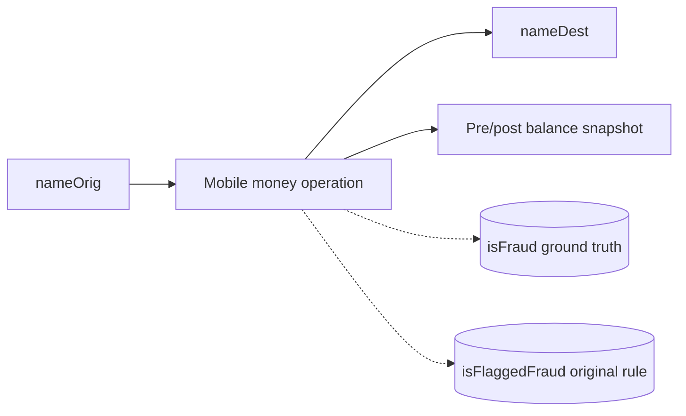

# PaySim — Detailed Dataset Description and Evaluation

> **Independent source model.** This document deliberately does **not** convert the dataset into a shared Z-Anti-Fraud event schema.

## 1. Introduction and provenance

- **Domain / dataset type:** Synthetic mobile-money payments with before/after balance fields
- **Unit and scale:** Published file reports 6,362,620 simulated mobile-money operations across hour-indexed steps. Each row is one operation between origin and destination participants; the transaction has a type and amount plus origin/destination balances before/after, a fraud label and an independent built-in flag. Five types occur: `CASH_IN`, `CASH_OUT`, `DEBIT`, `PAYMENT`, `TRANSFER` (published values use `CASH_IN`/`CASH_OUT` spelling).
- **Evidence available:** 10 authentic rows from uploaded `06_paysim_sample.csv`, of which two are fraud-positive; selection not representative.
- **Original sources:**
  - https://www.kaggle.com/datasets/ealaxi/paysim1

## 2. Native structure and relationships

The source has no stable transaction ID: use `(version, source row ordinal)` as a technical ID, not a new bank business ID. Participant identifiers may denote customers or merchants; do not assign all nodes an account-owner identity by their prefix alone.

## 3. Field-by-field dictionary

### All 11 source columns

| Original field | Type / role | Meaning | Risk / interpretation note |
|---|---|---|---|
| `step` | integer | Hour index in the simulation. | Not Unix timestamp or actual wall-clock date. |
| `type` | categorical | Operation type: `CASH_IN`, `CASH_OUT`, `DEBIT`, `PAYMENT`, `TRANSFER`. | Type-dependent accounting/visibility rules. |
| `amount` | decimal | Operation amount. | Publisher does not establish user currency per row. |
| `nameOrig` | string | Origin participant identifier. | Opaque synthetic key. |
| `oldbalanceOrg` | decimal | Origin balance recorded before operation. | Availability at exact scoring stage must be justified; potential simulator artifact. |
| `newbalanceOrig` | decimal | Origin balance after operation. | **Post-event**; do not use for pre-decision model. |
| `nameDest` | string | Destination participant identifier. | Can denote different simulated entity categories. |
| `oldbalanceDest` | decimal | Destination balance recorded before operation. | May be simulator-specific/zero for some recipients. |
| `newbalanceDest` | decimal | Destination balance after operation. | **Post-event**; leakage risk. |
| `isFraud` | binary target | Fraud label. | Offline only. |
| `isFlaggedFraud` | binary baseline | Dataset's pre-existing rule flag. | Do not confuse with fraud ground truth or assume rule is correct. |

## 4. Small example data

**Actual uploaded sample records** `06_paysim_sample.csv`; the selected sample contains positive fraud rows and is not a representative prevalence estimate.

| `step` | `type` | `amount` | `nameOrig` | `oldbalanceOrg` | `newbalanceOrig` | `nameDest` | `isFraud` | `isFlaggedFraud` |
|---|---|---|---|---|---|---|---|---|
| 1 | PAYMENT | 9839.64 | C1231006815 | 170136 | 160296.36 | M1979787155 | 0 | 0 |
| 1 | PAYMENT | 1864.28 | C1666544295 | 21249 | 19384.72 | M2044282225 | 0 | 0 |
| 1 | TRANSFER | 181 | C1305486145 | 181 | 0 | C553264065 | 1 | 0 |
| 1 | CASH_OUT | 181 | C840083671 | 181 | 0 | C38997010 | 1 | 0 |
| 1 | PAYMENT | 11668.14 | C2048537720 | 41554 | 29885.86 | M1230701703 | 0 | 0 |

## 5. Detailed interpretation and label semantics

### Fraud detection pitfalls
- The simulator may cancel fraudulent transfers or exhibit nonstandard balance-updating behavior. For a clean pre-authorization benchmark, exclude **all four balance fields** initially, not only the after-values; keep the fields in raw storage for auditing.
- `isFlaggedFraud` is a **simple built-in detector output**, not the true `isFraud` label. It can be evaluated as a baseline, but should not be used as ground truth.
- `step` is an **hour index**; event order within one hour may only be file order. Do not synthesize a fake timestamp without marking that translation.

Example `TRANSFER` followed by `CASH_OUT` can be used to test a basic drain/cash-out explanation, but the two positive rows in the sample alone do not establish a complete linked fraud campaign.

## 6. Advantages

- Small, understandable schema ideal for validating data ingestion and simple transactional rules.
- Origin/destination fields support a limited payment-transfer graph.
- Built-in flag can be compared against fraud ground truth and our custom Rules Engine.
- Balances allow offline accounting checks (once their simulator semantics are understood).

## 7. Limitations and threats to validity

- Severe leakage if post-transaction balances are supplied to pre-decision models.
- No real calendar times, stable transaction IDs, device/login context, KYC, charges or confirmation dates.
- Limited fraud variety and simulation artifacts may make benchmarks unrealistically easy.
- Graph and time histories sampled randomly will not preserve fraud sequences.

## 8. Proposed use in Z-Anti-Fraud (dataset-specific only)

**Sprint 1:** First test ingestion and `TRANSFER`/`CASH_OUT` rules without balances in the inference payload. Evaluate online velocity, amount thresholds and prior counterparties where enough history exists. Preserve raw balances only for offline reconciliation / alternate post-processing experiments. Compare `isFlaggedFraud` separately as the dataset's baseline.

## 9. Recommended acquisition and sampling

Use the full official CSV for credible evaluation. Retain a continuous set of steps and full account contexts; prepare an enriched sample for demonstration separately. The uploaded 10 rows are sufficient for schema inspection only.

## 10. Assessment

High priority **simple end-to-end rule demonstration**; low realism as a sole ML fraud benchmark.

## 11. Provenance policy

Source fields, source annotations, inferred analytical entities, and proposed features are distinguished throughout. Fraud ground-truth labels should never enter the online inference payload. Where small examples are illustrative, they do not claim to be observations from the official dataset. For benchmark-quality results, obtain the full official data and verify legal access, data versions, timestamp semantics and natural label rates.
