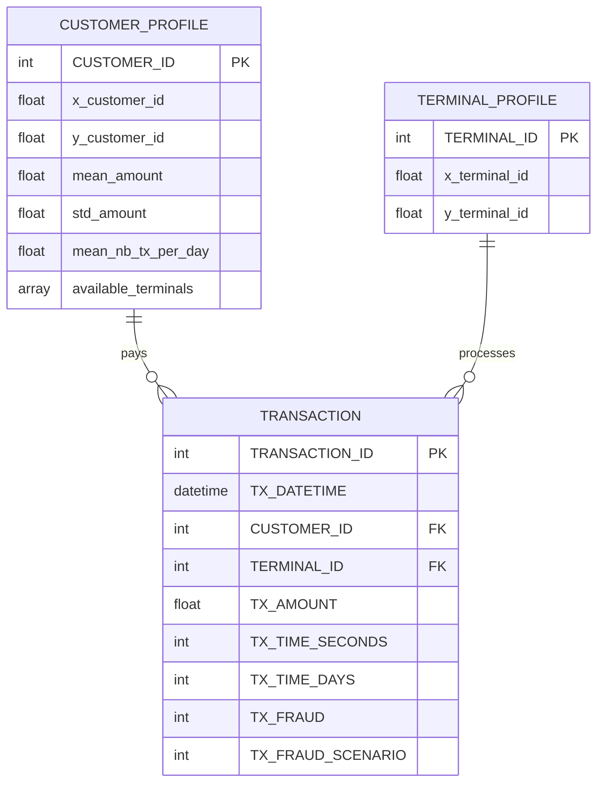

# 01 — Fraud Detection Handbook: independent dataset model

## Identity and provenance
- **Domain:** simulated card-present/card-payment transactions.
- **Authoritative source:** https://fraud-detection-handbook.github.io/fraud-detection-handbook/Chapter_3_GettingStarted/SimulatedDataset.html
- **Type:** parameterized *generator* with deterministic seed; not a sampled extract from an actual bank.
- **Reference demonstration:** 5,000 customer profiles, 10,000 terminal profiles, 183 simulated days, about 1.75 million payments, about 0.84% labeled fraud. Counts depend on settings and seed.
- **Granularity:** one row per payment in the final `transactions_df`.

## Native conceptual entities (do not unify yet)

**Actual data contract:** final labeled `transactions_df` is a flat 9-column table. Customer/terminal profiles are distinct generated tables within the simulator and should be saved if we want to preserve the underlying populations; they are not automatically columns in each transaction record. `available_terminals` is a simulator association, not an observed authorization/transaction fact.

## Field dictionary
| Native field | Type (logical) | Meaning | Scoring-time availability |
|---|---|---|---|
| `TRANSACTION_ID` | integer | unique simulator payment ID | yes |
| `TX_DATETIME` | datetime | occurrence time | yes |
| `CUSTOMER_ID` | integer/category | payer ID | yes |
| `TERMINAL_ID` | integer/category | payment terminal ID | yes |
| `TX_AMOUNT` | decimal | card payment amount | yes |
| `TX_TIME_SECONDS` | int | time elapsed since simulation start | derived from time |
| `TX_TIME_DAYS` | int | simulated day index | derived from time |
| `TX_FRAUD` | 0/1 | injected ground truth | **no** — evaluation only |
| `TX_FRAUD_SCENARIO` | 0,1,2,3 | generator's last assigned scenario (overlap may overwrite) | **no** — evaluation only |

**Profile fields:** Customer position (x, y), amount mean/deviation, typical transaction count/day, reachable terminal list; terminal position (x, y). Coordinates are abstract grid coordinates, **not latitude/longitude**. Currency is not explicitly a field in the documented transaction table.

## Original fraud scenarios
1. **Amount threshold:** `TX_AMOUNT > 220`, marked fraudulent. Deliberately trivial baseline; do not overinterpret good benchmark scores.
2. **Compromised terminals:** two terminals randomly selected per day; payments on those terminals in the following 28 days marked fraudulent.
3. **Compromised customers:** three customers selected per day; for 14 days a fraction of their payments have amount multiplied by 5 and are marked fraudulent.

The simulator executes these sequentially. One payment can belong to multiple candidate scenarios; `TX_FRAUD_SCENARIO` is a single value and later assignment can overwrite earlier markings. If we extend the generator, preserve multi-pattern membership separately as *our added annotation* (not original data).

## What to build from it
- **Rules Engine:** high-value transaction baseline (scenario 1); customer amount deviation; terminal risky-history threshold.
- **Feature Service:** `customer_tx_count_1h/24h`, `customer_mean_amount_30d`, `terminal_fraud_rate_7d` (only *previously confirmed* fraud), `customer_terminal_first_seen`.
- **ML Engine:** start with logistic regression/LightGBM; evaluate time-separated holdout, PR-AUC, recall at fixed FPR, and average precision.
- **Data replay:** sort by event timestamp, compute *strictly prior* history; consider availability delays for terminal labels.

## Limitations and engineering traps
- The fraud simulator largely defines the decision boundary. Detecting its exact rules is not evidence of general fraud detection ability.
- Very sparse context: no authentication, device, real-world geographic distance, account balance, KYC, or actual merchant reputation.
- Reused customers/terminals are valuable; random sampling 10k payments may discard their history. Sample a **contiguous time window** or a subset of customers with all their payments, and include all-positive challenge set separately.
- Fraud confirmation is not instantaneous in real systems: model delayed reporting or do not feed `TX_FRAUD` into online history.

## Proposed *independent* logical storage
Keep three source tables (`customer_profiles`, `terminal_profiles`, `transactions`), plus an **offline-only** `transaction_ground_truth(transaction_id, is_fraud, scenario)` projection. No conversion to a global event schema at this stage.

## Decision
**Very high priority for Sprint 1** — best explainable, reproducible end-to-end exercise for Rules + Features. **Low realism** as a standalone general-purpose performance benchmark.
