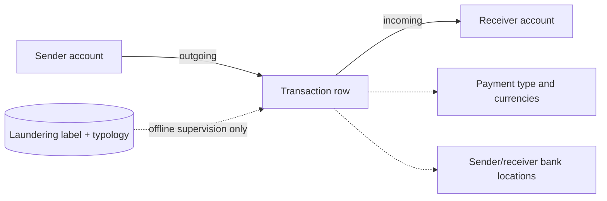

# 01 — SAML-D: independent source model

**Model status:** source-preserving conceptual model, not a shared Z-Anti-Fraud schema. **Inspected data:** 15 authentic rows from the provided *inspection pack* (10 labeled `1`, 5 labeled `0`, **not representative**). **Public reference:** https://github.com/BOztasUK/Anti_Money_Laundering_Transaction_Data_SAML-D ; download https://www.kaggle.com/datasets/berkanoztas/synthetic-transaction-monitoring-dataset-aml

## What is being modeled?
A time-ordered **directed multigraph of account-to-account financial transactions** with labels for suspicious transactions and named typologies. Many transactions can connect the same accounts; the same account can occur on both ends of different transactions. The author's dataset description reports 9,504,852 transactions, 28 typologies, and about 0.1039% suspicious labels. These are **publisher figures**, not measured from this 15-row sample.

## Source record (preserve field names)

| Original field | Logical type | Meaning / rule |
|---|---|---|
| `Time` | time-of-day string | Parse jointly with `Date`; timezone not provided |
| `Date` | calendar date | Transaction chronology, no timezone assumption |
| `Sender_account` | opaque string | Directed edge start; never parse into numeric account ID |
| `Receiver_account` | opaque string | Directed edge end |
| `Amount` | decimal | Supplied transaction value; no asserted conversion rate |
| `Payment_currency` | categorical string | Currency for payment-side amount |
| `Received_currency` | categorical string | Counterparty-side currency *name*; no received amount supplied |
| `Sender_bank_location` | categorical string | Location attributed to sender's **bank**, not customer device/GPS |
| `Receiver_bank_location` | categorical string | Receiver bank's location |
| `Payment_type` | categorical string | Cash Deposit, Debit card, Cheque, etc. |
| `Is_laundering` | binary label | 0/1 **offline ground truth**; don't feed to detector |
| `Laundering_type` | typology label | Includes `Normal_*` labels on normal transactions; don't map all nonempty values to suspicious |

## Dataset-native entities and relations

- **Account**: identified by original account value; don't attach a bank ID that the source doesn't provide.
- **Transaction**: source row with time, amount, payment type, and both endpoints. The source has **no explicit transaction ID**; use `(file version, row ordinal)` as a technical key, distinct from business identity.
- **Laundering classification**: binary + string typology belongs to that transaction row, retained as offline label. Typology is not necessarily a connected-component ID or laundering-attempt ID.

## Graph semantics and derived research views
A graph projection is natural: nodes = accounts; directed edge = each transaction, with timestamp and amount as edge attributes. Useful derivations: within-window fan-in/fan-out counts, total flows, unique counterparties, short cycles, multi-hop paths, structuring bursts. These require preserving enough **connected temporal context**; a random 10k set will often fragment the graph and conceal patterns.

## Sample plan
1. `saml_random_10k.csv`: uniform reservoir sample to inspect schema, nulls, categories and ranges (not graph inference).
2. `saml_context_10k.csv`: consecutive observations in original file order, or an actual dated interval after verifying sort order; prioritize preserving account interactions.
3. `saml_enriched_10k.csv`: up to 500 suspicious transactions plus 9,500 background transactions, *exploratory only*; do not report performance at natural prevalence using this file.
4. For typology evaluation later, preserve a sufficient **full-network time slice** and use native prevalence in chronological validation/testing.

## Decision points for review
Should we treat typology as a property of a **transaction** only (as the source encodes it), or also build an independently inferred *suspicious group/case* layer? The latter is a derived experimental structure, **not present as a source ID**.
