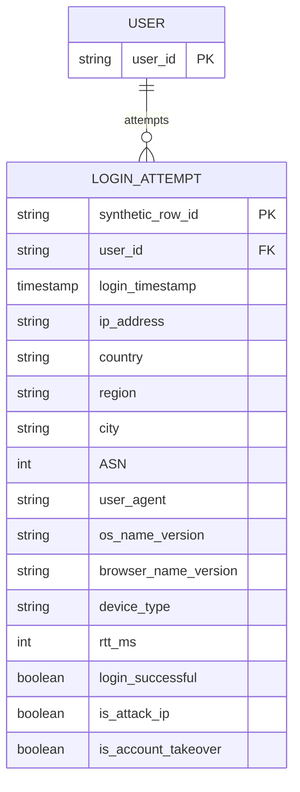

# 02 — Risk-Based Authentication (RBA) Login Dataset: independent dataset model

## Identity and provenance
- **Authoritative source:** https://github.com/das-group/rba-dataset
- **Download:** project Releases; CC BY 4.0, citation required under project notes.
- **Domain:** synthetic login attempts from a real SSO population's behavioral statistics (Norway, originally February 2020–February 2021).
- **Volume:** more than 33 million synthesized login attempts; more than 3.3 million users.
- **Granularity:** one row per attempted login; data are not transactions or authenticated sessions.
- **Critical warning:** IP, user agent, timestamps, RTT are artificial; do not deploy trained models on production from these records.

## Native flat schema
The source publishes a single login event table with **15** columns:

| Native column | Role | Meaning and cautions |
|---|---|---|
| `User ID` | actor key | persistent pseudonymous user identifier |
| `Login Timestamp` | event time | synthetic, ordered timestamp; verify units on raw import |
| `IP Address` | network | synthetic IP, may be reserved/private/inconsistent with reality |
| `Country` | network | synthetic IP-geolocation field |
| `Region` | network | synthetic region |
| `City` | network | synthetic city |
| `ASN` | network | synthetic network number (some values >=500,000 implausible) |
| `User Agent String` | client | user-agent text, **not** unique physical-device identity |
| `OS Name and Version` | parsed client | OS metadata |
| `Browser Name and Version` | parsed client | browser metadata |
| `Device Type` | parsed client | mobile / desktop / tablet / bot / unknown; some unparseable |
| `Round-Trip Time (RTT) [ms]` | network | synthetic server-measured RTT |
| `Login Successful` | outcome | authentication succeeded or failed; may only be known *after* attempted authentication |
| `Is Attack IP` | threat flag | known-attacker indicator, *not* equivalent to confirmed takeover |
| `Is Account Takeover` | label | incident-response classification; **offline-only** for a pre-login risk decision |

## Native conceptual shape vs proposed analytic projections

`USER` and `synthetic_row_id` are **our analytical abstractions**, not separate tables or source-defined primary keys. Preserve the original 15 source columns in a raw event table; create a source row ID for deterministic import. There is no documented persistent `DEVICE_ID` or `SESSION_ID`; do **not** manufacture reliable user-device edges merely by hashing user agents.

## Typical attack signals and scoring
- First observed IP / ASN / country for the user.
- Novel browser / operating-system signature.
- Distinct IP or ASN count in trailing 24 hours.
- Consecutive failed attempts, if evaluating a **post-authentication** or subsequent-attempt decision.
- Time since prior login; per-account / per-IP retry rate.
- Threat-list hit only when the list was in fact available at that instant.

**Point-in-time split:** if scoring *before* password verification, exclude the present attempt's `Login Successful` and `RTT` if no complete server measurement yet; if scoring *after* password verification for step-up MFA, they may be available. Always exclude `Is Account Takeover`, and gate `Is Attack IP` by provenance/knowledge time.

## Limitations
- No linked payments, transfers, withdrawals, identity documents, or known persistent device identifiers.
- Synthetic network fields may create misleading geographic or organizational inferences. Authors document artificial 10.0.0.0/8 IPs and ASN >= 500000 values.
- User event histories support login RBA, not causal claims that a login triggered a downstream financial loss.
- Attack-IP indicator can be an unrealistically strong or post-hoc feature depending on how it is used; run ablations without it.
- Prefer chronological sequences by user rather than 10,000 uniform rows, which would likely produce almost no repeated-user history across 3.3M users.

## Proposed independent storage
`login_attempts_raw`, with `row_id` generated at ingestion, and offline `login_ground_truth(row_id, is_account_takeover)`. Optionally materialize a `user_login_features` view (rolling IP/ASN/browser novelty). Keep separate from transactions until review.

## Decision
**Very high priority for Auth / User security** and useful for a behavioral Feature Service. **Not** a stand-in for fraudulent financial transaction data.
