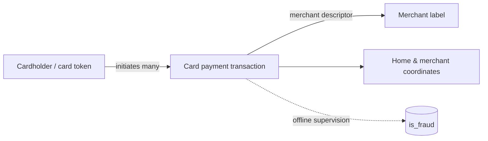

# 02 — Sparkov: independent source model

**Model status:** source-preserving card-activity model. **Inspected data:** 5 normal transactions (`is_fraud=0`), **no positive example** in the uploaded inspection extract. **Original distribution:** https://www.kaggle.com/datasets/kartik2112/fraud-detection ; simulator https://github.com/namebrandon/Sparkov_Data_Generation

## What is being modeled?
A time-ordered history of **cardholder/card → merchant payments**. Transactions have stable `trans_num`, synthetic cardholder profile and geographic location, merchant descriptors, merchant coordinates, payment time and amount. Typical distributed files are `fraudTrain.csv` and `fraudTest.csv`; keep these pre-existing partitions distinguishable and check their dates before any new split.

## Source field groups

| Family | Original field(s) | Model interpretation |
|---|---|---|
| Transaction identity | `trans_num` | Unique transaction key; string |
| Payment | `amt`, `category`, `merchant` | Amount; merchant business category; merchant *label*, not guaranteed unique merchant ID |
| Card identity | `cc_num` | Synthetic card account key; preserve as string; pseudonymise for logs |
| Event time | `trans_date_trans_time`, `unix_time` | Two source representations; **audit their consistency** before deciding canonical time |
| Cardholder profile | `first`, `last`, `gender`, `street`, `city`, `state`, `zip`, `city_pop`, `job`, `dob` | Simulation's cardholder static profile, not event-time identity proof |
| Cardholder location | `lat`, `long` | Typically cardholder/home geo, **not necessarily POS/device location** |
| Merchant location | `merch_lat`, `merch_long` | Coordinates attributed to merchant on record |
| Label | `is_fraud` | Binary transaction-fraud ground truth (offline only) |
| Unnamed/index | `index` or `Unnamed: 0` in some versions | CSV export row number, not a business ID |

**Source anomaly detected in supplied rows:** all five human-readable timestamps fall in **2019**, but the integer `unix_time` values decode to **2012**. Do not silently reconcile these values with guessed offsets; investigate full downloaded release, record discrepancy, and use `trans_date_trans_time` provisionally for the sample.

## Dataset-native entities and relations

- **Cardholder/card**: linked across repeated transactions by `cc_num`; a card may have one profile in the generator, but verify uniqueness instead of assuming.
- **Merchant**: `merchant` string has no documented hard uniqueness guarantee; treat as merchant **descriptor** until inspected.
- **Card payment**: identified by `trans_num`; status/authorization/chargeback event stages are **not present**.
- **Fraud label**: belongs to payment, not cardholder or merchant.

## Potential historical/derived views (not source fields)
Per-card rolling transaction count, spending deviation, merchant-category history, travel-distance proxy, unseen merchant, hour-of-day and intertransaction interval. Compute strictly from earlier events, not from later rows or a full-series global fit.

**Critical leakage trap:** most synthetic merchant names start with literal `fraud_`; this prefix is a generator naming convention, **not** a fraud classification. Do not create a rule or feature based on that string prefix.

## Sample plan
- 10k reservoir sample of **train** to inspect categories and profile properties; separately inspect test.
- 10k enriched **train** sample with e.g. 300 positive cases to examine rare fraud, explicitly not an unbiased test.
- Retain longer per-card histories when assessing sequence-based detection; random rows are bad substitutes for temporal windows.

## Decision points for review
Do we keep the static cardholder profile in its own table with `cc_num` foreign key, or store source values on every transaction (as supplied) and derive a cardholder view later? For now **preserve the raw rows** and describe the view without materialising a unified customer concept.
