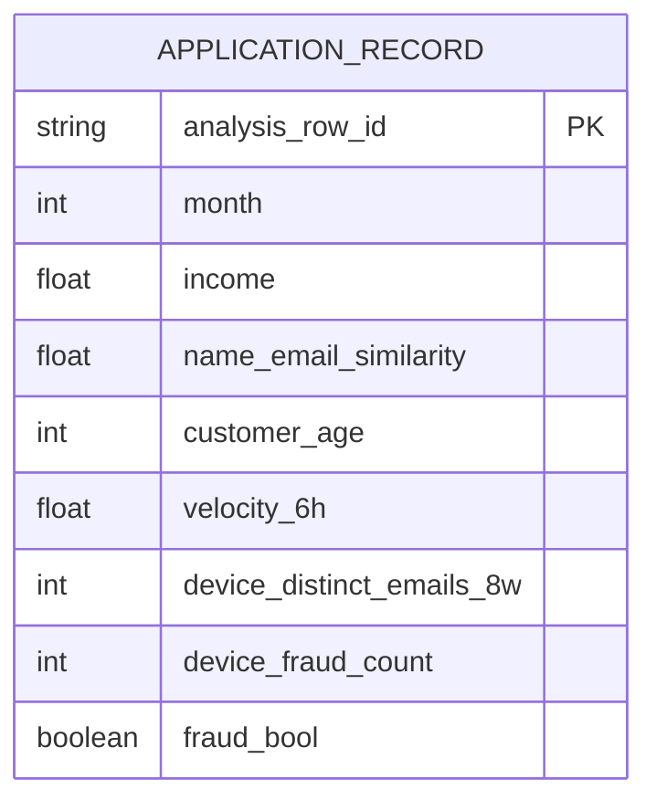

# 03 — Bank Account Fraud (BAF): independent dataset model

## Identity and provenance
- **Official repository:** https://github.com/feedzai/bank-account-fraud
- **Primary paper:** https://arxiv.org/abs/2211.13358 (NeurIPS 2022, Datasets and Benchmarks)
- **Official download:** linked Kaggle dataset from repository README; CSV / Parquet variants.
- **Origin:** anonymized real bank account-opening fraud data → privacy-preserving transformations and noise → CTGAN → generated samples.
- **Six variants:** Base, I, II, III, IV, V; ~1,000,000 synthetic applications per variant, 8 months (`month` = 0..7).
- **Unit of observation:** one *application decision record*, not a payment, not a persistent bank account history.
- **Labels:** `fraud_bool` 0 = legitimate account application, 1 = fraudulent (confirmed later).

## Native structure: one independent, feature-engineered record

This is **a conceptual subset of a single flat record**, not the full column list. The public dataset **does not provide stable applicant IDs, device IDs, IP addresses, application timestamps, transaction IDs, or edges linking records**. The row ID is our artificial import identifier; it must not be treated as a customer ID. The existing dataset contains aggregated features, but their raw constituent events cannot be reconstructed.

## Field families (actual source columns, with shorthand explanations)
| Category | Native fields |
|---|---|
| Target/time | `fraud_bool`, `month` |
| Applicant attributes | `income`, `customer_age`, `employment_status`, `housing_status` |
| Identity/address | `name_email_similarity`, `prev_address_months_count`, `current_address_months_count`, `email_is_free`, `phone_home_valid`, `phone_mobile_valid` |
| Financial/account | `intended_balcon_amount`, `payment_type`, `credit_risk_score`, `bank_months_count`, `has_other_cards`, `proposed_credit_limit` |
| Request/session/device | `days_since_request`, `foreign_request`, `source`, `session_length_in_minutes`, `device_os`, `keep_alive_session` |
| Historical aggregates | `zip_count_4w`, `velocity_6h`, `velocity_24h`, `velocity_4w`, `bank_branch_count_8w`, `date_of_birth_distinct_emails_4w`, `device_distinct_emails_8w`, `device_fraud_count` |
| Variants III/V | Additional synthetic separability columns `x1`, `x2` (not present in Base / all variants) |

The official datasheet sometimes calls `device_distinct_emails_8w` `device_distinct_emails`; actual CSV headers should govern ingestion. The Base CSV has 32 columns including target and month; separability variants have added fields. The original data uses sentinel codes such as `-1` rather than null for several unavailable quantities; inspect field-specific rules instead of globally interpreting all negatives as missing.

## Variant semantics
| Variant | Core experimental change |
|---|---|
| Base | Most representative sample of the privatized original distribution; still naturally biased |
| I | More pronounced protected-group **size** imbalance |
| II | Greater fraud **prevalence disparity** between groups |
| III | Feature **separability disparity** (extra predictive fields favor one group) |
| IV | Prevalence disparity changes between training and test periods |
| V | Separability disparity changes between training and test periods |

These are **different benchmark conditions**, not six independent user populations to concatenate into one 6M-row training set.

## Evaluation proposal
- Train on months 0–5; evaluate on later months; within training, retain earlier-month validation for tuning rather than using month 6–7 for both fitting decisions and unbiased final evaluation.
- Baseline: logistic regression and LightGBM; metric: PR-AUC / recall at fixed false-positive rate / calibrated probabilities, not accuracy alone.
- Compare score and error rates over `customer_age`, `income`, `employment_status` groups, with caution that fairness metrics are context-dependent.
- **Model audit:** `device_fraud_count`, `credit_risk_score`, `days_since_request` may encapsulate contextual/temporal information that a live scorer might not have. Test with and without them and record availability assumptions. Do not assert guaranteed leakage without more metadata.
- No meaningful graph-feature recomputation from BAF alone: entity relationships are unavailable.

## Limitations
- No real identifiable accounts or persistent timeline; cannot produce genuine per-user event histories or entity graph.
- Privacy generation may distort rare fraudulent behavior and complex interactions.
- Labels apply to **account applications**, not money laundering, card fraud, or known account takeover.
- Sensitive/protected features raise fairness/legality concerns in live scoring; treat them as audit variables until governance is defined.
- The authors advise against directly deploying models trained on this synthetic suite into real bank decisions.

## Proposed independent storage
For each variant: `application_records_<variant>` as a flat table with original columns, plus optionally `application_label(row_id, fraud_bool)`. Preserve variant and month metadata; do not fabricate applicant or device dimensions. Keep `x1/x2` variant-specific.

## Decision
**High priority for offline ML and fairness/shift experiments; medium/low priority for real-time stream-feature and graph integration**.
