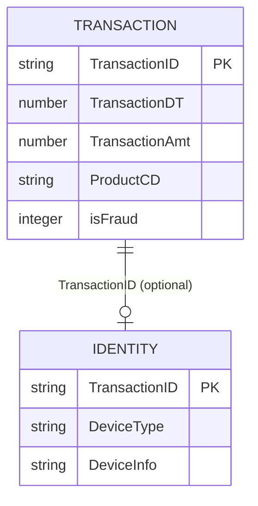

# 03 — IEEE-CIS: independent source model

**Model status:** two related source tables; **not** a flattened fraud event. **Inspected data:** 5 transaction rows (selected 19 columns, all normal) and 5 identity rows (42 columns including an unnamed CSV index); only **one** matching TransactionID in the uploaded sample. Official source: https://www.kaggle.com/competitions/ieee-fraud-detection/data . **Access subject to Kaggle competition rules.**

## What is being modeled?
A high-dimensional **e-commerce transaction** optionally linked to an **identity/device observation**. Unlike Sparkov, there may be no reliable non-masked card/customer ID or meaningful merchant ID. Feature groups are partly anonymized. Official data includes `train_transaction.csv` and `train_identity.csv`; equivalent test files often lack labels.

## Dataset-native source tables

### `Transaction` — key `TransactionID`
- `TransactionID`: transaction key.
- `isFraud`: binary target on training transaction rows only; **offline label**.
- `TransactionDT`: elapsed **seconds** from an undisclosed reference datetime, **not Unix epoch or actual date**.
- `TransactionAmt`: amount. Currency interpretation must follow the official host documentation, not inferred from a single row.
- `ProductCD`; `card1`–`card6`; `addr1`, `addr2`; `P_emaildomain`, `R_emaildomain`; `dist1`, `dist2`: masked or partially interpretable product/card/address/email/distance features.
- `C1`–`C14`, `D1`–`D15`, `M1`–`M9`, `V1`–`V339`: original feature groups, including masked engineered features **not present in the selected-column upload**. Preserve names and missingness; don't invent meanings.

### `Identity` — key `TransactionID` (optional)
- `id_01`–`id_38`, `DeviceType`, `DeviceInfo`.
- Some identity attributes are masked. **Do not rename** arbitrary `id_xx` to IP, login, account owner, or stable device identifier without source evidence.
- Empty values have meaningful *missingness*, distinct from zero or `false`.

## Dataset-native relationships



A **left join** is appropriate for presentation/feature inspection, not an inner join. Transactions without identity stay in the dataset. Maintain the two original tables so missing identity is never confused with absent transaction.

## Experimental uses and caveats
Good candidate for missing-feature robustness, masked feature encoding, online ML inference, lazy identity join and end-to-end scoring latency. Realtime availability of the provided engineered columns is **not guaranteed**; classify each as known at decision time, learned from history, or unknown before using it for online model claims.

## Recommendation for Z-Anti-Fraud: preserve opaque features, separate benchmarking from reproducible detection

**Key limitation:** Many IEEE-CIS columns are **anonymized, masked, or engineered—not necessarily encrypted**. Their values are observable, but their exact business meanings and calculation methods are not generally available. For example, we cannot safely interpret `id_01` as a login failure count or `C1` as the number of previously used addresses. The feature groups have broad published descriptions, but those descriptions do not provide a dependable field-by-field mapping.

### Mapping policy

| Feature category | Examples | Recommended handling |
|---|---|---|
| Explicitly described fields | `TransactionID`, `TransactionAmt`, `TransactionDT`, `DeviceType`, `DeviceInfo` | Preserve source semantics and data types. Remember `TransactionDT` is relative time and device fields are optional. |
| Partially interpretable or masked descriptors | `card1`–`card6`, `addr1`–`addr2`, `ProductCD`, `P_emaildomain`, `R_emaildomain` | Preserve under original field names; do not assume a masked card value is a stable customer ID or that a product code has a specific meaning. |
| Opaque numeric/categorical features | `C1`–`C14`, `D1`–`D15`, `M1`–`M9`, `V1`–`V339`, `id_01`–`id_38` | Keep as **opaque typed features**, including nulls; do not invent business field names or feature-generation formulas. |
| Ground-truth label | `isFraud` | Store separately for offline supervised training/evaluation; never expose as an inference feature. |

**Example of a possible adapter output (illustrative structure, not an actual IEEE-CIS record):**

```json
{
  "transaction": {
    "TransactionID": "2987004",
    "TransactionAmt": 50.0,
    "TransactionDT": 86400
  },
  "identity": {
    "DeviceType": "mobile",
    "DeviceInfo": null
  },
  "opaque_transaction_features": {
    "C1": 4,
    "D3": 2,
    "M2": "T",
    "V15": 0.72
  },
  "opaque_identity_features": {
    "id_01": -5,
    "id_02": null
  }
}
```

This adapter model is **specific to IEEE-CIS**, not a proposed common structure for all fraud datasets. It is intentionally incomplete and omits the ground-truth `isFraud` label from the inference payload.

### Two distinct research uses

1. **Offline ML benchmark with all available original features.** Keep opaque fields and train a transaction-fraud classifier using the labeled training split. This measures the predictive utility of the *provided* feature values. It does **not** prove that Z-Anti-Fraud can generate these features in real time. Respect chronological train/validation/test ordering where possible, and avoid incorporating the label in features or fitting preprocessing on validation/test data.
2. **Interpretable and potentially reproducible feature benchmark.** Use clearly understood fields and independently computed, point-in-time historical features **only where the source actually supports them**. For example, current transaction amount is usable, but we cannot claim to reconstruct `failed_login_count_1h` or `device_is_new` from unknown `id_XX` columns. We should explicitly record which features would be available at scoring time, which require earlier events, and which cannot be reproduced from this dataset.

The difference between these experiments is important: **a model can learn from an anonymized value without knowing what it represents, but our own real-time Feature Service cannot necessarily reproduce that value for new transactions.** We should therefore treat IEEE-CIS primarily as a strong **offline ML and optional-identity-join benchmark**, with more transparent datasets such as Sparkov, PaySim, SAML-D and IBM AML supporting demonstrations of configurable rules and independently generated historical/graph features.

**Further caution:** A comparison between the two feature sets would show performance under different *feature availability assumptions*. It would not, by itself, measure the intrinsic quality of an ML algorithm or prove that opaque features were available at the original authorization time.

## 10k sample plan
First select 10k transactions from official training transaction file (reservoir + optional label-enrichment). Then extract **all identity rows for exactly those `TransactionID`s**; keep those without identity in transactions. Generate a join coverage report. Never sample each file independently and then interpret a sparse overlap as the original dataset's identity coverage.

## Decision points for review
Should all `V1`–`V339` be retained as opaque typed features, or should we select a documented small subset for the first online benchmark? This is a model-service question for the later phase, not a reason to drop them from the source model.
