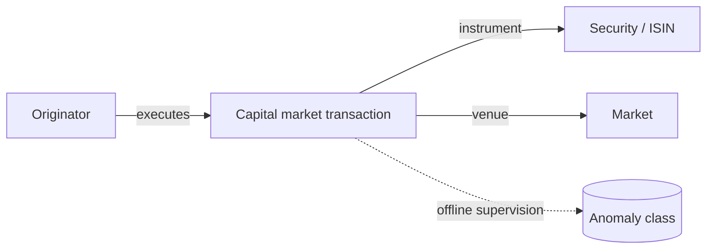

# 04 — Amaretto: independent source model

**Model status:** full structure documented by authors; **full data not present** here. The uploaded six-row CSV is an **illustration from the paper**, contains only 4 fields, and has **no anomaly labels**. Official project: https://github.com/necst/amaretto_dataset . Full repository describes an archive split into many parts; obtain original archive before empirical analysis.

## What is being modeled?
A time-series of **capital-market/securities transactions** by originators, with traded product/market descriptors and injected anomaly classes. This is **not** an account-to-account transfer dataset; imposing sender→receiver would fabricate nonexistent parties.

## Expected full raw row (12 source attributes)

| Original label in provided schema | Meaning / caution |
|---|---|
| `Transaction ID` | Full-data transaction identifier; the four-column paper example uses `Transaction_ID` instead |
| `Originator` | Source-originator label; inspect relationship with `Originator_ID` |
| `Originator_ID` | Originator identifier; verify uniqueness and consistency in full data |
| `EntryDate` | Trade date/time field; determine actual granularity on download |
| `Normalized Amount` | Source-normalized value; **not automatically USD** or raw consideration |
| `InputOutput` | Direction/inflow vs outflow indicator; validate value domain |
| `Market` | Securities market |
| `Product ISIN` | Instrument identifier; requires semantic validation, not inferred merchant counterpart |
| `Product Type` | e.g. subtype of traded instrument |
| `Product Class` | broader security class |
| `Currency` | Currency field, not proof that Normalized Amount is raw cash amount |
| `Anomaly` | Ground truth for normal vs five synthetic anomaly classes; mapping of numeric 1–5 to named categories requires validation |

## Independent entities

One originator may execute many trades; one product/instrument occurs in many trades; a trade has a `Market` and `InputOutput` attribute. **No receiver account/entity is available** in the documented source structure.

## Documented anomaly types (narrative, not asserted numeric codes)
1. Many small transactions in a short time window.
2. Repeated rounded amounts.
3. Trading security at unusual times.
4. Sudden unusually large withdrawal.
5. Large collateral transfers in/out in short time.

The repository reports ~29.7M transactions and ~0.27% anomalous. Its prose says **400 originators** while a summary table says **40**. Keep this disagreement visible until the archive can be examined directly. Likewise validate all class frequencies and numeric code mappings against full records.

## Sample plan
- After extracting **all** archive parts, generate one 10k uniform sample for schema/types.
- Select one or more **time-contiguous** 10k subsets and an enriched anomaly sample for rolling behavior analysis.
- If only the four-field paper example is available, document its four fields but do **not** perform anomaly-class evaluation or pretend to have the full row schema.

## Decision points for review
Do we eventually need a specialized `MarketTrade` event family? Likely, because unlike payment datasets it includes a traded security and market rather than a payer/recipient pair. Leave that architectural choice open until the source data is confirmed.
