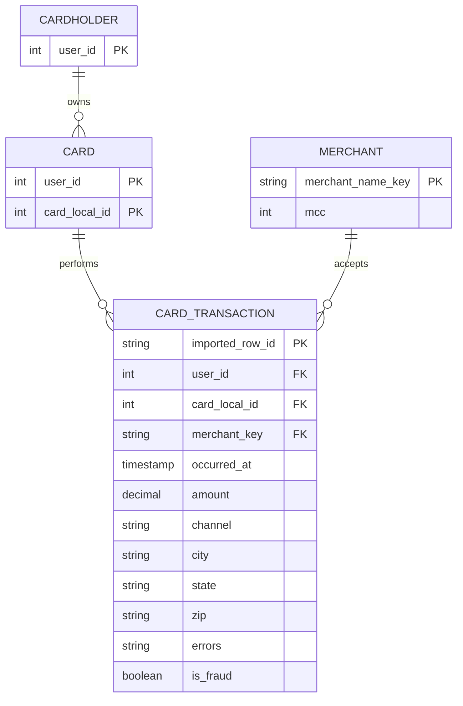

# 04 — IBM TabFormer: independent dataset model

## Identity and provenance
- **Official repository:** https://github.com/IBM/TabFormer
- **IBM data documentation:** https://github.com/IBM/TabFormer/blob/main/data/credit_card/README.md
- **Official archive:** `card_transaction.v1.tgz`, downloadable via Git LFS or IBM Box mirror linked from repo.
- **Type:** synthetic payment-card histories intended for modeling multivariate tabular sequences.
- **Volume:** about 24M rows (24,386,900 cited in independent benchmarks). The original IBM README describes 24M records and 12 fields **after the model's preprocessing**; raw CSV has **15 columns** because date/time occupies four fields.
- **Granularity:** one row per card transaction; historical `User` and `Card` repeated over many payments.

## Native raw flat columns
| Native field | Logical type | Meaning |
|---|---|---|
| `User` | categorical ID | cardholder/customer, repeating |
| `Card` | categorical ID | **card number within user**; treat `(User,Card)` as composite key |
| `Year`, `Month`, `Day`, `Time` | time components | combine into a transaction timestamp |
| `Amount` | currency string | often `$NN.NN`; parse to decimal, preserve source string |
| `Use Chip` | categorical | card usage / channel (swipe, chip, online, etc.) |
| `Merchant Name` | categorical | merchant identifier may be numeric-looking, not readable name |
| `Merchant City`, `Merchant State`, `Zip` | location fields | merchant location; may be blank for online transactions |
| `MCC` | categorical | merchant category code |
| `Errors?` | categorical/nullable | card transaction error information |
| `Is Fraud?` | Yes/No | offline fraud label, never scoring feature |

**Raw schema has no explicit transaction ID**: generate a stable import row ID. Do not assume `User` and `Card` can be separately joined on `Card` alone. **Do not interpret `Merchant Name` as a human-readable string** if data contain hashed integer-like names.

## Independent conceptual model (derived from raw data)

**Important:** only one raw CSV is supplied. These dimensions and relationships are **proposed analytic projections**; they are not actual separate supplied entity tables. Merchant location/MCC may vary by record, so keep them on transactions first and only construct a clean merchant dimension after checking functional dependencies.

## Preprocessed IBM model representation versus raw data
IBM's `dataset/card.py` converts Year/Month/Day/Time into `Timestamp`, encodes category columns, log-transforms and quantizes `Amount`, and produces 12 fields: `User, Card, Timestamp, Amount, Use Chip, Merchant Name, Merchant City, Merchant State, Zip, MCC, Errors?, Is Fraud?`. These **are modeling features, not the original raw amounts/timestamps**. For Z-Anti-Fraud, retain raw values and perform our own audited feature engineering.

## Candidate online features (proposed)
- Per-(User, Card) transaction counts and spend totals over 5 min / 1h / 1d / 30d.
- Amount deviation from historical cardholder median/quantiles.
- First-seen merchant and MCC, changes in transaction channel (chip → online).
- Merchant-risk history only from **labels with realistic confirmation delay**.
- Diversity of merchants and locations within a short window.
- Cross-customer linkage via identical merchant IDs for graph experiments, but no evidence of mule transfers or AML chains in this dataset.

## Sampling and evaluation design
- **Do not take first 10,000 lines:** may all belong to a tiny set of users/cards and may be heavily nonrepresentative.
- Build two samples: (a) consecutive time windows covering many users; (b) selected cardholders with complete histories and an enriched positive-case set. Clearly document artificial prevalence changes.
- Sort by parsed timestamp, stable tie breaker row ID. Validate uniqueness of `(User,Card)` pairs vs card ID, merchant key types, missing online-location fields and number of labels.
- Train/validate/test split by time for within-customer detection; optionally hold out users for out-of-identity generalization. Do not claim those evaluate the same property.
- **Label definition caution:** Fraud `Yes/No`, but fraud mechanism/subtype and exact confirmation times aren't documented. A sequence model might learn synthetic generation patterns.

## Limitations
- No login history, IP/device, KYC, balance, account-to-account transfers, chargebacks or confirmed fraud subtype.
- 0.1%-ish fraud prevalence means 10k random sample yields very few positive records; time/user-balanced sampling is necessary.
- Historical simulated multi-year timeline may differ from real contemporary product patterns.
- Raw data uses non-normalized fields; no reliable natural merchant names; payment-channel and error values need profiling.
- Original Python training dependencies (Python 3.7, older PyTorch/Transformers) are dated. We need **data**, not necessarily the original training stack.

## Proposed independent storage
Keep `tabformer_transactions_raw` (all 15 source fields + import row ID). For analysis only, derive `cardholders`, `cards`, and `merchants` with documented keys; separate `transaction_fraud_labels` from online scoring features.

## Decision
**Very high priority for evaluating historical behavioral features and cardholder/merchant graph edges.** Stronger behavioral-history benchmark than the Handbook, less controllable or interpretable than the Handbook.
