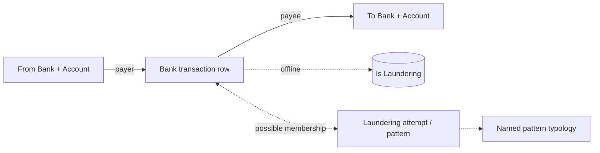

# 05 — IBM AML / AMLworld: independent source model

**Model status:** directed bank-account transaction graph + optional *laundering-attempt pattern* layer. **Inspected data:** 6 transaction rows from the user-provided sample (1 positive). Source: https://github.com/IBM/AML-Data and https://www.kaggle.com/datasets/ealtman2019/ibm-transactions-for-anti-money-laundering-aml . Data licensed **CDLA-Sharing-1.0** according to publisher; repository code separately carries Apache-2.0.

## What is being modeled?
Transactions between **bank-scoped accounts**. Two monetary values/currencies can appear on the **same** transfer, which allows currency conversion/cross-currency analysis without assuming equality. The optional `HI-Small_Patterns.txt` (in the published dataset family) contains named multi-transaction laundering-attempt streams and should be modeled as a **separate evidence structure**, not as a plain column on each transfer.

## Original transaction CSV: 11 positions

| Position | Original field | Model meaning |
|---:|---|---|
| 1 | `Timestamp` | Event local/unspecified time |
| 2 | `From Bank` | String bank code; retain leading zeros |
| 3 | **`Account`** | Origin account number |
| 4 | `To Bank` | String bank code; retain leading zeros |
| 5 | **`Account`** | Destination account number |
| 6 | `Amount Received` | Decimal amount credited to receiver |
| 7 | `Receiving Currency` | Receiver-side currency |
| 8 | `Amount Paid` | Decimal amount paid by sender |
| 9 | `Payment Currency` | Sender-side currency |
| 10 | `Payment Format` | Payment channel/format |
| 11 | `Is Laundering` | Ground-truth transaction label, offline only |

**Important:** The official original CSV has a *duplicate header named `Account`* at positions 3 and 5. The uploaded 6-row sample **already renamed** these to `From Account` / `To Account` for readability. For official data, parse positionally or explicitly rename by index after confirming all 11 columns. Do not use an automatic dictionary keyed by duplicated headers or assume the parser's silent rename is a source-defined name.

## Dataset-native entities and relations

- **BankAccount** technical business key: `(bank_code, account_code)` as *strings*; account code alone is not globally unique.
- **BankTransaction** key: `(source_file_version, row_ordinal)`; source has no explicit transaction UUID. Preserve original transaction values and textual numeric precision.
- **LaunderingAttempt**: a distinct sequence/group in pattern text; a named subtype and zero or more transaction occurrences, possibly overlapping. A row's `Is Laundering=1` does **not necessarily** imply presence in a named pattern.
- **PatternMembership**: links attempt and transaction when matching evidence is reliable; **don't fabricate membership from `Is Laundering` alone**. If matching uses a composite transaction value key, test precision and collisions, especially decimals with 6 places (e.g. crypto).

## Sample plan
For practical size, download the **HI-Small** variant rather than the huge medium/large files. Generate (a) 10k uniform rows for basic profile, (b) 10k fraud-enriched rows, and (c) a **pattern-preserving** subset retaining all transactions belonging to chosen laundering attempts plus surrounding graph context; this last subset needs dedicated extraction from `_Patterns.txt` and original transactions.

## Cautions
Plain transaction-row labels are not sufficient to evaluate **pattern-level** alerting. Directed graph cycles/fan-out require enough temporal and connected edges. The `Reinvestment` channel includes self-transfers in the sample, which are not automatically errors and should not be dropped without study.

## Decision points for review
Should laundering attempts be a first-class entity? For this source, yes as an independent **annotation layer**, with clear distinction between observed row facts and pattern annotation evidence; we should not force this onto other datasets lacking pattern IDs.
