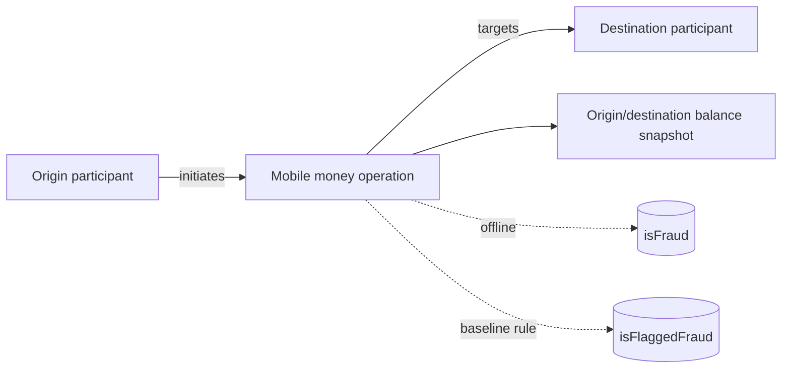

# 06 — PaySim: independent source model

**Model status:** source-preserving mobile-money payment events + balance snapshots. **Inspected data:** 10 rows in uploaded example, with 2 fraud positives and 8 normal; selected examples are not representative. Official source: https://www.kaggle.com/datasets/ealaxi/paysim1 ; 6,362,620 transaction rows reported in the public dataset description.

## What is being modeled?
Mobile-money transactions initiated by a source participant and directed to a destination participant, with simulated **balance state before and after**. The simulation has five operation types: `CASH-IN`, `CASH-OUT`, `DEBIT`, `PAYMENT`, `TRANSFER`. The dataset includes fraud ground truth and a separate built-in rule flag.

## Raw source fields

| Original field | Type | Model meaning |
|---|---|---|
| `step` | integer | Simulation hour, **not an epoch timestamp**; no actual calendar date |
| `type` | enum text | Operation type |
| `amount` | decimal | Transfer/payment amount in unspecified local currency |
| `nameOrig` | string | Origin participant key |
| `oldbalanceOrg` | decimal | Recorded origin balance before transaction |
| `newbalanceOrig` | decimal | Recorded origin balance after transaction |
| `nameDest` | string | Destination participant key |
| `oldbalanceDest` | decimal | Recorded destination balance before transaction |
| `newbalanceDest` | decimal | Recorded destination balance after transaction |
| `isFraud` | binary label | Target label; never reveal to inference |
| `isFlaggedFraud` | binary | Simulator's pre-existing simplistic fraud-rule flag; **not the fraud ground truth** |

## Dataset-native entities

There is **no original transaction ID**; identify a record technically by `(source_version, ordinal)`. `C` vs `M` identifier prefixes may distinguish simulator participant categories, but don't assume that every `nameDest` is a bank account or even another customer. A deposit/payment can have special accounting mechanics; always inspect per-`type` behavior.

## Data leakage and realism
Balance fields include **post-transaction state**. The simulator's cancellation and balance semantics can leak target information; the publisher cautions against using balance fields naively for fraud prediction. For a **pre-decision** model, exclude `newbalanceOrg` and `newbalanceDest`, and separately justify whether `oldbalance*` is actually accessible at decision time. For a clean initial benchmark, exclude **all four** balance columns from live inference, but retain them in the **source model** and analysis tables. Preserve `isFlaggedFraud` only as an offline comparator.

## Sampling and research uses
- Random 10k rows for type proportions, amount ranges and participant formats; in the full dataset, fraud is rare, so this does not guarantee substantial positives.
- 10k label-enriched rows with up to 400 fraud rows for explanatory pattern exploration.
- File-order segment for event replay (verify `step` monotonicity; hour groups contain many transactions). Distinct source accounts and sequences may not be preserved in random sample.
- Good small demo for `TRANSFER` → `CASH_OUT`, simple rules, and contrast between a naive source rule and a learned scorer. **Two matching small-sample examples do not establish causal links or a complete fraudulent scheme.**

## Decision points for review
Should balance snapshots be a distinct dataset-native child structure or remain columns on the transaction? The latter exactly matches source rows; a snapshot child view may help analyze pre/post behavior **without exposing it to pre-decision scoring**.
