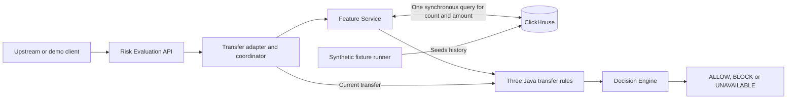
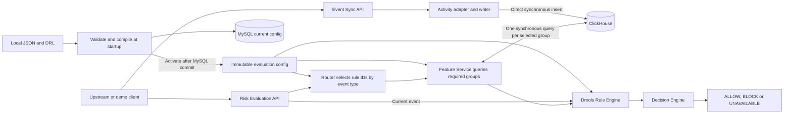

# Z-Anti-Fraud Research Progress

12 November 2026

The **Demo 1 V1 MVP is built**. A local Docker run verified the ClickHouse history totals and HTTP risk recommendations for all 22 synthetic transfer cases. The remaining Demo 1 research work is to measure the baseline under a controlled workload. **Demo 2 is underway at the design stage.** The V2.0 design specifies a configurable synchronous evaluation path and a separate event sync API. The repository still runs the V1 evaluation path. [Research proposal and milestones](Anti_Fraud_Research_Proposal.md#61-phases-and-dependencies) · [V1 test procedure](../../scripts/README.md) · [V2.0 design](../design/Z_Anti_Fraud_End_to_End_Design_V2.md)

## Demo 1 and Demo 2 architecture

### Demo 1 · V1 MVP implemented

The fixture runner seeds ClickHouse externally because the V1 event persistence method is a placeholder. The API evaluates the current transfer and returns an advisory recommendation. The upstream service owns transaction execution. [V1 API and implementation](../risk-api-v1.md#current-implementation)

### Demo 2 · V2.0 design

V2.0 keeps the evaluation request and response contract. The separate sync call writes activity rows to ClickHouse, while evaluation reads history and receives the current event directly. Upstream syncs every submission, including blocked attempts. The initial transfer configuration ports the existing three rules and two history features. Configured groups and rule dependencies allow later additions. [V2.0 flows and seed configuration](../design/Z_Anti_Fraud_End_to_End_Design_V2.md)

## RQ1 · Real-Time Detection

*How can an anti-fraud system provide effective fraud detection while maintaining low latency for synchronous transaction processing?*

**V1 baseline.** The evaluation request waits for a live ClickHouse query. One SQL statement calculates the sender’s distinct outgoing operation count and outgoing amount over the previous 24 hours. Java rules check the two rolling limits and a single-transfer amount limit. The single-transfer rule can still produce `BLOCK` if history is unavailable. The saved Docker run (`docker-v1-e8d5550de927`) passed 22 of 22 history checks and 22 of 22 API cases, covering rule boundaries, history-window boundaries, duplicate deliveries and account scoping. The cases establish expected policy behaviour on synthetic inputs. [V1 history and rules](../risk-api-v1.md#transfer-history-features) · [Synthetic cases](../../scripts/README.md)

**V2.0 plan and evidence still needed.** Evaluation remains synchronous. The coordinator fetches only features required by the selected rules, and each query group can return several aggregates in one statement. Compare V1 and V2.0 first with the same three rules, two features, input history, request mix and environment. Measure P50, P95 and P99 end-to-end latency, throughput and timeouts, and verify decision agreement. Then measure the cost of adding rules, features and query groups. The proposal’s live-query versus cached or precomputed comparison needs a separate implementation and experiment. Detection effectiveness needs a labelled evaluation dataset. [Proposal evaluation plan](Anti_Fraud_Research_Proposal.md#43-analysis-and-evaluation) · [V2.0 query design](../design/Z_Anti_Fraud_End_to_End_Design_V2.md#7-feature-service-query-behavior)

## RQ2 · Adaptability

*How can the system rapidly adapt to changing fraud patterns and detection requirements without tightly coupling fraud logic to core business services?*

**V1 baseline.** Anti-fraud runs behind its own HTTP API. The business service supplies the event and applies the recommendation. Transfer feature definitions, SQL and rule logic live in anti-fraud Java code, so changing them requires a code release. The three threshold values already come from startup properties and can be changed with a restart. [V1 API](../risk-api-v1.md) · [V1 application settings](../../src/main/resources/application.properties)

**V2.0 plan.** Local JSON defines routes, feature queries and rule parameters. Drools files define rule logic. At startup the service validates these together, seeds MySQL, and uses one immutable configuration for evaluation. Changes within the supported config and DRL contracts can be made without rebuilding the Java application. V2.0 activates them on restart. The later hot-swap goal is to validate and activate a new configuration while the service is running, with in-flight evaluations keeping their original snapshot. Measure time to activate a representative change and any interruption. Measure propagation delay across instances when runtime updates are available. [V2.0 startup design](../design/Z_Anti_Fraud_End_to_End_Design_V2.md#5-startup-and-mysql-configuration-storage) · [Proposal evaluation plan](Anti_Fraud_Research_Proposal.md#43-analysis-and-evaluation)

## RQ3 · Continuous Evolution

*How can asynchronous analysis and feedback mechanisms enable the anti-fraud system to continuously improve its detection capabilities?*

**Status.** Outcome collection, asynchronous analysis and the feedback loop remain future research work. V2.0’s configurable rules and features make it easier to apply a manually reviewed change after feedback becomes available. A later hot-swap mechanism could shorten the time to apply that change. The direct event sync API supplies transaction history for evaluation.

**Research experiment.** Run the proposal’s minimum V3 feedback experiment using outcomes made available at defined times. Use the feedback to refine a rule or feature, then compare precision, recall, F1 and false-positive rate before and after the change on separate evaluation data. [Proposal evaluation plan and V3 scope](Anti_Fraud_Research_Proposal.md#43-analysis-and-evaluation) · [Expected deliverables](Anti_Fraud_Research_Proposal.md#53-scope-and-expected-deliverables)

## RQ4 · Multi-Strategy Detection

*How can rules, machine-learning models, and graph-based analysis be coordinated to detect different types of fraudulent behaviour?*

**Status.** Multi-strategy detection has yet to start. V1 provides a rules-only baseline. V2.0 still uses rules only, with Drools producing rule outcomes and a separate Decision Engine applying the policy. The proposal places initial ML training and inference in the broader V2 work package. That work sits beyond the current V2.0 design.

**Research experiment.** Compare rules alone with rules plus one baseline ML detector using the same labelled evaluation data. Report precision, recall, F1 and false-positive rate. Combined rules and ML is part of the proposal’s minimum V3 scope. Graph-based detection is an optional extension. [Proposal work packages](Anti_Fraud_Research_Proposal.md#541-work-breakdown-structure-wbs) · [V2.0 decision behaviour](../design/Z_Anti_Fraud_End_to_End_Design_V2.md#8-rule-and-decision-behavior)

## Milestone status

| Milestone | Proposal target | Status |
| --- | --- | --- |
| Demo 1 and V1 experimental findings | 26 November 2026 | MVP built and synthetic functional checks passed. Controlled latency, throughput and detection measurements remain to be collected. |
| V2 design and working prototype | 10 December 2026 and 25 January 2027 | V2.0 design documented. The configurable evaluation and sync paths are specified for implementation. |
| Demo 2 and V2 comparative findings | 11 February 2027 | Design work started. The demonstration and controlled comparison with V1 follow implementation. |

The proposal defines the milestones and the planned comparisons. [Proposal timeline](Anti_Fraud_Research_Proposal.md#61-phases-and-dependencies)
