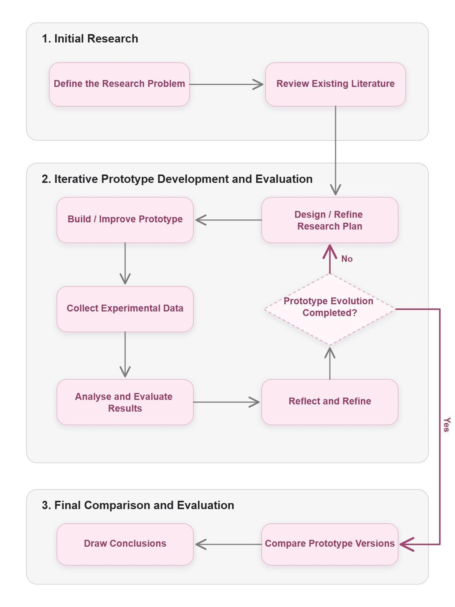
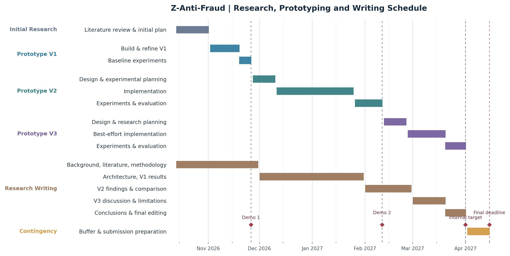

# Research Methodology and Project Plan

## 1. Student Name / Number

- **Student name:** Zhiyuan Sun
- **Student number:** A00336117

## 2. Project Title

**Design and Evaluation of a Modular, Event-Driven Anti-Fraud Architecture for Fintech Transaction Data**

## 3. Clearly Articulated Research Question

### 3.1 Main Research Question

How can a dedicated anti-fraud architecture support effective and efficient fraud detection in modern fintech transaction systems?

### 3.2 Sub-Research Questions

- **RQ1 — Real-Time Detection:** How can an anti-fraud system provide effective fraud detection while maintaining low latency for synchronous transaction processing?
- **RQ2 — Adaptability:** How can the system rapidly adapt to changing fraud patterns and detection requirements without tightly coupling fraud logic to core business services?
- **RQ3 — Continuous Evolution:** How can asynchronous analysis and feedback mechanisms enable the anti-fraud system to continuously improve its detection capabilities?
- **RQ4 — Multi-Strategy Detection:** How can rules, machine-learning models, and graph-based analysis be coordinated to detect different types of fraudulent behaviour?

### 3.3 Research Objectives and Scope

The research aims to design, implement, and evaluate a modular anti-fraud prototype, focusing on low-latency detection, adaptability, asynchronous feedback, and multi-strategy detection. The study will investigate architectural trade-offs through controlled experiments using public datasets and synthetic scenarios. The proposed solution, detailed scope, and expected deliverables are described in Sections 5.2 and 5.3.

## 4. Description and Justification of Chosen Research Methodology

### 4.1 Selected Methodology and Justification

The study will primarily use Experimental Research, supported by quantitative data analysis, a literature review, and iterative software prototyping. Experimental research compares selected variables under controlled conditions to examine how they affect measurable outcomes.

This methodology is appropriate because it allows different architectural approaches to be evaluated through controlled experiments and measurable results, rather than relying solely on theoretical analysis or implementation. For example, the use of precomputed features can be varied while measuring fraud-check latency. Repeated tests with controlled workloads will help identify performance and detection trade-offs (Kohavi et al., 2009).

### 4.2 Research Process and Data Collection

#### 4.2.1 Research Process

The research will follow an iterative experimental process involving three successive prototype versions, with initial research followed by repeated design, implementation, and evaluation cycles. The overall research process is illustrated below:

*Figure 1. Research process, including the iterative feedback loop and final evaluation.*

#### 1. Initial Research

- **Define the research problem:** Establish the research questions, objectives, and scope.
- **Review existing literature:** Examine academic research and documented industrial anti-fraud architectures to identify gaps and feasible design alternatives.

#### 2. Iterative Prototype Development and Evaluation

The following steps will be repeated for each prototype version:

- **Design or refine the research plan:** Define hypotheses, comparison baselines, evaluation metrics, datasets, and experimental controls, incorporating previous findings.
- **Build or improve the prototype:** Implement or refine architectural components and fraud-detection capabilities.
- **Collect experimental data:** Conduct repeatable experiments using labelled fraud datasets, synthetic events, and system performance measurements.
- **Analyse and evaluate results:** Compare outcomes against established baselines and research objectives.
- **Reflect and refine:** Identify limitations and improvements to guide the next iteration.

#### 3. Final Comparison and Evaluation

Compare results across the three prototype versions, evaluate architectural trade-offs, and draw conclusions addressing the research questions. Where feasible, comparisons will use consistent datasets, workloads, and test conditions.

#### 4.2.2 Candidate Datasets and Intended Use

The study will initially consider the following public datasets. Their suitability and final selection will be assessed during the initial research phase.

| Dataset | Most suitable research | Potential limitations |
| --- | --- | --- |
| Sparkov | RQ1: historical features and replay; RQ3: delayed-feedback simulation; RQ4: rules and ML. | Synthetic card-payment data; fraud labels have no observed feedback-availability times. |
| PaySim | RQ1: transaction replay; RQ3: time-ordered feedback simulation; RQ4: detection baselines. | Synthetic mobile-money transactions; limited login/device context and discrete time steps. |
| IEEE-CIS | RQ4: supervised detection and contextual feature comparison. | Anonymised features and incomplete identity information may limit linked event histories. |
| IBM AML (optional) | RQ4: graph-derived signals and money-laundering patterns. | Synthetic AML-focused transfers may not generalise to other payment fraud types. |

RQ2 will be tested through controlled rule and configuration updates rather than a particular dataset. During initial research, the study will assess field availability, event ordering, fraud labels, and the feasibility of simulating delayed feedback; synthetic context events may be used for controlled architectural experiments, with their limitations documented.

### 4.3 Analysis and Evaluation

The experimental plan will compare configurations using the same workload and test environment wherever possible, with repeated runs and documented settings.

| Research area | Illustrative comparison | Evidence / measures |
| --- | --- | --- |
| RQ1 | Live feature queries vs cached/precomputed features | P50/P95/P99 latency; throughput |
| RQ2 | Static or deployment-based rule/feature changes vs dynamic configuration updates | Time to activate changes; update propagation delay; risk-evaluation interruption |
| RQ3 | Detection before and after a feedback/update cycle | Precision, recall, F1-score, and false-positive rate (FPR) on separate evaluation data |
| RQ4 | Rules alone vs rules combined with ML or graph-derived signals | Precision, recall, F1-score, and false-positive rate (FPR) |

Independent variables will be the architectural or detection configurations; dependent variables will be performance and detection measurements. Because fraud labels are often highly imbalanced, RQ3 and RQ4 will use precision, recall, F1-score, and FPR together, rather than relying on accuracy alone. Results will be tabulated and visualised, and unexpected findings will be discussed rather than excluded.

### 4.4 Limitations and Ethical Considerations

Public or synthetic datasets may not represent the complexity of real financial fraud, and limited computing resources may constrain scale. Model comparisons must avoid training/test leakage, and observed performance may not generalise to production environments. To minimise privacy risks, experiments will use public data subject to its usage conditions and synthetic or appropriately anonymised context records; no real customer credentials or sensitive wallet details are required. Assumptions, researcher choices, and limitations will be documented transparently.

## 5. Project Proposal

### 5.1 Background and Problem Statement

Fraud detection can draw on transaction history, login activity, and account or wallet state. When fraud logic is scattered across business services, updates can become harder to manage; synchronous checks can also introduce latency (Diao and Geracioti, 2017; Li et al., 2019). This project therefore investigates a dedicated, modular anti-fraud architecture that processes contextual events through well-defined interfaces, without requiring an operational financial platform for its evaluation.

### 5.2 Proposed Solution and Objectives

The project proposes Z-Anti-Fraud, an independent prototype that processes transaction and contextual events replayed from public datasets and synthetic scenarios. It will expose a synchronous risk API and support asynchronous event ingestion. A risk orchestrator will coordinate a feature service, configurable rules, and selected model/graph analysis (e.g., Fathony et al., 2023). A decision component will aggregate detection outputs into an overall fraud-risk assessment. An asynchronous pipeline will support outcome feedback and evaluation.

The aim is not to reproduce a commercial fraud platform but to investigate and measure key architectural trade-offs identified in RQ1–RQ4. Modular interfaces and event-based data ingestion support a non-invasive design without requiring integration with an operational financial platform.

### 5.3 Scope and Expected Deliverables

| Category | Description |
| --- | --- |
| Core scope | Synchronous risk API, asynchronous event ingestion from dataset replay and synthetic events, feature aggregation, configurable rules, at least one baseline ML detector, and automated experiments. |
| Minimum V3 scope | Asynchronous feedback evaluation and combined rules + ML detection experiments. |
| Optional features | Graph-based detection, advanced unsupervised anomaly detection, automated model adaptation, rule backtesting, shadow mode, and a basic monitoring interface. |
| Out of scope | Live Z-Exchange or other financial-system integration, production payment processing, full AML compliance, extensive fraud-analyst tooling, and deployment to a real financial institution. |
| Deliverables | Working prototype and source code, architecture documentation, reproducible experimental setup, evaluation findings, and final research report. |

### 5.4 Work Breakdown, Resources, and Risks

#### 5.4.1 Work Breakdown Structure (WBS)

The project will be organised into five work packages, including three iterative prototype versions. Each iteration includes research planning, implementation, experimentation, and evaluation. V1 and V2 target fixed demonstration milestones; V3 is best-effort for optional features, while retaining minimum experiments needed to address RQ3 and RQ4. The feature allocation may be refined as the research progresses.

| Work package | Main activities | Expected deliverable |
| --- | --- | --- |
| WP1 — Research and Design | Literature review, dataset investigation, architecture design, and experimental planning | Research plan and architecture design |
| WP2 — Prototype V1 | Implement event replay, core risk orchestration, feature retrieval, and basic rule-based detection; conduct baseline experiments | Baseline prototype and initial results |
| WP3 — Prototype V2 | Develop low-latency features and precomputed aggregations, configurable rules/features, and initial ML model training and inference; evaluate performance and adaptability | Enhanced prototype and comparative results |
| WP4 — Prototype V3 | Minimum: evaluate combined rules + ML detection and a basic asynchronous feedback cycle. Best-effort extensions: graph analysis, advanced anomaly detection, and automated adaptation; conduct V3 experiments and evaluation | Minimum RQ3/RQ4 experimental findings; extended prototype where feasible |
| WP5 — Final Evaluation and Documentation | Compare the three prototype versions, analyse architectural trade-offs, and complete the final report | Final evaluation and research report |

#### 5.4.2 Resources

The project is planned for approximately 10–14 hours of work per week and will use the following resources:

- **Development environment:** Java/Spring Boot, Python, and supporting libraries will be used to implement the anti-fraud prototype and ML experiments.
- **Data and storage infrastructure:** Databases, caching, and event-streaming technologies will support storage and processing of fraud-related data and events.
- **Fraud datasets:** Public labelled datasets and synthetic events will support development and evaluation.
- **Testing and monitoring tools:** Load-testing tools, application metrics, and statistical analysis will support data collection and result evaluation.
- **Computing resources:** Local infrastructure will be used for development and controlled experiments, with cloud resources if necessary.

#### 5.4.3 Risk Assessment and Mitigation

| Key risk | Impact | Mitigation |
| --- | --- | --- |
| Insufficient or unsuitable fraud datasets | High | Evaluate datasets early and supplement them with clearly documented synthetic events where needed |
| Implementation complexity and scope expansion | High | Prioritise core components and introduce advanced detection capabilities incrementally |
| Limited development time | High | Set clear iteration milestones and reserve contingency time |
| Limited machine-learning expertise | Medium | Start with established algorithms and libraries before considering advanced models |
| Infrastructure or performance limitations | Medium | Use reproducible deployment configurations and scale experiments to available resources |

Experimental consistency will be addressed through the controlled testing procedures described in Section 4, rather than treated as a separate project risk.

## 6. Project Timeline (Gantt Chart)

### 6.1 Phases and Dependencies

The project runs from 13 October 2026 to 15 April 2027. The internal completion target is 1 April 2027, with 2–15 April reserved as a contingency buffer for corrections and unexpected delays, rather than new feature development.

The research problem has already been defined. The literature review and initial experimental plan for V1 (with preliminary V2 planning) are scheduled for completion by 1 November 2026. Each prototype then follows an iterative cycle of design, implementation, data collection, analysis, and refinement. Research writing proceeds in parallel with implementation and evaluation.

| Workstream | Phase | Target date | Deliverable |
| --- | --- | --- | --- |
| Initial research | Literature review and initial V1 / preliminary V2 research plan | 1 Nov 2026 | Research basis, hypotheses, baseline and evaluation plan |
| Prototype V1 | Implementation and baseline experiments | 26 Nov 2026 | Demo 1 and V1 experimental findings |
| Prototype V2 | Detailed design and experimental plan | 10 Dec 2026 | V2 design and planned comparisons |
| Prototype V2 | Implementation | 25 Jan 2027 | Working V2 prototype |
| Prototype V2 | Experiments, analysis and refinement | 11 Feb 2027 | Demo 2 and V2 comparative findings |
| Prototype V3 | Detailed design and experimental plan | 25 Feb 2027 | Prioritised V3 plan with protected minimum experiments |
| Prototype V3 | Best-effort implementation | 20 Mar 2027 | Minimum RQ3/RQ4 capabilities; optional features where feasible |
| Final evaluation | V3 experiments, cross-version comparison and conclusions | 1 Apr 2027 | Completed research results |
| Research writing | Dissertation draft, final editing and completion | 1 Apr 2027 | Completed research report |
| Contingency | Corrections, retesting and submission preparation | 15 Apr 2027 | Final submission |

**Dependencies:** V1 establishes a reproducible baseline for subsequent comparison; V2 extends that baseline; V3 builds on working rules and ML capabilities from V2. V3 advanced features will be de-scoped if needed to protect the minimum feedback and combined-detection experiments. Equivalent datasets, workloads, and evaluation metrics will be used where feasible across the iterations.

### 6.2 Gantt Chart

*Figure 2. Project Gantt chart showing prototype, research writing, milestones and contingency.*

### 6.3 Milestones and Contingency

Project progress will be reviewed against the milestones and Gantt chart presented in Sections 6.1 and 6.2. The internal completion target is 1 April 2027, with 2–15 April reserved for contingency and final submission preparation. Optional V3 features may be reduced if necessary to protect the core experiments and research report.

## 7. References

1. Kohavi, R., Longbotham, R., Sommerfield, D. and Henne, R.M. (2009). 'Controlled experiments on the web: Survey and practical guide.' Data Mining and Knowledge Discovery, 18, pp. 140–181. <https://doi.org/10.1007/s10618-008-0114-1>
2. Diao, Y. and Geracioti, I. (2017). 'Mastermind: Using Uber Engineering to Combat Fraud in Real Time.' Uber Engineering. <https://www.uber.com/us/en/blog/mastermind/>
3. Li, M., Allan, G. and Kansal, V. (2019). 'Griffin, an Anti-fraud Risk Rule Engine Making Billions of Predictions Daily.' Grab Engineering. <https://engineering.grab.com/griffin>
4. Fathony, R., Ng, J. and Chen, J. (2023). 'Interaction-Focused Anomaly Detection on Bipartite Node-and-Edge-Attributed Graphs.' 2023 International Joint Conference on Neural Networks (IJCNN), pp. 1–10. <https://doi.org/10.1109/IJCNN54540.2023.10191331>
5. IEEE Computational Intelligence Society (2019). IEEE-CIS Fraud Detection, Kaggle dataset. <https://www.kaggle.com/competitions/ieee-fraud-detection/data>
