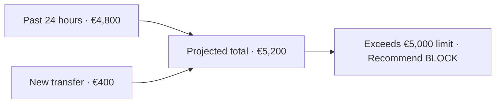
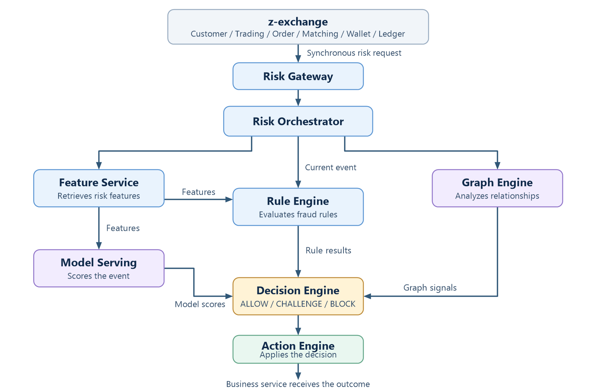
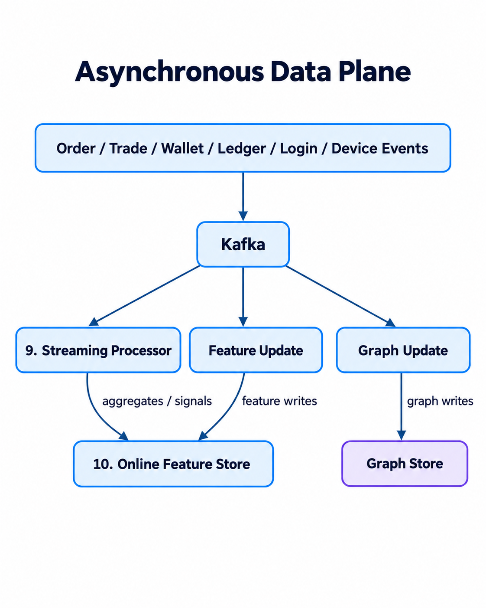
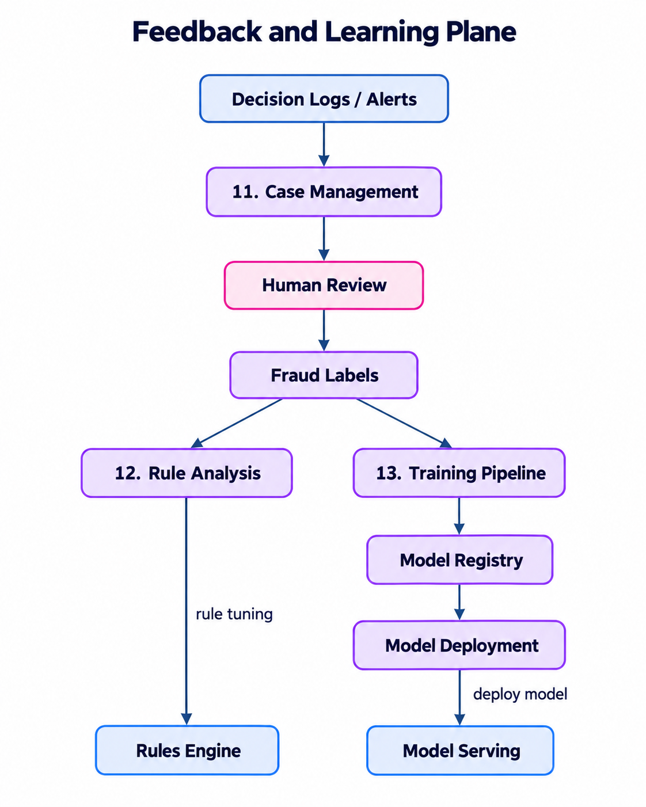
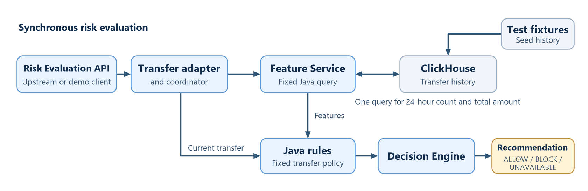
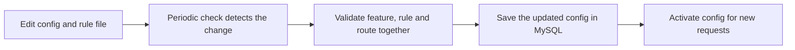

# Z-Anti-Fraud

**Design and Evaluation of a Modular, Event-Driven Anti-Fraud Architecture for Fintech Transaction Data**

Zhiyuan Sun · MSc research project · 13 November 2026

## 2. Why check the history before a transfer?

An account has submitted **€4,800** in outgoing transfers over the past 24 hours. A new **€400** transfer is below the **€1,000** single-transfer limit. Adding it brings the projected 24-hour total to **€5,200**, above the **€5,000** limit.

**Z-Anti-Fraud recommends `BLOCK`** because the projected 24-hour total exceeds the limit. The transfer service makes the final execution decision.



## 3. How the three flows work together


## 4. Target architecture · Synchronous risk decision

Z-Anti-Fraud gives z-exchange an immediate risk recommendation. The Rule Engine uses both the **current event** and **features** from the Feature Service. The full design also shows where model scores and graph signals could inform decisions.



## 5. Target architecture · Asynchronous data processing

Business events can update features and relationships in the background. Demo 2 starts exploring asynchronous ingestion in V2.x.



## 6. Target architecture · Feedback and learning

Investigators review flagged cases. Their labels help assess rules and train models. Demo 3 explores this feedback loop.



## 7. What will we build and evaluate?

**How can a dedicated anti-fraud architecture support effective and efficient fraud detection in modern fintech transaction systems?**

- **RQ1 — Real-Time Detection:** How can an anti-fraud system provide effective fraud detection while maintaining low latency for synchronous transaction processing?
- **RQ2 — Adaptability:** How can the system rapidly adapt to changing fraud patterns and detection requirements without tightly coupling fraud logic to core business services?
- **RQ3 — Continuous Evolution:** How can asynchronous analysis and feedback mechanisms enable the anti-fraud system to continuously improve its detection capabilities?
- **RQ4 — Multi-Strategy Detection:** How can rules, machine-learning models, and graph-based analysis be coordinated to detect different types of fraudulent behaviour?

## 8. Three demos, three research steps

| Demo | What it demonstrates | Status |
| --- | --- | --- |
| **1 · Establish a baseline** | Evaluate transfers using live history and rules defined in Java. | V1 MVP built. Synthetic correctness checks passed. |
| **2 · V2.0 · Make detection easier to change** | Configure event routing and update rules and features while the service is running. | Design underway. |
| **2 · V2.x · Extend the prototype** | Add asynchronous event ingestion and integrate a simple ML model. | Planned. |
| **3 · Learn from outcomes** | Run a feedback experiment and compare rules alone with rules plus ML. Graph analysis is optional. | Planned. |

## 9. Demo 1 · What V1 does today



- Java code defines **which features to fetch** and **how to query ClickHouse** for them. A feature is a measurement such as the total sent in the past 24 hours.
- Java code applies the **rules** to the current transfer and those features and returns rule results.

## 10. Demo 2 · What V2.0 adds


| Configuration | What it controls |
| --- | --- |
| **Rules** | Add or change rule logic and thresholds while the service is running. |
| **Features** | Add or change what ClickHouse measures, such as the time window or aggregation, while the service is running. |
| **Routing** | Map each event type to the rules that should run for it. |

## 11. Demo 2 · How config drives an evaluation


**Hot-swapping** means activating a validated change without rebuilding or restarting the Java service. Requests already running finish with the config they started with.

## 12. Example · Adding a ten-minute burst rule in V1

Eight €400 transfers were submitted in ten minutes. A ninth arrives. We want to flag this pattern with a new ten-minute count and a rule that uses it.

```java
// Illustrative addition to the V1 Java code
long recentCount = history.countOutgoing(sender, eventTime.minusMinutes(10), eventTime);
if (recentCount + 1 >= 9) {
    matches.add("transfer-burst");
}
```

**V1 workflow** · Add the ClickHouse query and Java rule → merge into the release branch → build a new version or hotfix → deploy.

## 13. Example · Adding the same rule in V2.0

```yaml
feature:
  id: transfer-out-10m.count
  window: 10 minutes
  filter: outgoing transfers
  operation: count distinct transactions
rule:
  id: transfer-burst
  uses: transfer-out-10m.count
  match: history count + 1 >= 9
route:
  TRANSFER: [transfer-burst]  # Append to the existing transfer rules
```

Edit the feature and route config and add the Drools rule file. The snippet shows the three changes in a simplified form.

## 14. Example · How V2.0 activates the change



**V2.0 makes features and rules more flexible and faster to update.** The running service picks up a policy change without a Java code change, a new application release or a deployment.

## 15. What will show whether V2.0 is better?

| Test | Evidence to collect |
| --- | --- |
| **Same rules, same inputs** | Decision agreement, median and tail latency (P50/P95/P99), and throughput on the same workload. |
| **Add the ten-minute policy** | Time from edit to activation, including the polling delay in V2.0, and any interruption to evaluations. |
| **Evaluate on labelled data** | How many fraudulent transfers the policy detects and how often it flags legitimate ones. The synthetic demo cases establish expected rule behaviour. |

## 16. Discussion with supervisors

- Is the ten-minute burst policy a clear first experiment for adaptability?
- Which dataset and workload should we use to compare latency and detection while keeping the experiment reproducible?

### Source material

- [Target architecture](../z-anti-fraud-architecture.md)
- [Research proposal and questions](Anti_Fraud_Research_Proposal.md#3-clearly-articulated-research-question)
- [Research progress and V1 test evidence](Anti_Fraud_Research_Progress.md)
- [V1 API and transfer rules](../risk-api-v1.md#transfer-rules)
- The earlier technical draft describes restart-based activation. These slides reflect the revised plan for periodic config checks and hot-swapping. [V2.0 end-to-end design](../design/Z_Anti_Fraud_End_to_End_Design_V2.md)
