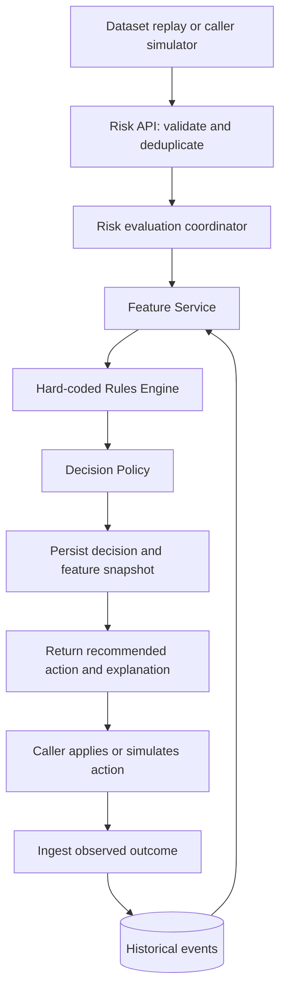

# Z-Anti-Fraud design evaluation and V1 recommendations

Review date: 6 November 2026; updated 7 November 2026 for the advisory boundary and consistency-throughput discussion. This is a design review and recommendation, not a measured performance result or an implementation specification.

## 1. Assessment

**Proceed with the proposed synchronous V1: current-event features plus historical queries, hard-coded rules, and a separate decision policy.** Implement these as modules in one Spring Boot application. Anti-Fraud provides advice using available evidence; Z-Exchange owns execution, Quota Service enforces mandatory quotas, and Wallet/Ledger protects balances and financial records. Delayed history and overlapping concurrent evaluations are accepted detection limitations, subject to measurement and explicit fallback policies.

ClickHouse is a reasonable historical feature-store candidate under this advisory contract. MongoDB remains an option when simplifying operational decision storage and retries matters more. Choose through representative queries and deployment complexity, rather than requiring the anti-fraud history store to enforce business quotas. V1 does not require Kafka, dependency checkpoints, or per-user decision serialization.

The three-plane architecture is a sound long-term direction. Its strongest ideas are central ownership of risk logic, separation of synchronous decisions from expensive processing, and a feedback path. The dataset research is also unusually careful about source semantics, labels, and missing identifiers. The main gaps are precise event lifecycle semantics, point-in-time feature availability, history-update behavior, and a controlled experimental design.

The general envelope should be shared, while event payloads remain typed by business domain and lifecycle stage. A shared envelope does not imply that every dataset has a user, device, sender, recipient, or real timestamp.

### Review scope and evidence

Inspected the six top-level Markdown documents, the three architecture PNGs, both proposal/methodology DOCX files and both PDF versions, all ten dataset descriptions, all ten reference models, sample provenance, the eight CSV samples, and the Amaretto schema text. Proposal text and embedded figures were inspected for design content; this was not a typography or layout audit. The application currently contains a Spring Boot bootstrap and basic dependencies, so these recommendations concern the proposed design rather than existing risk-engine behavior.

Primary local sources:

- [Architecture overview](z-anti-fraud-architecture.md) and its three diagrams.
- [Methodology and project plan](research_methodology_project_plan_diagram_updated.md), plus [proposal PDF](anti_fraud_diagrams/Anti_Fraud_Research_Proposal.pdf).
- [Research questions](anti_fraud_research_questions_summary.md) and [industry research](anti_fraud_industry_solutions_research_questions.md).
- [Fraud taxonomy](fraud_family_subtype_dataset_list.md).
- [Dataset research index](Z_Anti_Fraud_Dataset_Descriptions_10/README.md) and [sample provenance](Z_Anti_Fraud_Dataset_Descriptions_10/samples/PROVENANCE.md).
- [Quota and anti-fraud responsibility boundary](design/z-exchange-quota-antifraud-boundary.md).
- [Asynchronous ingestion and decision-freshness proposal](design/Z_Anti_Fraud_V1_Consistency_Plan.md), reviewed as a **future design outside V1**, despite its current filename and V1 wording.

The full dataset releases are not present. Findings below distinguish observations from the supplied samples, source-document statements, and proposed design choices. Selected external primary documentation was checked for event-envelope conventions, storage behavior, and dataset semantics; this is not a verification of every industry claim in the existing research.

## 2. Highest-priority improvements

| Priority | Finding | Recommended change |
|---|---|---|
| Before V1 implementation | The synchronous diagram routes feature, rule, and graph results through Model Serving. It does not show historical features feeding rules. | Draw `Feature Service -> Rules Engine -> Decision Engine`. Later, model and graph outputs can feed decision policy directly or feed explicitly score-dependent rules. ML must be optional. |
| Before V1 implementation | The event proposal does not distinguish an attempted operation from an executed operation. | Define request, outcome, and feedback stages. A transfer request, transfer completion, and later fraud confirmation are distinct events with distinct IDs. |
| Before V1 implementation | Synchronous evaluation does not guarantee complete history; concurrent recommendations may use overlapping evidence. | Accept this advisory trade-off explicitly; report freshness and fallback behavior. Use sequential replay as a reference experiment, not a production serialization requirement. Mandatory quotas belong to Quota Service. |
| Before V1 implementation | Features may be missing, stale, or available only after a decision. | Return feature availability metadata and define policy for unknown inputs; never silently turn missing history or a database error into zero. |
| Before V1 evaluation | The supplied CSVs are inspection examples, not benchmark datasets. | Acquire or generate a reproducible chronological corpus with warm-up history, a development window, and an untouched evaluation window. |
| Before V1 evaluation | Versions change several dimensions at once. | Keep a fixed rules/features/workload baseline and isolate each architectural change in separate experiments. |
| Documentation | Architecture assumes Z-Exchange integration; proposal excludes live integration. Research notes have five RQs; proposal has four. | Describe the architecture as a target integration model and V1 as replay-driven. Keep four formal RQs and make contextual integration a cross-cutting design objective, unless explicitly restoring RQ5. |
| Documentation | Fraud taxonomy places Amaretto anomalies under money-laundering families. | Separate observed activity, suspicious patterns, and confirmed label semantics. An injected market anomaly is not established laundering ground truth. |

Keep business enforcement with the business service. Anti-Fraud recommends an action; Order Service coordinates the recommendation, atomic quota reservation, and execution. Quota Service accounts for consumed plus reserved usage and releases reservations only after confirmed failure or cancellation; an unknown execution outcome needs reconciliation. Wallet/Ledger owns balance correctness. Authentication services apply recommendations at their own decision points. A caller simulator represents these boundaries in the research prototype; implementing Quota Service is outside the anti-fraud V1 scope. Avoid repeated independent risk checks across Order, Wallet, and Ledger without explicit decision points and operation identity.

**Advisory does not mean automatically fail-open.** The caller owns whether to proceed, hold, or reject when risk evaluation is unavailable or degraded. An `ALLOW` recommendation neither authorizes execution by itself nor proves that an operation is safe or completed.

## 3. Event model

### 3.1 Recommended event families

`user-event` is reasonable as a documentation grouping but too broad as a single payload schema. `financial-event` is similarly broad. Prefer the following domain names:

| Family | Example event types | Key payload concepts |
|---|---|---|
| `authentication` | `authentication.login.attempted`, `authentication.login.completed`, `authentication.challenge.completed` | Account reference when known, network/client observations, authentication stage; result only after it exists |
| `account` | `account.registration.requested`, `account.application.submitted`, `account.verification.completed`, `account.recovery.requested` | Applicant/account reference when available, application or verification facts |
| `money_movement` | `money_movement.transfer.requested`, `money_movement.transfer.completed`, `money_movement.withdrawal.requested`, `money_movement.payment.requested` | Operation identity, payer/source, payee/destination where known, amount/asset, channel |
| `market_activity` | `market_activity.order.submitted`, `market_activity.trade.executed`, `market_activity.transaction.observed` | Originator, instrument, venue, quantity/value; no invented beneficiary account |
| `risk_feedback` | `risk_feedback.case.confirmed`, `risk_feedback.label.corrected` | Referenced operation/event/decision, label type, source, confirmation time and revision |

Use **MoneyMovementEvent** for transfer/withdrawal/payment/deposit. It describes the domain more precisely than FinancialEvent. Authentication verification and identity/KYC verification should have different payload types even when both are called “verification” in product language.

Start by implementing only the event types needed by the V1 datasets. Define a common Java envelope with typed data records, validated by `type` and schema version. Avoid one giant payload with dozens of optional fields or an unrestricted map consumed directly by rules.

### 3.2 Envelope conventions

Use CloudEvents 1.0 conventions for the transport envelope. Its required core attributes are `specversion`, `id`, `source`, and `type`; `time`, `subject`, `dataschema`, and `datacontenttype` provide additional context. `source + id` identifies a distinct event and supports recognition of redelivery. This provides a standard starting point for the proposed event ID, service ID, and event data fields. See the [CloudEvents specification](https://github.com/cloudevents/spec/blob/v1.0.2/cloudevents/spec.md).

Example below is an invented live-service transfer request, not an adapted dataset row. The schema URI is an illustrative identifier to define locally.

```json
{
  "specversion": "1.0",
  "id": "evt-transfer-request-000042",
  "source": "urn:z-exchange:wallet-service",
  "type": "money_movement.transfer.requested",
  "subject": "accounts/account-123",
  "time": "2026-11-06T10:15:30.123Z",
  "datacontenttype": "application/json",
  "dataschema": "urn:z-anti-fraud:schema:transfer-requested:1",
  "correlationid": "flow-001",
  "data": {
    "operationId": "transfer-042",
    "actor": {
      "namespace": "z-exchange",
      "kind": "user",
      "id": "user-17"
    },
    "sourceAccount": {
      "namespace": "z-exchange",
      "id": "account-123"
    },
    "destinationAccount": {
      "namespace": "z-exchange",
      "id": "account-456"
    },
    "requestedAmount": {
      "value": "250.00",
      "asset": "EUR"
    },
    "channel": "mobile_app"
  }
}
```

Recommended distinctions:

| Concept | Meaning |
|---|---|
| Event ID | Immutable identity of one occurrence. Redelivery preserves it; completion receives a different ID from the request. |
| Request ID | One risk API invocation/transport attempt. Keep in the outer API request or tracing metadata; it may change on retry. |
| Idempotency key | Stable identity of a logical risk evaluation retry. Scope it to the caller, operation/event, and decision point. Store and compare an input digest. |
| Operation ID | Business transfer/payment/login attempt spanning several lifecycle events. |
| Correlation ID | Links a broader workflow; it is not a deduplication key. |
| Source/service identity | The producer context. Authenticate the caller and check that it may assert this source; do not trust a client-supplied service name alone. |
| Event time | When the occurrence happened, with known precision and timezone assumptions. |
| Received time | When the risk platform ingested the event, stamped by the platform. |
| Available time | When a fact or derived feature became usable by the decision path. This can be later than occurrence or ingestion. |
| Schema version | Version of the payload contract, separate from the envelope specification version and rule/policy versions. |

Do not require a user ID for every event. Registration may precede account creation, and some datasets provide only account, card, terminal, or originator identity. Entity references need namespaces and roles. IBM AML uses `(bank, account)` and TabFormer uses `(user, card)` composite identity. Namespace dataset entities to prevent accidental cross-dataset joins.

Use decimal amounts, such as JSON strings parsed to Java `BigDecimal`, with explicit asset/currency when known. IBM AML needs distinct paid and received amount/currency pairs. SAML-D does not provide a received amount, so leave it absent. An unknown source currency must remain unknown. A synthetic dataset unit is acceptable for experiments if explicitly marked and kept separate from real currencies. Never aggregate different assets as if they were one amount without a defined conversion basis available at decision time.

### 3.3 Preserve source uncertainty

Dataset adapters should produce three separate outputs:

1. Immutable raw rows and import metadata, including dataset version, file checksum and original row ordinal.
2. Typed events and allowed feature observations for scoring.
3. Offline labels/annotations for evaluation, inaccessible to the V1 scorer.

Use `(dataset version, file identity, original row ordinal)` to identify rows without native IDs. Assign IDs before sorting. Hashing only the row values can incorrectly collapse two identical but distinct transfers. Isolate replay state by run ID so multiple experiments do not share history; retain stable source-event IDs within each run.

Record adapter version, original time representation, time precision, and any assumed timezone or synthetic clock mapping in provenance. CloudEvents `time` is optional: omit it when the source cannot justify an absolute timestamp. A replay clock can translate relative offsets using a documented synthetic origin without presenting that origin as observed fact.

PaySim supports hour buckets, BAF supports month buckets, and IEEE-CIS supports relative seconds. None supports arbitrary invented subsecond event timing. Ordering tied records by original row ordinal makes replay deterministic, but does not establish their true within-bucket order. Test order sensitivity or use previous completed buckets for affected temporal features.

For historical transaction rows whose lifecycle is unspecified, retain an `observed` event or source stage of `UNKNOWN`. A pre-authorization scoring experiment is an adapter-level projection of fields assumed to exist before authorization; it is not evidence that the source captured a request/completion pair.

Opaque engineered fields, especially IEEE-CIS and BAF, belong in a separate, typed provided-feature namespace with provenance. Do not disguise them as recomputed business-event features.

## 4. Recommended synchronous V1



Attempt-history writes also occur in the evaluation lifecycle; the diagram separates actual business outcomes to avoid suggesting that an allow decision proves execution. No Kafka dependency is required for V1. A direct ingestion API or replay writer can populate history. The sequential reference experiment confirms history visibility before the next dependent evaluation; concurrent best-effort experiments deliberately allow and measure ingestion delay.

### 4.1 Component responsibilities

| Component | V1 responsibility | Boundary |
|---|---|---|
| Risk API/coordinator | Validate event and decision point, establish deadline, resolve retry, pin rules/policy version, run evaluation | One application module; no separate gateway/orchestrator deployment needed |
| Feature Service | Combine current known fields, cheap derived values, and bounded indexed historical queries | No rule decisions; no hidden remote call per feature |
| Rules Engine | Evaluate event-specific predicates against an immutable feature snapshot | No database access or business side effects |
| Decision Policy | Resolve matched signals, missing evidence, priorities, and caller-supported recommendations | No execution or quota enforcement; no duplicate feature queries or rule predicates |
| Decision repository | Persist result, reasons, feature evidence, versions, and timings | Durable acknowledgement before returning a successful completed evaluation |
| History ingestion | Deduplicate and retain attempts and observed outcomes with appropriate stages | Blocked attempts count toward attempt features, not executed-spend features |
| Replay/evaluator | Control logical time, supply history, score labels separately, collect metrics | Offline labels never enter request or feature payloads |

“JIT” should initially mean current request facts and inexpensive calculations. Querying multiple business services during scoring would create latency and availability dependencies that the V1 replay prototype does not need. Supply trusted current context in the request or ingest it beforehand.

Hard-coded Java rules are a good baseline for RQ2. Give each rule an ID, version, applicable event types/decision points, required features, and a structured result. Keep threshold/configuration values in one versioned configuration snapshot even when predicate code is static. A dynamic DSL or a separate rules product is unnecessary for V1.

Example interfaces:

```text
FeatureService.build(event, decisionContext) -> FeatureSnapshot
RuleEngine.evaluate(eventType, featureSnapshot, ruleSetVersion) -> RuleResults
DecisionPolicy.resolve(ruleResults, availability, policyVersion) -> RiskDecision
```

A rule result should distinguish `MATCH`, `NO_MATCH`, `UNKNOWN`, and `NOT_APPLICABLE`. A history query failure cannot legitimately yield `NO_MATCH`. The final API should separately report evaluation status (`COMPLETED`, `DEGRADED`, `UNAVAILABLE`) and recommended action (`ALLOW`, `CHALLENGE`, `BLOCK`, or absent when no recommendation is possible). The caller applies its execution and outage policies; an unavailable evaluation must not silently become a completed `ALLOW`.

For an initial policy, explicit blocking rules override challenge rules, which override a normal allow. Unknown required evidence follows an event-specific fallback; it must not default implicitly to allow. Unsupported challenges need a declared caller behavior. A later review workflow can introduce `REVIEW`/`HOLD`, but an asynchronous review queue is not interchangeable with an authentication challenge.

### 4.2 Feature contracts and point-in-time correctness

Every feature needs a definition: entity key, source event types/stages, window, aggregation, unit, inclusion of the current event, missing-data policy, and freshness requirement.

Examples:

| Feature | Definition sketch |
|---|---|
| `account_transfer_attempt_count_1h_prior` | Earlier transfer requests for this source account in the preceding hour, excluding the current request and its retries |
| `account_completed_outflow_sum_24h_prior` | Amounts from completed outbound movements, grouped by asset; excludes blocked requests |
| `user_login_failure_count_5m_prior` | Earlier completed login failures known before this evaluation |
| `card_amount_ratio_to_mean_30d` | Current amount divided by prior comparable card amounts; insufficient history and zero denominator are explicit cases |
| `counterparty_seen_before` | Prior observation of this counterparty relationship; unknown differs from confirmed unseen |

For a chronological feature at event time `t` and decision time `d`, an event must both belong to the defined historical window and have become available by `d`. Filtering only on event time is insufficient when facts arrive late. A deterministic tie-order convention is needed where timestamps coincide. For live decisions on delayed requests, explicitly choose event-time or evaluation-time windows and acceptable clock skew.

A feature value should carry status, definition version, computed/as-of time, relevant history coverage, and watermark/freshness evidence where available. A recent `computedAt` value alone does not prove that upstream ingestion is current. Separate `MISSING`, `STALE`, `INSUFFICIENT_HISTORY`, and `ERROR`.

Thirty-day features need adequate warm-up history or an explicit partial-window policy. The five-to-fourteen-day slices suggested in some dataset notes are not automatically sufficient to evaluate a complete thirty-day baseline.

### 4.3 Retries, concurrent requests, and failure behavior

Resolve idempotency before history mutation. A repeated key with the same input returns the stored decision; the same key with different material input is rejected. Deliberate re-evaluation under a new policy is a new evaluation with explicit linkage, not a retry. Pin the rules and policy snapshot for each evaluation.

Record an incoming attempt once. History queries explicitly exclude that event, and rules that include the current request add it exactly once. Persist the completed decision and audit evidence before acknowledging success. If evaluation fails, the attempt may still count as an attempt, but no successful transaction is inferred. Define recovery for an in-progress evaluation after a crash.

**Concurrent evaluations are an accepted detection limitation under the advisory contract.** If four prior requests are visible, two concurrent requests can both read four and receive an `ALLOW` recommendation from a threshold-of-five rule. A synchronous API does not prevent this, but Anti-Fraud does not promise strict velocity-limit enforcement. If five is a mandatory admission limit, Quota Service must enforce it atomically. Missing concurrent history is a trade-off; duplicate counting, treating query errors as zero, or violating an explicitly promised visibility condition are still correctness defects.

Use deterministic sequential replay as a reference for feature and rule behavior, not as a requirement to serialize live V1 decisions. Concurrent experiments should quantify the detection impact of delayed and overlapping history. Accepting less coordination may improve throughput and latency, but acceptable delay and detection loss must be established experimentally; advisory ownership alone does not establish that every delay is acceptable.

Specify a total evaluation deadline and bounded query budgets. Optional unavailable features can produce a degraded result; mandatory unavailable evidence needs a documented fallback. An infrastructure failure is not a fraud label. A decision should be bound to its operation, material input digest and decision point, with an expiry policy where reuse could be unsafe.

Minimum decision evidence: decision ID, source event reference, operation ID, request/trace reference, action, evaluation status, reason codes, matched/unknown rules, rule-set and policy versions, actual feature values/statuses, evaluation timestamp and component timings. A rule weight should not be advertised as a calibrated fraud probability.

### 4.4 Future consistency-throughput trade-off (outside V1)

The [decision-freshness proposal](design/Z_Anti_Fraud_V1_Consistency_Plan.md) is a sound future direction: asynchronous durable ingestion supplies history, while synchronous evaluations select `BEST_EFFORT` or `REQUIRE_EVENTS`. The former evaluates available evidence immediately; the latter waits within a deadline for specified dependencies or reports that they are not ready. Decisions may still run concurrently. A successful dependency check guarantees a minimum set of visible facts, not complete history, a common snapshot across all features, or visibility of concurrent business outcomes.

Brief concerns before implementation:

- **Checkpoint contract:** define event IDs versus stream sequences/offsets, scope, and how callers obtain them. A Kafka partition's order is not business-time order across producers or topics.
- **Actual query visibility:** progress must reflect the Feature Service's read path, including replica routing. A complete-prefix checkpoint must not skip failed events; crash recovery and replay must preserve deduplication. This coordination also has a throughput cost.
- **Explicit fallback:** distinguish evaluation completion, dependency satisfaction, and recommendation. Unmet `REQUIRE_EVENTS` must not silently downgrade to best effort or return a successful `ALLOW`.
- **Guarantee versus observation:** an unlisted event may be visible opportunistically; listing it makes visibility required. A risk recommendation and a completed business operation remain different facts.
- **Serialization is insufficient alone:** serial decisions can still read stale history. Any later serialization must be paired with the relevant state update or visibility barrier to improve that guarantee.

Evaluate the benefit before adding this machinery. The proposal's current V1 labels do not expand the V1 scope in this review.

## 5. MongoDB versus ClickHouse

**Recommendation: choose the history store independently of hard quota enforcement.** ClickHouse is a reasonable candidate for append-heavy historical aggregation with accepted ingestion delay. MongoDB can simplify a small deployment that also stores operational decisions and retry state. Benchmark representative feature queries, freshness, and operational complexity; neither option has a measured advantage in this project yet.

| Need | MongoDB starting design | ClickHouse consideration |
|---|---|---|
| Recent entity history | Indexed entity-and-time queries with bounded windows | Viable with carefully chosen ordering keys; benchmark the actual selective queries |
| Decision retries and operational state | Unique keys, conditional writes, document updates | Define a separate reliable mechanism for evaluation idempotency; historical ingestion deduplication does not replace it. Business quota state remains outside Anti-Fraud |
| Large historical aggregation | Acceptable baseline at measured scale; inspect query plans and rows scanned | Strong candidate for large append-heavy analytical history and aggregation experiments |
| New-event visibility | Define acknowledgement and read consistency explicitly | Synchronous insertion or acknowledged async flush can provide visibility, but batching changes latency/freshness tradeoffs |
| Initial complexity | One database for history and decision records | Adding a second database creates ingestion and consistency work before the baseline is measured |

MongoDB documents single-document atomic writes, unique indexes, and multi-document transactions, while warning that distributed transactions have extra cost. That supports operational state handling but does not make arbitrary multi-query feature construction atomic. See [MongoDB atomicity documentation](https://www.mongodb.com/docs/manual/core/write-operations-atomicity/).

ClickHouse recommends batching inserts because small writes create overhead. Its asynchronous inserts buffer data and, with `wait_for_async_insert=1`, acknowledge after flushing. This is a deliberate latency/visibility tradeoff; ClickHouse is not inherently incapable of synchronous history access. See [insert strategy](https://clickhouse.com/docs/concepts/best-practices/selecting-an-insert-strategy) and [asynchronous inserts](https://clickhouse.com/docs/concepts/features/operations/insert/asyncinserts).

If MongoDB is selected, start with logical collections for historical events and decision records; keep raw research data and labels separately accessible. Use a unique event index scoped by experiment/tenant, source, and event ID, and an idempotency uniqueness constraint for risk evaluations. Add compound indexes matching actual feature queries, for example namespace/account + relevant event type/stage + event time. Confirm with query plans rather than assuming an index is used. Store amounts in a decimal representation, not lexical strings for numeric aggregation. If ClickHouse is selected, specify event deduplication and durable evaluation-retry handling explicitly rather than assuming MongoDB-style uniqueness semantics.

Bound windows and query execution time. Avoid keeping an indefinitely growing history array inside one account document. A thirty-day query for a very active account can still be expensive despite an index; report scanned history and density.

For V2, compare raw historical queries against precomputed features using the same definitions and inputs. Add a dedicated low-latency serving store only if measurements justify it. Keep offline analytical history and online serving responsibilities distinct even if V1 uses one database product.

## 6. Dataset-by-dataset evaluation

| Dataset and local description | Suitable event/projection | Recommended use | Constraint |
|---|---|---|---|
| [Fraud Detection Handbook](Z_Anti_Fraud_Dataset_Descriptions_10/descriptions/01_Fraud_Detection_Handbook.md) | Payment observation with customer and terminal | First reproducible V1 baseline; history-feature correctness | Generated data; exact injected rules are easy to rediscover. Currency absent; coordinates are artificial. |
| [RBA Login](Z_Anti_Fraud_Dataset_Descriptions_10/descriptions/02_RBA_Login_Dataset.md) | Login attempt/outcome projection | Authentication extension; repeated-user history | No payment links, stable device ID, or supplied CSV. Current success/RTT depends on decision stage; attack-IP knowledge time is uncertain. |
| [BAF](Z_Anti_Fraud_Dataset_Descriptions_10/descriptions/03_BAF_Bank_Account_Fraud.md) | Account-application record plus provided features | Later ML and shift/bias experiments | No persistent applicant/device IDs or raw events to recompute the provided aggregates; month resolution only. |
| [IBM TabFormer](Z_Anti_Fraud_Dataset_Descriptions_10/descriptions/04_IBM_TabFormer.md) | Card-payment observation | Later volume and behavioral-feature experiments | Composite `(User, Card)` identity; post-attempt errors need availability review; archive absent. |
| [SAML-D](Z_Anti_Fraud_Dataset_Descriptions_10/descriptions/05_SAML_D.md) | Transfer observation | AML temporal/graph extension | Row labels and typologies do not establish case membership; preserve connected context. |
| [Sparkov](Z_Anti_Fraud_Dataset_Descriptions_10/descriptions/06_Sparkov.md) | Card-payment observation | Interpretable behavioral rules after time audit | Supplied timestamps conflict; home-to-merchant distance is not device travel. |
| [IEEE-CIS](Z_Anti_Fraud_Dataset_Descriptions_10/descriptions/07_IEEE_CIS.md) | Transaction observation plus optional identity and opaque features | Later ML and missing-feature evaluation | Left join identity; relative time; masked features are not evidence of recomputable online features. |
| [Amaretto](Z_Anti_Fraud_Dataset_Descriptions_10/descriptions/08_Amaretto.md) | Market transaction observation | Optional specialized anomaly extension | Four-column paper example lacks labels; normalized value is not necessarily cash; anomaly does not establish fraud. |
| [IBM AML](Z_Anti_Fraud_Dataset_Descriptions_10/descriptions/09_IBM_AML.md) | Transfer observation with paid/received amount pairs | Later graph and pattern-level evaluation | Bank-scoped accounts, duplicate original headers, no native event ID; pattern matching requires verification. |
| [PaySim](Z_Anti_Fraud_Dataset_Descriptions_10/descriptions/10_PaySim.md) | Transfer/payment/cash-in/cash-out observation | Second V1 adapter if money movement is a demo priority | Hour buckets; no currency or event ID; balance artifacts; source detector flag is not ground truth. |

### 6.1 Observations verified from the supplied samples

| Sample | Rows | Label observations |
|---|---:|---|
| Handbook published example | 5 | 0 positive |
| SAML-D | 15 | 10 positive, 5 negative |
| Sparkov | 5 | 0 positive |
| IEEE-CIS transaction snippet | 5 | 0 positive |
| IEEE-CIS identity snippet | 5 | No target column; only `2987004` overlaps the transaction snippet |
| Amaretto paper example | 6 | No label column; only four fields |
| IBM AML | 6 | 1 positive |
| PaySim | 10 | 2 positive |

All five supplied Sparkov rows pair printed 2019 dates with epoch values decoding to 2012. Preserve both source fields and reconcile the full release before temporal benchmarking. The IBM AML snippet is not monotonically ordered by timestamp. PaySim's sample uses `CASH_OUT`; the older reference model's `CASH-OUT` spelling and its `newbalanceOrg` reference should be corrected to the supplied/source `CASH_OUT` and `newbalanceOrig` names.

These sample counts validate the local descriptions, not population prevalence or detection quality. RBA, BAF and TabFormer have illustrative examples rather than supplied official record extracts. The RBA publisher describes synthetic values and a timestamp field whose actual release representation should still be validated on import: [official RBA repository](https://github.com/das-group/rba-dataset).

### 6.2 Dataset selection for V1

Use the Handbook generator as the primary repeatable baseline. Add PaySim if demonstrating transfers and withdrawals is essential. Keep RBA as the next event-family extension rather than requiring three full dataset integrations before the first benchmark. If money movement must be the main demonstration, reverse Handbook/PaySim priority while retaining Handbook for precise temporal correctness checks.

Start PaySim scoring without all four balance columns and without `isFraud` or `isFlaggedFraud`. The source flag can be compared offline as a separate baseline. Any later use of pre-operation balances needs an explicitly justified availability and simulator-semantics experiment.

Use synthetic linked login/transfer scenarios to demonstrate cross-event architecture. Do not join unrelated RBA user IDs to PaySim or Sparkov accounts and call the result observed behavior. Scenario-generated links and values must remain marked as synthetic, and performance on them must be reported separately from dataset detection metrics.

Correct the taxonomy by keeping separate fields for business event type, suspected pattern, and target/annotation type (`payment_fraud`, `account_takeover`, `application_fraud`, `laundering`, `market_anomaly`). Registration is not a fraud subtype. A high-frequency market pattern can be suspicious without carrying a money-laundering label. The [Amaretto publisher](https://github.com/necst/amaretto_dataset) describes injected anomaly classes; the archive and numeric mapping still need validation.

## 7. Research and evaluation improvements

The proposal's iterative method and protected minimum V3 experiments are appropriate. Its main improvement opportunity is to turn broad questions into controlled comparisons with fixed data and explicit hypotheses.

| Question | Controlled experiment | Additional measurements |
|---|---|---|
| RQ1: latency | Indexed history aggregation versus precomputed lookup with identical features, rules, inputs and hardware | p50/p95/p99, achieved throughput, errors/timeouts, CPU/memory, history density, feature freshness and decision agreement |
| RQ2: adaptability | Apply the same threshold/rule change through redeployment versus a versioned configuration update | Activation/propagation time, interruption, rollback time, mixed-version decisions; distinguish parameter changes from new predicates |
| RQ3: feedback | Frozen policy/model versus an update using only labels released by a simulated feedback clock | Later untouched evaluation period, label-delay assumptions, precision/recall changes and uncertainty |
| RQ4: combined detection | Rules only, ML only, and combined policy on the same eligible records and feature budget | PR-AUC for ranked scores, precision/recall/FPR, recall at fixed review/challenge capacity, incremental latency |
| Contextual integration objective | Transaction-only versus linked synthetic context with the same transaction backbone | Integration contract changes and feature coverage; synthetic scenario results reported separately |

Important controls:

1. **Fix time and knowledge boundaries.** Split development, tuning, and final evaluation chronologically. Fit encoders/scalers on development data only. Warm up state before measuring. Delay labels by a declared experimental schedule when discovery times are unavailable.
2. **Keep label prevalence meaningful.** Evaluate on an unaltered background distribution. Use positive-enriched examples only for debugging and demonstrations. Report positive counts and uncertainty; rare positives make recall estimates unstable.
3. **Separate replay clock from wall clock.** Logical time determines historical windows; elapsed wall time measures latency. Faster replay must not shrink a one-hour feature into one minute.
4. **Choose replay semantics.** Use shadow scoring for primary historical benchmarks: record proposed actions while continuing to ingest observed source history. If a simulator suppresses blocked operations, it changes subsequent histories and must be a separate intervention experiment. Public replay cannot by itself measure realized fraud prevented.
5. **Control load measurement.** Separate cold/warm runs and use repeatable arrival rates, history sizes and concurrency. Account for queueing and avoid a closed-loop client hiding overload. State latency targets as project hypotheses tied to workload and hardware, not as already-established capability.
6. **Check semantic parity before timing.** Compare feature values and decisions between query and precomputed implementations. If faster results use stale or approximate history, report that difference alongside latency.
7. **Treat feedback as evidence.** A rule hit, block, or analyst suspicion is not automatically confirmed fraud. Store label source, confirmation time, revisions and confidence/status; do not treat unlabeled records as confirmed legitimate. Address selection bias when only alerted cases are reviewed.
8. **Preserve graph context.** AML evaluation needs time- and path-preserving subsets with background edges; random rows can destroy the very pattern being measured. Distinguish row-level fraud recall from case/pattern detection.
9. **Measure the consistency-throughput trade-off.** Hold events, rules, and feature definitions fixed while varying ingestion delay, arrival rate, and same-account concurrency. Record end-to-end business-event-to-query visibility lag, p95/p99 latency, throughput, decision differences, and labeled false-positive/false-negative rates. Sequential replay is a reference, not fraud ground truth. In later checkpoint experiments, also compare freshness modes, wait time, and readiness failures.

Prioritize architecture contribution: the envelope, availability contracts, reproducible replay, and measured tradeoffs provide stronger evidence than the number of engines implemented. Industry systems such as [Uber Mastermind](https://www.uber.com/us/en/blog/mastermind/) support the separation of feature aggregation and centralized risk logic, but their scale and vendor descriptions are not performance guarantees for this prototype.

## 8. V1 delivery boundary and acceptance criteria

The plan schedules Demo 1 for 26 November 2026 at approximately 10–14 hours per week. Keep V1 to one application, one selected history store with explicit durable decision/retry handling, one primary dataset, a small rule set, and repeatable experiments. The general architecture can remain extensible without deploying all its components.

Suggested implementation order:

1. Define envelope, typed payloads, decision point, source provenance and label separation.
2. Build the primary adapter and chronological replay, with stable IDs and warm-up history.
3. Implement indexed historical features and current-event features.
4. Implement a few pure rules and explicit decision policy; capture feature/rule evidence.
5. Add idempotency, explicit fallback behavior, and observable history availability; confirm visibility for the sequential reference experiment.
6. Run correctness and baseline performance/detection experiments; add the second adapter only after the first path is repeatable.

V1 is ready when:

- Duplicate delivery does not change event counts or produce another completed decision for the same logical evaluation.
- Changing a future event or offline label cannot change an earlier decision.
- Requested, blocked, completed and failed operations contribute to the correct feature populations.
- Missing/stale/error history follows a declared policy and is visible in the result.
- Tied timestamps, insufficient warm-up, and unsupported source fields have documented behavior.
- Decision outputs include reasons, feature evidence and pinned versions.
- Sequential reference and concurrent performance/detection results declare their consistency limits; overlapping recommendations do not claim strict quota enforcement.
- The caller's fallback policy and advisory/business boundary are explicit; unavailable evaluation is not reported as successful `ALLOW`.
- A versioned experiment manifest reproduces dataset selection, seed, adapter/rule versions, workload and environment.

Defer Kafka, dependency checkpoints/Progress Tracker, per-context decision serialization, distributed feature serving, graph databases, dynamic rule languages, ML serving, full case management, and a separate Action Engine to later versions when needed by a specific experiment. Preserve the future interfaces, but let V1 establish a trustworthy baseline first.
