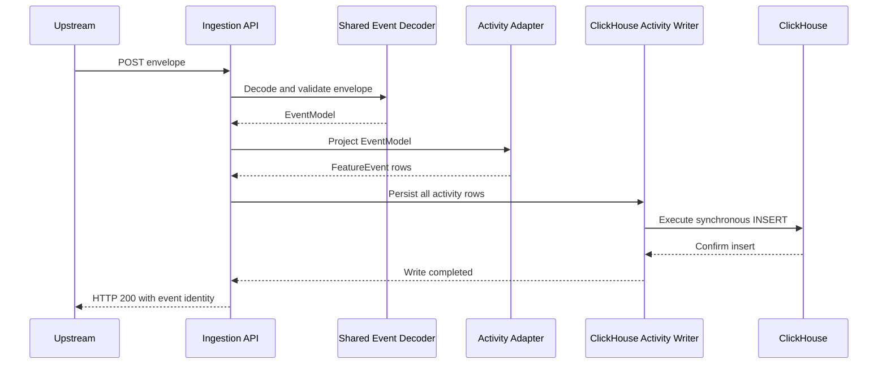
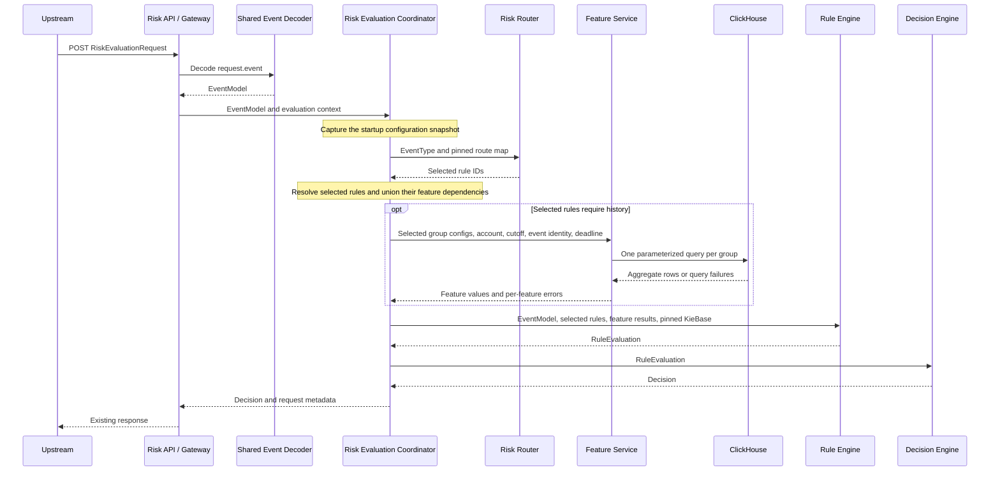
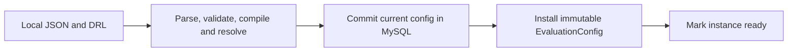

# Z-Anti-Fraud End-to-End Design V2

## 1. Scope and upstream contract

V2 separates event synchronization from risk evaluation. The first release covers submitted transfers and preserves the three existing transfer rules, their thresholds, reason codes, and integer amount semantics. Z-Anti-Fraud returns an advisory recommendation. Upstream owns the final execution decision.

This is the implementation reference for V2.0. Its sync flow, component interfaces, and startup configuration lifecycle supersede the earlier V2 drafts. V2 uses a fresh storage schema. Configuration changes take effect at restart. An update API and configuration history are deferred.

| Operation | HTTP | Request | Successful response |
| --- | --- | --- | --- |
| Synchronize an event (`ingestEvent`) | `POST /api/v2/events` | Existing `JsonEventEnvelope` | HTTP `200` with `source` and `eventId` after ClickHouse confirms the write. |
| Evaluate risk (`evaluateRisk`) | `POST /api/v1/risk-evaluations` | Existing `RiskEvaluationRequest`, including `requestId`, `idempotencyKey`, optional `decisionPoint`, and `event` | Existing `RiskEvaluationResponse`. HTTP `200` with `COMPLETED` and `ALLOW` or `BLOCK` when a recommendation is available. |

The evaluation path keeps its existing URL and wire DTOs. The same producer payload goes in the sync body and in `RiskEvaluationRequest.event`. The initial payload is `money_movement.transfer`, schema version `1`, with one sender, one recipient, a positive integer `amount` in upstream units, and `currency`. The caller authenticates, and the API authorizes the supplied `source` before dispatch. The decoder validates the `(eventType, source, schemaVersion)` and converts the payload into a typed `EventModel`.

Upstream calls sync for every submitted transfer, including ones that receive `BLOCK`. Evaluation reads activity history and accounts for the current event directly. Sync and evaluation can arrive in either order for that event. A caller using the existing evaluation endpoint alone must add the sync call to populate history. The current evaluation coordinator's persistence hook is a placeholder. [Existing API and error contract](../risk-api-v1.md)

The response still echoes the upstream `eventId` and `operationId`. Completed responses retain the existing metadata fields, including `ruleSetVersion` and `policyVersion`. Keep `rules-v2` and `policy-v1` as compatibility labels for the initial transfer implementation. They identify the rule set and policy exposed by the API and carry no configuration revision. Retain `idempotencyKey` on evaluation requests. Until durable decision replay is implemented, repeated evaluations are separate attempts.

## 2. Event synchronization

The upstream service calls the sync API. The API decodes the event, projects the activity rows, and writes them directly to ClickHouse within the request.



### 2.1 Identity and activity storage

| Concept | Java field | ClickHouse column | Example |
| --- | --- | --- | --- |
| Producer namespace | `source` | `source` | `urn:service:transfers` |
| Upstream event ID | `eventId` | `event_id` | `evt-123` |
| Business event type | `eventType` | `event_type` | `TRANSFER` |
| Derived activity ID | `activityId` | `activity_id` | `evt-123-1`, `evt-123-2` |
| Derived activity type | `activityType` | `activity_type` | `TRANSFER_OUT`, `TRANSFER_IN` |
| Transaction ID | `operationId` | `operation_id` | `transfer-123` |

`eventId` and `activityId` are strings. Upstream supplies `eventId`, unique within its `source`, and preserves the event and its identity on retry. The adapter derives `activityId` as `eventId + "-" + legNumber` with a positive integer leg number unique within the event. The transfer adapter assigns `1` to the sender leg and `2` to the recipient leg for schema version `1`. A later multi-leg payload can use immutable upstream leg numbers or a stable order defined by that payload's schema. Several legs may have the same activity type.

Use `(source, eventId)` for upstream event identity and `(source, activityId)` for activity identity. `operationId` identifies the transaction and is shared across its legs. Upstream guarantees a unique `operationId` per transaction and emits one qualifying transfer submission for it. Optional `correlationId` supports tracing related events.

The ClickHouse transfer table uses `ReplacingMergeTree`, a sparse primary index `(account_id, event_time)`, and sorting key `(account_id, event_time, source, activity_id)`. Store `event_time` and `received_at` as UTC `DateTime64(3)`. The API stamps `received_at` for each sync attempt. Feature windows use `event_time`. Replay preserves all sorting-key values and business fields. History reads use `FINAL`, which collapses matching sorting keys. [ClickHouse ReplacingMergeTree](https://clickhouse.com/docs/reference/engines/table-engines/mergetree-family/replacingmergetree)

### 2.2 Write acknowledgment and retries

- Insert all legs of the event together in one synchronous `INSERT` to the history table. All transfer legs use the same event timestamp and therefore the same time partition. The API returns `200` after the insert succeeds. [ClickHouse insert guarantees](https://clickhouse.com/docs/concepts/features/operations/insert/transactions)
- Invalid input uses the existing HTTP `400` validation codes. A transient ClickHouse failure or write timeout returns `503` when the API can still respond. A timeout or lost response can leave the write outcome unknown. Upstream retries with the same envelope and event identity. Stable activity IDs and `FINAL` make identical retries count once in history.
- Upstream owns the immutable event contract. It must preserve the original payload on every retry. `FINAL` collapses rows by sorting key and provides no conflicting-payload detection for a reused event ID.
- When a later evaluation depends on a particular prior event, upstream waits for that event's sync success before requesting evaluation. V2.0 uses the same ClickHouse node for the write and history reads so an acknowledged insert is visible to subsequent queries on that node, subject to the feature's account, filters, and time window.

## 3. Risk evaluation



1. The API validates and decodes the current event. Evaluation reads the history available at query time. Upstream can wait for required prior sync calls as described in section 2.2. The current event is supplied directly for rule evaluation.
2. The coordinator captures the immutable startup snapshot once. The router selects rule IDs by exact business `EventType`. For `TRANSFER`, route once for the original event. A valid decoded event with no route returns HTTP `503`, `UNAVAILABLE`, reason `NOT_CONFIGURED`.
3. The coordinator gets the selected rule descriptors, takes the union of their resolved feature references, and passes each selected group with only its requested features to the Feature Service. For transfers it derives the account from `fromAccountId` and `asOf` from event time truncated to UTC milliseconds. It reserves part of the request budget for rule execution. When no selected rule needs history, it supplies an empty feature result directly.
4. The Rule Engine validates the returned values per rule, builds facts for runnable rules, and returns one outcome per selected rule. A failed query makes only dependent rules unavailable. An oversized current transfer can still produce a match.
5. The Decision Engine applies the existing policy to those outcomes. The API builds the response and maps the decision to HTTP. Evaluation does not project or persist activity rows.

## 4. Local configuration

The deployment supplies a local `risk-config.json` and the DRL files it names. Paths are relative to the config directory. Spring Boot deployment settings supply the config directory and named MySQL and ClickHouse connections. Credentials and physical ClickHouse mappings live outside the policy JSON.

```text
risk-config/
  risk-config.json
  rules/
    transfer.drl
```

### 4.1 Complete transfer configuration

```json
{
  "routes": {
    "TRANSFER": [
      "transfer-out-amount-24h-limit",
      "transfer-out-count-24h-limit",
      "transfer-single-amount-limit"
    ]
  },
  "queryGroups": [
    {
      "id": "transfer-out-24h",
      "source": "account-asset-movement",
      "window": 24,
      "timeUnit": "HOUR",
      "filters": { "activityType": "TRANSFER_OUT" },
      "features": [
        {
          "id": "transfer-out-count-24h",
          "operation": "COUNT",
          "distinct": ["operationId"]
        },
        {
          "id": "transfer-out-amount-24h",
          "operation": "SUM",
          "field": "amountMinor"
        }
      ]
    }
  ],
  "ruleFiles": ["rules/transfer.drl"],
  "rules": {
    "transfer-out-amount-24h-limit": {
      "parameterSchema": { "limit": { "type": "LONG", "minimum": 1 } },
      "parameters": { "limit": 500000 }
    },
    "transfer-out-count-24h-limit": {
      "parameterSchema": { "limit": { "type": "LONG", "minimum": 1 } },
      "parameters": { "limit": 50 }
    },
    "transfer-single-amount-limit": {
      "parameterSchema": { "limit": { "type": "LONG", "minimum": 1 } },
      "parameters": { "limit": 100000 }
    }
  }
}
```

| Config | Definition and validation |
| --- | --- |
| `routes` | Maps a business `EventType` to an ordered, nonempty list of unique compiled rule IDs. Each rule's DRL `@eventType` must agree with the route. Order is used for output and diagnostics. |
| `queryGroups[]` | Unique group `id`, registered logical `source`, positive `window`, `timeUnit`, optional `filters`, and a nonempty `features` list. Units are `MINUTE`, `HOUR`, and `DAY` (24 hours). A group's scope is shared by all its features. |
| `features[]` | Globally unique `id`, `operation`, and optional `field`, `distinct`, and `filters`. The operation defines which fields are valid and the result type. `groupId.featureId` resolves against membership in that exact group. IDs cannot contain `.`. |
| `filters` | Optional map of logical field names to non-null, typed equality operands. Entries combine with `AND`. Group filters apply to all features. Feature filters apply only to the containing aggregate. Logical enum values are converted through the source registry. |
| `ruleFiles` | Unique local DRL file paths. The compiled DRL rule name is its canonical rule ID. The rule metadata declares event type and required feature references with expected result types. |
| `rules` | Parameter schema and values keyed by compiled rule ID. Each compiled rule has one entry. Use empty maps for a parameterless rule. Parameter names and types are declared per rule. V2 supports `LONG` parameters, converted exactly from JSON integers, with optional inclusive `minimum` and `maximum`. Reject missing, extra, and invalid values. |

Reject unknown properties, duplicate JSON keys, invalid enum values, missing required fields, and explicit `null` in place of an optional collection. An omitted `filters` is empty. An omitted `distinct` means row count. An explicitly empty `distinct` is invalid.

### 4.2 Java 17 configuration records

These records map the JSON shape. Constructors, imports, and Jackson setup are omitted. The loader validates tree shape and field presence before mapping, then normalizes filter values and rule parameters using their declared types. Collections in the active snapshot are defensively copied.

```java
record RiskConfig(
        Map<EventType, List<String>> routes,
        List<QueryGroupConfig> queryGroups,
        List<String> ruleFiles,
        Map<String, RuleConfig> rules) {}

record QueryGroupConfig(
        String id,
        String source,
        int window,
        WindowUnit timeUnit,
        Map<String, JsonNode> filters,
        List<FeatureConfig> features) {}

record FeatureConfig(
        String id,
        AggregateOperation operation,
        String field,
        List<String> distinct,
        Map<String, JsonNode> filters) {}

record RuleConfig(
        Map<String, ParameterDefinition> parameterSchema,
        Map<String, JsonNode> parameters) {}

record ParameterDefinition(ParameterType type, Long minimum, Long maximum) {}

enum WindowUnit { MINUTE, HOUR, DAY }
enum AggregateOperation { COUNT, SUM, MIN, MAX, AVG }
enum ParameterType { LONG }
```

At startup, translate these input records into immutable runtime definitions. Raw `JsonNode` values stop at the loader. A field reference resolves through the Java source registry and carries a known physical column, type, and nullability. The registry also specifies the named connection, table, account and time columns, upstream identity columns, and whether reads require `FINAL`. These identifiers are supplied by application code and validated when the registry is built.

```java
record FeatureRef(String groupId, String featureId) {}
record EqualityFilter(FieldDefinition field, Object value) {}

record FeatureDefinition(
        FeatureRef ref,
        AggregateOperation operation,
        Optional<FieldDefinition> operand,
        List<FieldDefinition> distinctKeys,
        List<EqualityFilter> filters,
        Class<?> resultType) {}

record QueryGroupDefinition(
        String id,
        SourceDefinition source,
        Duration window,
        List<EqualityFilter> filters,
        List<FeatureDefinition> features) {}

record FeatureRequirement(FeatureRef ref, Class<?> valueType) {}
record RuleDefinition(
        String id,
        EventType eventType,
        List<FeatureRequirement> requiredFeatures,
        Map<String, Long> parameters) {}

record EvaluationConfig(
        Map<EventType, List<String>> routes,
        Map<String, QueryGroupDefinition> groups,
        Map<String, RuleDefinition> rules,
        KieBase kieBase) {}
```

`SourceDefinition` and `FieldDefinition` are registry types owned by the Feature Service. `Object` in `EqualityFilter` is an immutable scalar normalized to the registered field type. A qualified rule reference is resolved and type-checked during startup. If `A.feature1` moves to group B, startup fails with `FEATURE_NOT_FOUND`, including the dependent rule ID and old reference. Update the rule to `B.feature1` before restarting.

## 5. Startup and MySQL configuration storage

The local files are authoritative for V2. Each instance reads them at startup, validates them together, seeds MySQL with that exact content, and serves requests from the resulting in-memory snapshot. MySQL stores the current seed. Evaluation does not load configuration from MySQL per request.



Use one InnoDB row to store the complete current config and its DRL sources. Apply the schema before startup. Event activity rows are stored in ClickHouse.

```sql
CREATE TABLE risk_config (
    config_key VARCHAR(32) NOT NULL PRIMARY KEY,
    config_json JSON NOT NULL,
    drl_sources JSON NOT NULL
) ENGINE = InnoDB;
```

`config_key` is the fixed key `current`. `config_json` contains the structure in section 4. `drl_sources` maps each configured relative file path to the UTF-8 DRL text read from that file. The application reads the files once and uses the same content for validation, compilation, and persistence.

1. Parse the JSON strictly and load the listed files from the configured directory. Build the source registry and resolve group definitions, filters, fields, and result types. Compile DRL to one `KieBase` using the pinned application dependency.
2. Cross-check compiled rule IDs, parameter definitions and values, route entries, event types, and qualified feature references. Validate the complete candidate before writing it.
3. Upsert the fixed `current` row in a MySQL transaction, replacing both JSON columns together. Restarting with identical input leaves the same content. Removing a rule or group from the seed removes it from the stored config on the next successful startup. [MySQL transaction semantics](https://dev.mysql.com/doc/refman/8.4/en/commit.html)
4. After commit, install the validated `EvaluationConfig` and mark the instance ready. A parse, validation, compilation, or database failure fails startup. The instance serves no requests with a partial or uncommitted config. Each request uses the single snapshot loaded by its instance.

There are no configuration revision IDs, history tables, or hot reloads. Deploy the same local files to all instances sharing a MySQL config table. During a rollout with overlapping old and new instances, evaluations can use the snapshot loaded by either instance, and the MySQL row reflects the last successful startup write. Use a coordinated traffic cutover when every request must use the same config immediately.

## 6. Component interfaces

The API reuses `JsonEventEnvelope`, `RiskEvaluationRequest`, `RiskEvaluationResponse`, and the decoded `EventModel`. The Decision Engine reuses `RuleEvaluation` and `Decision`. The following signatures show where the new data crosses the boundaries. All components run in-process in the same application.

| Component | Input | Output and ownership |
| --- | --- | --- |
| Config Loader | Local JSON and DRL, source registry, MySQL connection | Validated `EvaluationConfig` after the MySQL commit. Owns parsing, compilation, and cross-reference validation. |
| Shared Event Decoder | `JsonEventEnvelope` | Typed `EventModel` or existing validation error. Used by both API paths. |
| Activity Adapter | `EventModel` | Immutable `List<FeatureEvent>`, one entry per leg. Owns activity type, leg numbering, and projected fields. |
| Sync API | `JsonEventEnvelope` and request deadline | `SyncReceipt` after the activity writer confirms success, or an HTTP error. Owns orchestration and platform receipt time. |
| ClickHouse Activity Writer | Projected `List<FeatureEvent>`, `receivedAt`, and write deadline | Returns after the insert is confirmed or raises a write failure. Owns history persistence. |
| Risk Evaluation Coordinator | `EventModel` and request deadline | `Decision`. Owns orchestration, query scope, and the pinned config used by all steps. The API owns HTTP response metadata. |
| Risk Router | Business `EventType` and pinned route map | Selected rule IDs in route order. An empty result means `NOT_CONFIGURED`. |
| Feature Service | Selected typed `QueryGroupDefinition` values and `FeatureQueryContext` | `FeatureQueryResult`. Owns SQL, deadlines, and checked aggregate conversion. |
| Rule Engine | `EventModel`, selected `RuleDefinition` values, `FeatureQueryResult`, pinned `KieBase`, and deadline | `RuleEvaluation` with per-rule findings. Owns feature-to-fact adaptation and Drools execution. |
| Decision Engine | `RuleEvaluation` | `Decision` with evaluation status, recommended action, and reasons. |

```java
record EventIdentity(URI source, String eventId) {}
record SyncReceipt(URI source, String eventId) {}

record FeatureEvent(
        EventIdentity upstreamEvent,
        EventType eventType,
        String activityId,
        ActivityType activityType,
        String operationId,
        String correlationId,
        int schemaVersion,
        EventTime eventTime,
        FeaturePayload data) {}

record FeatureQueryContext(
        String accountId,
        Instant asOf,
        EventIdentity currentEvent,
        Instant deadline) {}

record FeatureError(String code, String message) {}
record FeatureQueryResult(
        Instant asOf,
        Map<String, Object> values,
        Map<String, FeatureError> errors) {}

interface EventDecoder {
    EventModel decode(JsonEventEnvelope envelope);
}

interface ActivityAdapter {
    List<FeatureEvent> project(EventModel event);
}

interface ActivityWriter {
    void persist(List<FeatureEvent> activities, Instant receivedAt, Instant deadline);
}

interface RiskRouter {
    List<String> select(EventType eventType, Map<EventType, List<String>> routes);
}

interface FeatureService {
    FeatureQueryResult query(List<QueryGroupDefinition> groups, FeatureQueryContext context);
}

interface RuleEngine {
    RuleEvaluation evaluate(EventModel event, List<RuleDefinition> rules,
                            FeatureQueryResult features, KieBase kieBase, Instant deadline);
}
```

`ActivityType` is the activity enum for values such as `TRANSFER_OUT` and `TRANSFER_IN`. The transfer activity payload carries `accountId`, amount, and currency. `FeatureQueryResult` keys are the globally unique feature IDs. The Rule Engine uses its startup-validated `FeatureRef` to read the returned value and exposes the qualified name to DRL. A requested feature appears in exactly one of `values` and `errors`. A successful `null` lives in `values`; copy that map using an immutable view of a defensive copy that permits null values.

## 7. Feature Service query behavior

The transfer source `account-asset-movement` registers `account_asset_movements` on the named ClickHouse connection. Its logical fields include `accountId`, `eventTime`, `source`, `eventId`, `eventType`, `activityId`, `activityType`, `operationId`, `amountMinor`, and `currency`. `amountMinor` maps to the existing `amount` column. For the initial table, `event_type` and `activity_type` store the enum names shown in section 2.

| Operation | Definition | Java result |
| --- | --- | --- |
| `COUNT` | Omit `field`. With no `distinct`, count qualifying rows. With `distinct`, count unique keys using `uniqExact` or `uniqExactIf`. | Checked `Long`, zero on empty input. |
| `SUM` | Require a numeric `field`. Sum qualifying non-null values. Widen the accumulator for integral input before checked conversion. | Checked `Long` for integral fields, `BigDecimal` for decimal fields, `Double` for floating fields. Zero on empty input. |
| `MIN`, `MAX` | Require a comparable `field`. Aggregate qualifying non-null values. | Registered field type or `null` when no qualifying value exists. |
| `AVG` | Require a numeric `field`. Average qualifying non-null values. | `Double` or `null` when no qualifying value exists. |

`distinct` belongs to a `COUNT` feature. If present, it is a nonempty array of unique, registered, non-nullable key fields. Multiple fields form one composite key. For example, `"distinct": ["source", "operationId"]` counts distinct pairs. A feature filter applies before that feature counts keys. Two qualifying outgoing legs for one transaction with amounts of 100 and 200 produce count `1` and sum `300`. [ClickHouse exact distinct counts](https://clickhouse.com/docs/sql-reference/aggregate-functions/reference/uniqexact) · [Aggregate combinators](https://clickhouse.com/docs/sql-reference/aggregate-functions/combinators)

For each selected group, the shared `WHERE` covers the account, `[asOf - window, asOf)`, current upstream event exclusion, and group filters. Feature filters compile into conditional aggregate expressions. Generate identifiers from the registry and validated aliases. Bind request and filter values using JDBC parameters. Execute one statement per selected group, with bounded concurrency and the query deadline. A failed statement marks its group's requested features unavailable; other groups can still succeed. A value conversion failure affects its own feature.

The two transfer history features use one statement.

```sql
SELECT
    uniqExact(operation_id) AS `transfer-out-count-24h`,
    coalesce(sum(toInt128(amount)), toInt128(0)) AS `transfer-out-amount-24h`
FROM account_asset_movements FINAL
WHERE account_id = ?
  AND activity_type = ?
  AND event_time >= fromUnixTimestamp64Milli(?, 'UTC')
  AND event_time < fromUnixTimestamp64Milli(?, 'UTC')
  AND NOT (source = ? AND event_id = ?)
```

Bind the sender account, `TRANSFER_OUT`, lower and upper epoch-millisecond bounds, producer source, and upstream event ID in that order. The identity predicate excludes all activities of the current event and preserves eligible history from a different producer with the same local ID. The amount uses existing raw upstream units across currencies, with no scaling or currency conversion. Both aggregates use exact checked conversion to signed 64-bit integers. Successful empty history yields zero. Overflow and unavailable history return feature errors.

## 8. Rule and decision behavior

DRL rule names match the route and parameter keys. The metadata `@requiredFeatures` declares a comma-separated list of `groupId.featureId:TYPE` entries. An empty string declares a rule that uses only the current event. The loader resolves the declared type, for example `LONG` to `Long.class`. The Rule Engine provides `RuleInput.getRuleId()`, `getLongFeature(qualifiedName)`, and `getLongParameter(name)`. It exposes the event type and amount through `TransferRequestFact.getEventType()` and `getAmountMinor()`. The seed loads the following `rules/transfer.drl`.

```drl
package com.example.zantifraud.rules

import com.example.zantifraud.event.model.EventType;
import com.example.zantifraud.evaluation.rule.runtime.RuleInput;
import com.example.zantifraud.evaluation.rule.runtime.RuleHitCollector;
import com.example.zantifraud.evaluation.rule.runtime.TransferRequestFact;

global RuleHitCollector hits;

rule "transfer-out-amount-24h-limit"
    @eventType("TRANSFER")
    @requiredFeatures("transfer-out-24h.transfer-out-amount-24h:LONG")
when
    $input : RuleInput(ruleId == "transfer-out-amount-24h-limit")
    $transfer : TransferRequestFact(eventType == EventType.TRANSFER)
    eval($input.getLongFeature("transfer-out-24h.transfer-out-amount-24h")
         > $input.getLongParameter("limit") - $transfer.getAmountMinor())
then
    hits.recordMatch($input.getRuleId(), "TRANSFER_OUT_AMOUNT_24H_LIMIT_EXCEEDED");
end

rule "transfer-out-count-24h-limit"
    @eventType("TRANSFER")
    @requiredFeatures("transfer-out-24h.transfer-out-count-24h:LONG")
when
    $input : RuleInput(ruleId == "transfer-out-count-24h-limit")
    TransferRequestFact(eventType == EventType.TRANSFER)
    eval($input.getLongFeature("transfer-out-24h.transfer-out-count-24h")
         >= $input.getLongParameter("limit"))
then
    hits.recordMatch($input.getRuleId(), "TRANSFER_OUT_COUNT_24H_LIMIT_EXCEEDED");
end

rule "transfer-single-amount-limit"
    @eventType("TRANSFER")
    @requiredFeatures("")
when
    $input : RuleInput(ruleId == "transfer-single-amount-limit")
    $transfer : TransferRequestFact(eventType == EventType.TRANSFER)
    eval($transfer.getAmountMinor() > $input.getLongParameter("limit"))
then
    hits.recordMatch($input.getRuleId(), "TRANSFER_SINGLE_AMOUNT_LIMIT_EXCEEDED");
end
```

| Rule ID | Required feature | Match condition | Match reason |
| --- | --- | --- | --- |
| `transfer-out-amount-24h-limit` | `transfer-out-24h.transfer-out-amount-24h:LONG` | `history > limit - currentAmount` | `TRANSFER_OUT_AMOUNT_24H_LIMIT_EXCEEDED` |
| `transfer-out-count-24h-limit` | `transfer-out-24h.transfer-out-count-24h:LONG` | `history >= limit` | `TRANSFER_OUT_COUNT_24H_LIMIT_EXCEEDED` |
| `transfer-single-amount-limit` | None | `currentAmount > limit` | `TRANSFER_SINGLE_AMOUNT_LIMIT_EXCEEDED` |

The transfer limits use strict exceedance. For the count rule, `history >= limit` is the overflow-safe equivalent of `history + 1 > limit`. Upstream emits one qualifying event per transaction, and the query excludes all of that event's persisted legs. The rule accounts for the current transaction exactly once. The amount rule's subtraction is safe for the positive `Long` limit and current amount and avoids overflowing an addition.

For each selected rule, the Rule Engine checks that required features are present, correctly typed, and usable. The two rolling transfer rules require nonnegative `Long` values. Zero is valid; a missing value, error, successful `null`, wrong type, or negative transfer history makes the affected rule `UNAVAILABLE`. Preserve `TRANSFER_OUT_HISTORY_UNAVAILABLE` and `TRANSFER_OUT_COUNT_HISTORY_UNAVAILABLE` for the corresponding rolling inputs. The coordinator converts an entire Feature Service call failure into errors for the requested features so current-event rules can still run.

Create a fresh `KieSession` from the compiled `KieBase` for each evaluation with runnable rules. Insert the typed event fact and one `RuleInput` per runnable rule. Each DRL rule binds its own input by rule ID. Apply an agenda filter for the same runnable IDs. DRL emits findings to a request-local collector. It performs no external I/O. After a successful session, classify each runnable rule as `MATCHED` or `NOT_MATCHED`; return unavailable rules alongside them. On a session failure or deadline expiration, return `UNAVAILABLE` for its runnable rules and discard that session's partial findings. Dispose of the session in `finally`. [Drools KIE bases and sessions](https://kie.apache.org/docs/10.0.x/drools/drools/rule-engine/index.html#kie-sessions)

| Rule evaluation | Decision | HTTP |
| --- | --- | --- |
| At least one `MATCHED` | `COMPLETED` / `BLOCK`, with all matched reasons | `200` |
| At least one rule applied and every rule is `NOT_MATCHED` | `COMPLETED` / `ALLOW` | `200` |
| No match and at least one `UNAVAILABLE` | `UNAVAILABLE`, with no recommendation and the unavailable reasons | `503` |
| Empty outcome list | `UNAVAILABLE`, with no recommendation and reason `NO_APPLICABLE_RULES` | `503` |

The coordinator handles a missing route separately with `NOT_CONFIGURED`. Unsupported adapters and invalid event data use the existing HTTP `400` problem-details codes. Query failures use the per-rule policy above.

## 9. Implementation checks

| Scenario | Expected result |
| --- | --- |
| Call the existing risk endpoint with the current request DTO | The URL, response shape, reason codes, and completed-response metadata remain compatible. The evaluation call leaves activity history untouched. |
| Restart with valid, changed local config | One MySQL row contains the full new JSON and DRL. The process serves requests from the validated in-memory snapshot. |
| Start with invalid DRL, a moved feature reference, an invalid route, or MySQL unavailable | Startup fails before readiness. Validation failures leave the stored config intact. |
| Submit and replay the same envelope | The sync endpoint returns `200` after the write and echoes the same event identity. Stable leg IDs give one logical row per leg under `FINAL`. |
| Lose the response after a successful insert and retry | The retry succeeds with the same envelope. The repeated write leaves history aggregates unchanged. A ClickHouse failure never returns a successful sync acknowledgment. |
| Evaluate after syncing a qualifying prior event | The following evaluation can read the prior event on the same ClickHouse node. |
| Evaluate before or after syncing the same current event | Current-event legs are excluded from history. The rule accounts for the current transaction once. |
| Request transfer amount and count for history with multiple outgoing legs per operation | One SQL statement. Count includes each operation once; sum includes each qualifying leg. |
| Test exact window boundaries and same local event ID from another source | The lower bound is inclusive, `asOf` is exclusive, and source scoping preserves the other producer's eligible rows. |
| Simulate ClickHouse outage with a current amount above the single-transfer limit | The two rolling rules are unavailable and the single-transfer match returns `BLOCK`. Below the single-transfer limit the request returns `UNAVAILABLE` if no rule matches. |
| Evaluate empty history, equality at limits, and overflow | Empty count and sum are zero. Equality is permitted. Overflow yields a feature error. |
| Load an unrouted compiled rule | It cannot fire. The engine returns outcomes for the selected rule IDs only. |
| Sync a transfer that receives `BLOCK` | Its activity remains eligible history for subsequent transfers. |

Record startup validation and seed failures, sync latency and write failures, selected rule IDs, feature query and rule execution latency, unavailable reason codes, and recommendation counts. Keep raw event payloads and financial values out of routine logs. Run the transfer integration checks against real MySQL and ClickHouse and compile the DRL with the Java 17 build before release.
