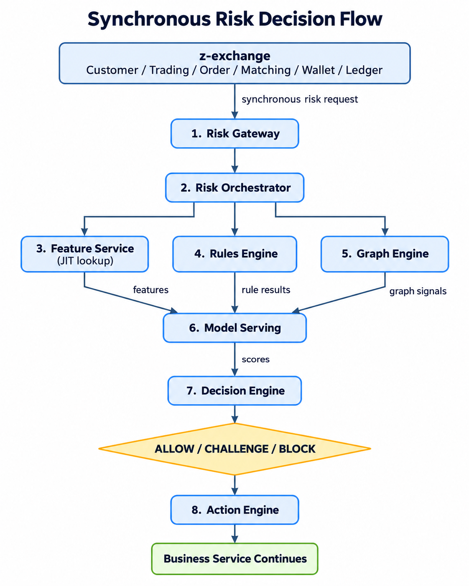
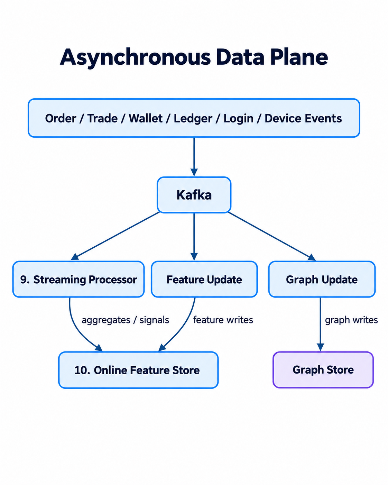
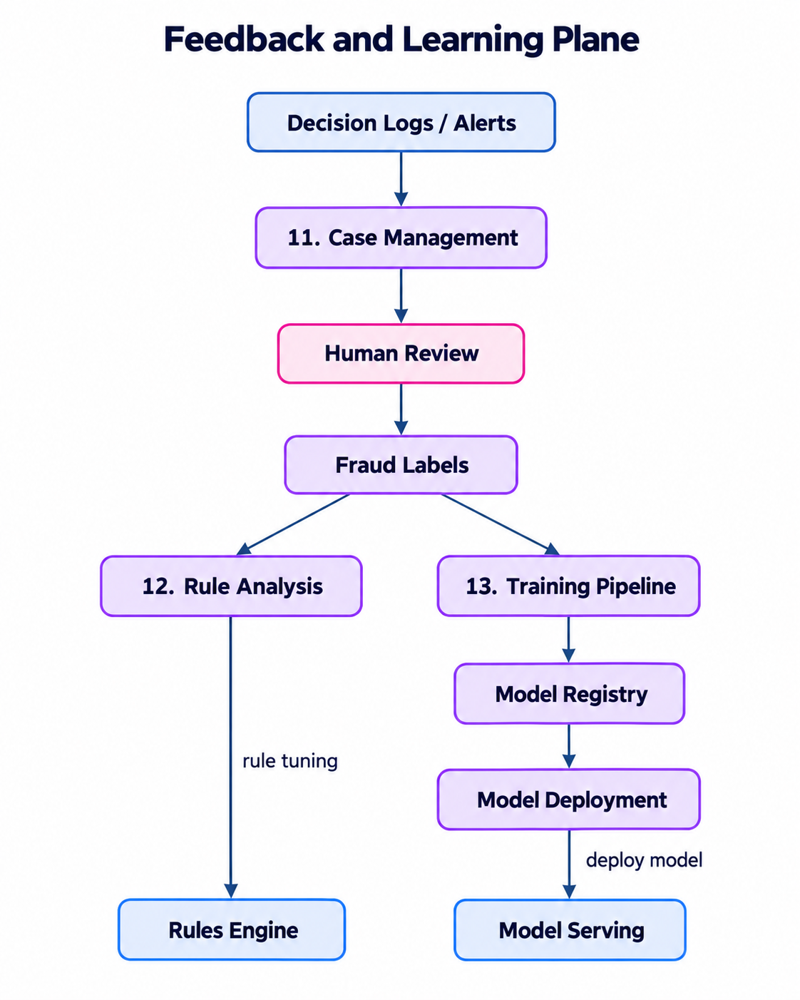

# Z-Anti-Fraud Architecture Overview

## 1. Overview

`z-anti-fraud` is designed as a dedicated risk platform integrated with `z-exchange`. It separates real-time fraud decisions from asynchronous data processing and the longer feedback/training lifecycle.

The architecture is divided into three main flows:

1. **Synchronous risk decision flow** — evaluates a business request before it continues.
2. **Asynchronous data plane** — continuously processes behavioral and transaction events to update reusable risk data.
3. **Feedback and learning plane** — turns decisions and human review results into improved rules and models.

---

## 2. Synchronous Risk Decision Flow

This path is latency-sensitive and is called directly by business services such as Customer, Order, Trading, Matching, Wallet, and Ledger.

### Components

**1. Risk Gateway**  
The entry point of the anti-fraud system. It accepts risk requests, validates the request format, applies authentication/rate limits, and provides a stable API to upstream services.

**2. Risk Orchestrator**  
Coordinates the risk-evaluation workflow. It determines which features, rules, graph checks, and models should be executed for a particular request.

**3. Feature Service**  
Provides risk features used during evaluation. It can combine:
- **JIT features** — calculated immediately from the current request or source systems.
- **NRT features** — recently updated streaming features.
- **Batch features** — periodically calculated historical features.

**4. Rules Engine**  
Evaluates deterministic fraud rules, for example transaction limits, velocity rules, unusual behavior, blocked entities, or policy constraints.

**5. Graph Engine**  
Analyzes relationships between entities such as users, devices, accounts, wallets, IP addresses, and payment instruments. It is useful for detecting fraud rings and suspicious shared relationships.

**6. Model Serving**  
Runs deployed machine-learning models using the collected features and signals, and returns one or more risk scores.

**7. Decision Engine**  
Combines rule results, graph signals, model scores, and business policy to produce the final decision, typically:
- `ALLOW`
- `CHALLENGE`
- `BLOCK`

**8. Action Engine**  
Translates the decision into concrete actions, such as rejecting a transaction, requesting extra verification, applying limits, creating an alert, or allowing the business flow to continue.

---

## 3. Asynchronous Data Plane

The asynchronous plane processes events outside the latency-critical request path. It continuously builds the state needed by the synchronous risk flow.

### Components

**Kafka**  
Acts as the event backbone. Business systems publish events such as orders, trades, wallet activity, ledger changes, login events, and device events.

**9. Streaming Processor**  
Consumes event streams and calculates near-real-time aggregates and behavioral signals, such as transaction velocity, recent login failures, or activity within a rolling time window.

**Feature Update**  
Writes updated risk features into the online feature store so that they can be retrieved quickly during synchronous risk decisions.

**Graph Update**  
Maintains relationships between fraud-relevant entities and updates the graph store when new events arrive.

**10. Online Feature Store**  
Stores low-latency features used by the Feature Service and Model Serving layer. It is optimized for fast online reads rather than analytical queries.

**Graph Store**  
Stores entity relationships used by the Graph Engine, for example `user -> device`, `wallet -> account`, or `device -> multiple users`.

---

## 4. Feedback and Learning Plane

The feedback plane closes the loop between production decisions and future risk improvements.

### Components

**Decision Logs / Alerts**  
Persist the inputs, signals, scores, rules, and outcomes of risk decisions for audit, investigation, and later analysis.

**11. Case Management**  
Groups suspicious activities into reviewable cases and provides the workflow for analysts or operators to investigate them.

**Human Review**  
Allows investigators to confirm or reject suspected fraud and provide high-quality ground-truth labels.

**Fraud Labels**  
Represent the confirmed outcome of historical cases. These labels are important for both rule evaluation and model training.

**12. Rule Analysis**  
Analyzes false positives, false negatives, rule hit rates, and fraud patterns. The results are used to create, remove, or tune rules in the Rules Engine.

**13. Training Pipeline**  
Builds training datasets from historical events, features, and fraud labels; trains and evaluates candidate models; and produces approved model artifacts.

**Model Registry**  
Stores versioned model artifacts and metadata, including model versions, evaluation results, and deployment status.

**Model Deployment**  
Promotes an approved model into production and makes it available to Model Serving.

---

## 5. How the Three Planes Work Together

The synchronous plane makes the immediate decision, but it depends on data continuously prepared by the asynchronous plane. Decisions and investigation results then enter the feedback plane, where they are used to improve future rules, features, graph logic, and models.

In simplified form:

`Business Request -> Real-Time Risk Decision -> Decision/Action`

`Business Events -> Streaming/Feature/Graph Updates -> Better Online Risk Context`

`Decision Results -> Human Review -> Fraud Labels -> Rule/Model Improvement`

This separation keeps the real-time path relatively small and latency-sensitive while allowing more expensive analytics, aggregation, investigation, and training to happen asynchronously.
